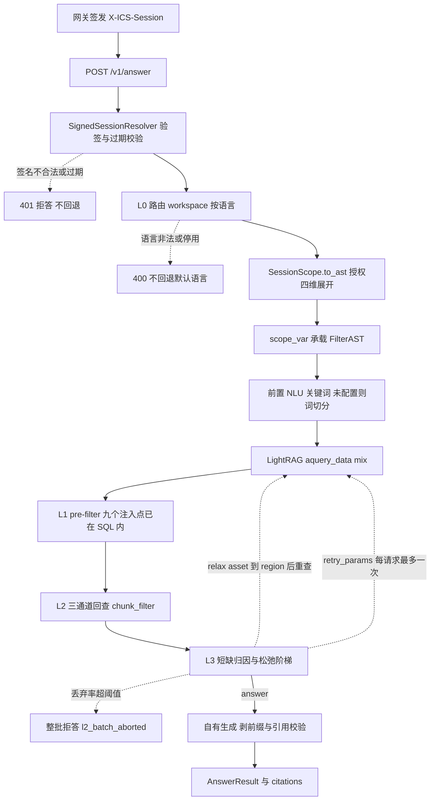

# 知识管理服务（KMS）

智能客服的**授权合规知识管理服务**：LightRAG 负责召回与生成，PostgreSQL 18 + pgvector 是唯一存储；
本服务在框架之外补一层「会话验签 → workspace 路由 → SQL pre-filter → 后置断言 → 松弛阶梯」的授权防线，
目标是**越权内容不进入 prompt**，且判定只认一个真相源。


## 一、功能说明

| 能力 | 入口 | 实现位置 |
| --- | --- | --- |
| 问答（唯一业务入口） | `POST /v1/answer`，请求体**只有 `question`**（3–4000 字符，`extra="forbid"`） | `src/kms/api/app.py`、`src/kms/query/pipeline.py` |
| 会话鉴权 | 网关签名的 `X-ICS-Session`（HMAC-SHA256），服务端只验签 | `src/kms/api/session.py` |
| 多语言语料隔离 | `workspace = {lang}`，一进程装配多套 LightRAG | `src/kms/workspace.py`、`src/kms/query/router.py`、`src/kms/runtime.py` |
| 知识发布/撤回 | **库内流水线，无 HTTP 写入口**：`PublishPipeline.publish(CardDraft)` / `.withdraw()` | `src/kms/publish/pipeline.py` |
| 只读管理面 | `GET /v1/admin/cards`、`GET /v1/admin/cards/{kid}`（`Authorization: Bearer $ICS_ADMIN_TOKEN`；未配 token 则不注册路由） | `src/kms/api/admin.py` |
| 运维端点 | `GET /healthz`、`GET /metrics` | `src/kms/api/app.py`、`src/kms/observability/metrics.py` |
| 离线质量评测 | 确定性轨 + 模型轨（LLM-as-judge）+ 黄金集 + 生命周期用例 | `eval/`、`scripts/run_eval.py`、`scripts/run_model_track.py` |
| 门禁与对账 | G1 正文闸 / G2 对账 / G3 上线；Nightly 对账；M8 规模决策 | `scripts/g1_content_gates.py`、`g2_reconcile_gate.py`、`g3_release_gate.py`、`nightly_reconcile.py`、`m8_evaluate.py` |


## 二、架构设计

### 2.1 请求链路




### 2.2 五层授权防线

六维 = 授权四维 `product` / `year` / `security_level` / `publish_state` ＋ 偏好两维 `asset` / `region`（常量见 `scope.AUTHORIZATION_COLLECTION_DIMS` / `PREFERENCE_DIMS`）；
`valid_from` / `valid_to` 是独立有效期窗，不计入维度。集合维统一 `text[]` 重叠语义（`&&`），
空数组按"不限"处理；`security_level` 按读集合阶梯展开（`TopSecret ⊇ Confidential ⊇ Secret ⊇ Public`，
见 `config.SECURITY_LEVEL_READ_SETS`）。

| 层 | 位置 | 判什么 | 失败语义 |
| --- | --- | --- | --- |
| L0 | `workspace.py` | 语言是唯一路由键；`workspace_registry.resolve(lang)` | 非法/停用语言硬拒，**不回退默认语言** |
| L1a | `storage/kv.py`（注入点①） | 图谱路的正文唯一出口 `LIGHTRAG_DOC_CHUNKS` | SQL 层就查不出来 |
| L1b | `storage/vector.py`（②④）、`storage/graph.py`（③a③b⑤–⑨） | ②④ 为正文闸，其余为候选闸 | 同上；degree 必须与批查同谓词 |
| L2 | `query/l2.py` `assert_channels` | 框架返回后、prompt 组装前，对 chunks / entities / relationships 三通道一次批量回查 `chunk_filter`（按 `chunk_id + kid_version` join）；判据是授权三维（`product`/`year`/`security_level`）+ `publish_state` + 有效期 + 版本滞后 `version_lag`；偏好两维只记 `preference_hit` 打点，不丢弃 | 「查不到」即丢弃；丢弃率 > `ICS_L2_BATCH_DISCARD_RATIO` 整批拒答并告警 |
| L3 | `query/l3.py` `decide` | 短缺归因后决定 `answer` / `retry_batch` / `retry_params` / `relax` / `abort_batch`；松弛只在偏好维、固定顺序 `asset → region`，每阶重查后**重跑 L2** | 松弛只改 L1 谓词、不改 L2 判据（同构不变量）；两维用尽即 `ladder_exhausted`，调参重查每请求最多一次 |


### 2.3 一个真相源：权威层 vs 投影层

- **权威层**（本服务自建，附录 A）：`knowledge`、`knowledge_version`、`chunk_filter`、`workspace_registry`、
  `dim_registry`、`dim_scope_value`、`conflict_review_queue`、`workspace_publish_freeze`（DDL 幂等，见 `authority/schema.py`）。
  授权判定只认这里；管理面只查这里，**禁止 JOIN / UNION LightRAG 表**。
- **投影层**（LightRAG 原生表）：scope 由发布事务单向抄入并加列（`authority/projection.py`），无外键无 CHECK，
  不作判据；一致性靠 Nightly 对账兜底。
- `chunk_filter` 以 `(chunk_id, kid_version)` 为主键保留历史版本行，含六维＋有效期＋`scope_sig`，
  是 L2 与对账的唯一基准。

### 2.4 发布流水线（§八，六阶段）

`PublishPipeline.publish()` 在「按语言 advisory lock + 冻结检查（`workspace_publish_freeze`）」下依次执行：
① 草稿校验（`validate_draft`，不过 → `PublishRejected(issues)`）→ ② 同语言逐维重叠冲突检测
（`find_conflicts` → 入 `conflict_review_queue`，人工裁决）→ ③ workspace 解析 →
④ 投影事务（改版先 `adelete_by_doc_id` 再重投；`process_options="F!"`；`chunk_filter` 版本行用 MERGE，
两张 chunk 表同源回填；候选表 scope 反聚合：节点取来源并集、边取两端交集）→
⑤ 提交后按语言推进代次（`registry.bump_generation`，答案缓存按可见集合代次失效）并做卡级对账
（`reconcile_card(freeze_on_failure=True)`，对账不过直接冻结该语言发布队列）。
幂等判据是「同 `(chunk_id, kid_version)` 重放才覆盖」，禁止"存在即跳过"。

### 2.5 scope 传递与写路径护栏

谓词只由 `scope.render_scope_sql(FilterAST, ...)` 一套代码生成（铁律 3，手写 WHERE 视为缺陷），取值一律 `$n` 参数。
查询期把 `FilterAST` 放进 `contextvars.scope_var`，`set/reset` 成对且复位在 `finally`；
三个存储子类的写路径（upsert / delete / drop / flush / `remove_edges`）入口调 `ensure_write_path()`，
检测到非空 scope 立刻抛 `ScopeContaminationError`（铁律 1）；后台任务前显式 `clear_scope_for_background()`。
类名保持 `PGKVStorage` / `PGVectorStorage` / `PGTableGraphStorage` 不变，只在 `storage/backends.py`
用 `install_scoped_backends()` 重指向 `lightrag.kg.STORAGES`；表名一律经 `namespace_to_table_name` 动态解析。

### 2.6 缓存

自研答案缓存可选（`ICS_ENABLE_ANSWER_CACHE`，默认关）。key = 归一化问题 + `scope_sig` + 语言 +
`corpus_generation` ＋ 模型/提示版本 + 检索参数；只有 `ladder_steps == 0` 且未整批丢弃、框架未失败的
结果才写入；代次推进时按语言清掉旧代次条目。默认 `InMemoryAnswerCache`（进程内）。

### 2.7 可观测

- 指标：`/metrics`（Prometheus 文本），三层命名 + 标签白名单，禁 `user_id / trace_id / query / chunk_id` 作标签。
- Trace：OTel span 层级固定 `rag-answer → retrieval → context-assembly → answer-generation → citation-validation → final-response`；
  属性白名单，正文禁入。`OTEL_EXPORTER_OTLP_ENDPOINT` 为空时不起 exporter。
- 模型观测：`LANGFUSE_ENABLED=true` 时走 Langfuse，只记元数据与脱敏摘要（`observability/langfuse.py`）。
- 观测不得成为授权旁路（方案 §11.6 三条红线）；`scripts/alert_drill.py` 静态校验告警规则引用的指标是否存在。

## 三、主要目录

| 目录 | 内容 |
| --- | --- |
| `src/kms/scope.py` | `FilterAST` / `SessionScope`、唯一谓词渲染、`scope_var` 与写路径护栏、请求打点上下文 |
| `src/kms/workspace.py` | L0：`workspace_registry` DDL、`resolve()`、代次 `bump_generation` 与缓存边界 `next_boundary` |
| `src/kms/storage/` | 注入点①（`kv.py`）、②④（`vector.py`）、③a③b⑤–⑨（`graph.py`）、后端装配与启动自检（`backends.py`） |
| `src/kms/authority/` | 权威层 DDL/模型/读写/发布闸校验（草稿 + 冲突）/投影层加列 |
| `src/kms/publish/` | 流水线、渲染、`chunk_filter` 与两表回填、图 scope 反聚合、前缀与标识、对账、按语言冻结 |
| `src/kms/query/` | 八步链路、L2、L3、生成与引用、答案缓存、前置 NLU 关键词、多语言路由 |
| `src/kms/api/` | `app.py` 网关与 `/v1/answer`、`session.py` 验签与签发、`gateway.py` L0 硬拒、`admin.py` 只读管理面 |
| `src/kms/observability/` | 指标、OTel、Langfuse 适配 |
| `src/kms/config.py` / `db.py` / `providers.py` / `runtime.py` / `cli.py` | 环境变量集中校验（fail-fast）/ asyncpg 池（与 LightRAG 池分离）/ OpenAI-compatible LLM 与 embedding / 按语言装配 / uvicorn 入口 |
| `scripts/` | `run_m0_probes.py`（五项探测，**会 `DROP SCHEMA public CASCADE`**）、`g1`–`g3` 门禁、`nightly_reconcile.py`、`m8_evaluate.py`、`run_eval.py`、`run_model_track.py`、`build_golden_set.py`、`alert_drill.py`、`probes/` |
| `eval/` | 黄金集（`golden/locked.jsonl` + `locked.sha256`、`dev.jsonl`）、确定性指标、模型轨、门禁阈值、生命周期用例、DeepEval 可选适配 |
| `tests/` | `unit/`（无 PG）、`integration/`（`pytestmark` 带 `db`）、`acceptance/`（M0/M7/M7a/M8）、`support/fakes.py`（确定性 embedding/LLM + schema/registry 准备） |
| `docker/` | `docker-compose.yml`（PG18 + Pushgateway）、`observability-compose.yml`（collector/tempo/prometheus/alertmanager/grafana）及其配置与看板 |
| `docs/` | 方案 + 评测体系 0–2、可观测体系 3–4 |
| `ci/ci.sh`、`.github/workflows/ci.yml` | 本地/PR 共用门禁链 |
| `standard/` | 编码规范（`02-stack/python/` 已落地；`01-global/`、`03-project/` 目前多为空占位文件） |

## 四、使用方式

### 4.1 起存储

```bash
docker compose -f docker/docker-compose.yml up -d      # ics-pg18 → 宿主 5434，ics-pushgateway → 9091
```

### 4.2 建隔离环境

SMB 等网络挂载上不要做可编辑安装（egg-info 写入失败），用 `PYTHONPATH` 运行：

```bash
uv venv -p 3.12 /tmp/ics_venv
uv pip install --python /tmp/ics_venv/bin/python \
  lightrag-hku==1.5.7 asyncpg pgvector pydantic fastapi uvicorn prometheus-client httpx numpy \
  pytest pytest-asyncio pytest-cov ruff mypy bandit
export PYTHONPATH=src:scripts
```

### 4.3 测试

```bash
/tmp/ics_venv/bin/python -m pytest tests -q -p no:cacheprovider            # 全量，需要 4.1 的 PG
/tmp/ics_venv/bin/python -m pytest tests -q -m "not db"                     # 无 PG 的快跑（见下方注意）
/tmp/ics_venv/bin/python -m pytest tests -q -m m6                           # 按里程碑筛选（m0…m8、db）
```

注意：`-m "not db"` 会跑 `tests/acceptance/test_m0_mechanism.py` 与 `test_m8_decision.py`，二者读取
`reports/` 下的 M0/M8 工件；未跑过 `run_m0_probes.py` / `m8_evaluate.py` 时这两条会因缺文件失败，不是回归。
覆盖率门槛 85%（`pyproject.toml` 的 `fail_under`）。

### 4.4 起服务

```bash
cp .env.example .env && 编辑 .env            # 全部配置来自环境变量，启动时 fail-fast 校验
export ICS_SESSION_SECRET="$(/tmp/ics_venv/bin/python -c 'import secrets; print(secrets.token_urlsafe(40))')"
export ICS_LLM_BASE_URL=http://127.0.0.1:11434/v1
export ICS_EMBEDDING_BASE_URL=http://127.0.0.1:11434/v1   # 留空则回退到 ICS_LLM_BASE_URL
PYTHONPATH=src /tmp/ics_venv/bin/python -m kms.cli        # 或 pip 安装后的 ics-knowledge
```

前置事实：

- `ICS_SESSION_SECRET` < 32 字符、`ICS_LLM_BASE_URL` / embedding 端点缺失、`POSTGRES_WORKSPACE` 非空都会直接启动失败。
- 启动自动建权威层与 registry 表（幂等 DDL），但**不会写入语言行**：`workspace_registry` 里没有 `enabled` 语言时
  不装配任何 RAG，`/v1/answer` 一律 400。语言登记目前只有测试辅助 `tests/support/fakes.py: seed_language()`，
  生产注册入口尚未落地（见第六节）。
- `ICS_ADMIN_TOKEN` 未配置时管理面路由不注册。

### 4.5 调用示例

```bash
SECRET=$ICS_SESSION_SECRET PYTHONPATH=src /tmp/ics_venv/bin/python - <<'PY'
import os
from kms.api.session import SessionSigner
from kms.scope import SessionScope
print(SessionSigner(os.environ["SECRET"]).sign_scope(SessionScope(
    language="zh-CN", product=["BTC_SPOT"], year=["2026"],
    security_level="Confidential", asset=["SPOT"], region=["CN"],
), ttl_seconds=300))
PY

curl -s localhost:8000/v1/answer \
  -H "Content-Type: application/json" \
  -H "X-ICS-Session: <上一步输出>" \
  -d '{"question":"请说明 BTC 现货的交易规则"}'
```

### 4.6 门禁、评测、对账

```bash
PYTHONPATH=src:scripts /tmp/ics_venv/bin/python scripts/run_m0_probes.py     # M0 探测（会重建 public schema）
PYTHONPATH=src:scripts /tmp/ics_venv/bin/python scripts/g1_content_gates.py   # G1 正文闸（M3 出口）
PYTHONPATH=src:scripts /tmp/ics_venv/bin/python scripts/g2_reconcile_gate.py  # G2 对账（M5 出口）
PYTHONPATH=src:scripts /tmp/ics_venv/bin/python scripts/g3_release_gate.py    # G3 上线（M7 出口）
PYTHONPATH=src:scripts /tmp/ics_venv/bin/python scripts/run_eval.py           # 确定性轨，锁定集
PYTHONPATH=src:scripts /tmp/ics_venv/bin/python scripts/run_model_track.py    # 模型轨，可选推 Pushgateway
PYTHONPATH=src:scripts /tmp/ics_venv/bin/python scripts/nightly_reconcile.py  # Nightly 对账，非零即冻结该语言
PYTHONPATH=src:scripts /tmp/ics_venv/bin/python scripts/m8_evaluate.py        # M8：按 lang 分区 vs 单表
PYTHONPATH=src:scripts /tmp/ics_venv/bin/python scripts/build_golden_set.py   # 重建黄金集
PYTHONPATH=src:scripts /tmp/ics_venv/bin/python scripts/alert_drill.py        # 告警规则与指标一致性
```

### 4.7 观测栈与 CI

```bash
docker compose -f docker/observability-compose.yml up -d
# collector 4317/4318、内部 8889；tempo 3200；prometheus 9090；alertmanager 9093；grafana 3000(admin/admin)
```

应用仍由 `kms.cli` 在宿主启动，`docker/prometheus.yml` 抓 `host.docker.internal:8000`、`otel-collector:8889`、
`pushgateway:9091`；规则 `docker/alerts.yml`，看板 `docker/grafana-dashboard.json`。
观测栈里没有 Langfuse 容器（需自托管并配 `LANGFUSE_*`）。

```bash
bash ci/ci.sh    # ruff check → ruff format --check → mypy src → pytest+cov(85) → bandit -r src → pip-audit
```

PR 门禁在 `.github/workflows/ci.yml`（同一条 `ci/ci.sh`，服务容器为 `pgvector/pgvector:pg18`）。

### 4.8 关键环境变量

`.env.example` 是完整清单；最常改的：

| 变量 | 默认 | 作用 |
| --- | --- | --- |
| `POSTGRES_HOST/PORT/USER/PASSWORD/DATABASE` | 127.0.0.1 / 5434 / ics / ics / ics | 存储连接 |
| `POSTGRES_WORKSPACE` | **必须空** | 非空会静默覆盖全部 workspace，启动自检直接拒绝 |
| `ICS_SESSION_SECRET` / `ICS_SESSION_MAX_AGE_SECONDS` | 空 / 300 | 会话验签（`exp` 超出 `now+max_age+60s` 亦拒） |
| `ICS_ADMIN_TOKEN` | 空 | 管理面 Bearer；空则不注册路由 |
| `ICS_TOP_K` / `ICS_CHUNK_TOP_K` / `ICS_MAX_TOTAL_TOKENS` | 40 / 20 / 12000 | 召回预算 |
| `ICS_ANSWER_MIN_CHUNKS` / `ICS_L2_BATCH_DISCARD_RATIO` | 2 / 0.5 | L2 拒答阈值与整批丢弃比例 |
| `ICS_ENABLE_RERANK` / `ICS_RERANK_MODEL` / `ICS_MIN_RERANK_SCORE` | false / default / 0.5 | 外部 rerank 首发关闭，出境白名单确认前不得开启 |
| `ICS_ENABLE_ANSWER_CACHE` | false | 答案缓存开关 |
| `ICS_LLM_BASE_URL/MODEL_ID/PROMPT_VERSION` / `ICS_EMBEDDING_BASE_URL/API_KEY` | — | 模型端点；`ICS_EMBEDDING_DIM` 仅默认值，实际维度按 `workspace_registry` 逐语言取 |
| `POSTGRES_HNSW_EF_SEARCH` / `_ITERATIVE_SCAN` / `_MAX_SCAN_TUPLES` / `_SCAN_MEM_MULTIPLIER` | 40 / off / 20000 / 1 | 连接池启动参数（禁止用会话 GUC 传 scope） |
| `ICS_NLU_BASE_URL` / `ICS_NLU_MODEL` | 空 | 前置关键词 LLM；未配则回退词切分 |
| `ICS_FRAMEWORK_RETRY_ATTEMPTS` / `ICS_PUBLISH_LOCK_TIMEOUT_SECONDS` | 2 / 30 | 框架重试与发布锁 |
| `OTEL_EXPORTER_OTLP_ENDPOINT` / `LANGFUSE_ENABLED` / `PUSHGATEWAY_URL` | 空 / false / 空 | 观测出口 |

## 五、关键约束（改代码前必读）

1. 写路径（upsert / delete / drop / flush / 删边）入口断言 `scope_var is None`；查询期 scope 只在 `contextvars` 里。
2. 谓词只有 `render_scope_sql` 一套；`get_by_ids` 必须保持按位对齐契约，裁切后用 `reorder_to` 还原。
3. 只信会话签名头；提问文本里出现的任何维度都不参与授权。会话无效或缺维 → 拒答，绝不回退"全部可见"。
4. 顺序不可颠倒：L2 断言在生成之前，前缀清洗（剥 `[KNOWLEDGE:{kid}]`）在断言之后；前缀始终开启，无运行期开关。
5. L3 只放松偏好维，且每放松一次必须重查 + 重跑 L2；调参重查每请求最多一次，阶梯最多两阶。
6. 管理面只读、只查权威层；投影层 scope 由发布事务单向抄入，不作判据。
7. `chunk_filter` 以 `(chunk_id, kid_version)` 保留历史；改版先 `adelete_by_doc_id` 再重投，重放才 MERGE 覆盖。
8. 存储子类类名不改，只重指向 `STORAGES`；`enable_vector` 与 `vector_storage` 必须为 `PGVectorStorage` 且同进程取值一致。
9. 观测不得成为授权旁路：正文/问题/`chunk_id` 不进指标标签，不进 Trace 属性。

## 六、当前实现边界与已知偏差

- **语言注册无生产入口**：`workspace_registry` 的 `enabled` 行只能由测试辅助 `seed_language()` 建；服务在全新库上
  不会挂任何语言路由。补生产注册工具是待办。
- **M0 与方案不一致（实测，方案已按实测口径记录）**：
  1. 本机 1.5.7 构建把 `process_options` 放在 `apipeline_enqueue_documents`，`apipeline_process_enqueue_documents()` 不接受该参数；
  2. `PGTableGraphStorage` 的删边方法是 `remove_edges`（不是 `delete_edge`），写路径护栏按实际方法名覆盖。
- **外部 rerank 默认关闭**：`ICS_ENABLE_RERANK=false` 是首发口径，十点存活断言与出境白名单确认前不得开启。
- `standard/01-global/*.md`、`standard/03-project/00-instructions.md` 等文件当前为空占位（尚未撰写）。
