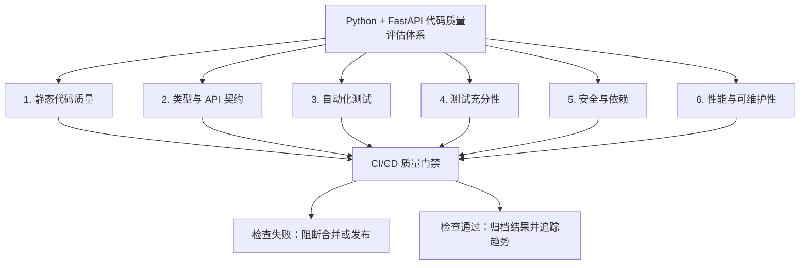
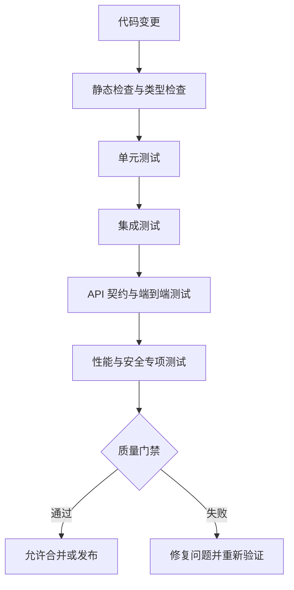
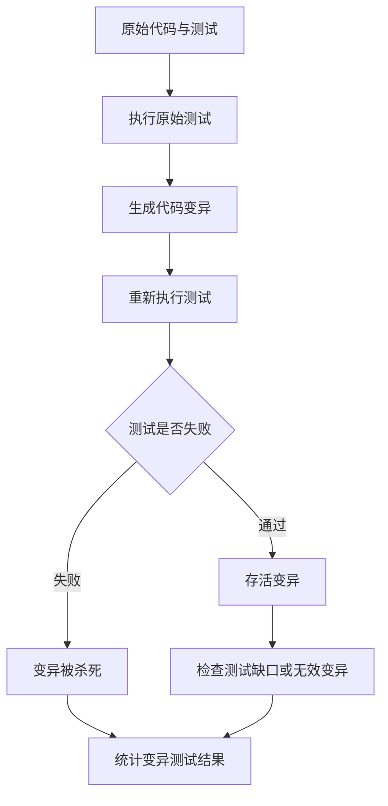
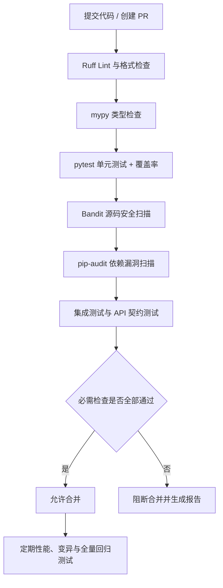
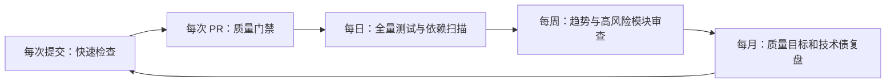
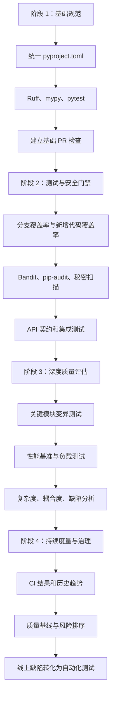

#  Python + FastAPI 代码质量评估体系建设方案

本文目标是建立一套能够集成到 FastAPI 项目和 CI/CD 流水线中的代码质量评估体系，实现从开发阶段的静态检查、自动化测试，到持续集成、质量门禁和线上质量反馈的完整闭环。


核心原则是：**代码质量不是一个分数，而是多个维度的可验证约束。** 不能只依赖单元测试覆盖率，也不能只依赖静态扫描。一个工程化的评估体系，至少需要回答以下问题：

- 代码是否符合规范，是否存在明显缺陷？
- 类型、接口契约和数据校验是否正确？
- 业务逻辑是否经过充分测试？
- 重构是否引入回归问题？
- 安全漏洞、依赖风险和性能问题是否得到控制？
- 每次提交是否满足统一的质量门禁？
- 质量趋势是否持续改善，而不是只在发布前检查一次？

## 一、整体架构设计

建议采用六个评估维度、三个执行层次和一个质量门禁。



### 1.1 三个执行层次

| 层次 | 触发时机 | 主要目标 |
|---|---|---|
| 本地开发 | 编码、提交前 | 快速发现格式、类型和基础测试问题 |
| 持续集成 | Pull Request、合并请求 | 阻断缺陷、安全问题和质量回退 |
| 定期评估 | 每日、每周、发布前 | 发现依赖漏洞、覆盖率退化、性能回归和长期技术债 |

本地检查强调速度；CI 检查强调可重复和可阻断；定期评估强调趋势、全量检查和历史对比。

## 二、评估标准与工具选型

### 2.1 参考标准

| 标准或规范 | 在体系中的作用 |
|---|---|
| ISO/IEC 25010:2023 | 定义功能适合性、可靠性、性能效率、安全性、可维护性等质量特征 |
| ISO/IEC/IEEE 29119 系列 | 作为软件测试过程、测试文档和测试技术的参考；具体采用部分应结合项目测试策略 |
| PEP 8、PEP 257 | Python 代码风格与文档字符串规范 |
| PEP 484、Python typing 文档 | 类型注解和静态类型检查的基础 |
| OWASP ASVS、OWASP Top 10 | Web API 的安全需求与常见安全风险参考 |
| Google Engineering Practices | Code Review、可测试性、变更可维护性等工程实践参考 |

需要区分：国际标准定义质量模型或过程要求，工具负责检测具体问题，企业内部的质量门槛则需要结合业务风险自行制定。不能把某个工具的默认规则直接等同于国际标准的全部要求。

### 2.2 推荐工具栈

以下是适用于大多数 Python + FastAPI 后端项目的起步组合，不需要一开始引入大型商业平台。

| 评估领域 | 推荐工具 | 主要用途 | 是否建议作为门禁 |
|---|---|---|---|
| 格式与静态检查 | Ruff | 格式化、未使用导入、常见错误、部分代码异味 | 是 |
| 类型检查 | mypy | 参数、返回值、可空类型、类型契约 | 是 |
| 单元及集成测试 | pytest | 业务逻辑、异常、边界条件和回归测试 | 是 |
| 覆盖率 | Coverage.py + pytest-cov | 行覆盖、分支覆盖 | 是 |
| 安全扫描 | Bandit | Python 源码中的常见安全风险模式 | 是，按严重度 |
| 依赖安全 | pip-audit | 已安装依赖中的已知漏洞 | 是，按严重度 |
| 秘密扫描 | Gitleaks 等 | 误提交的密钥、Token、密码 | 是 |
| 复杂度分析 | Ruff 复杂度规则、Radon | 圈复杂度、复杂函数识别 | 初期以告警为主 |
| 变异测试 | mutmut | 检查测试能否识别故意注入的逻辑错误 | 定期执行 |
| 性能测试 | pytest-benchmark、Locust | 函数基准测试、API 负载和延迟 | 按项目需求 |

工具官方资料：

- Ruff：[官方文档](https://docs.astral.sh/ruff/)
- pytest：[官方文档](https://docs.pytest.org/)
- pytest-cov：[官方文档](https://pytest-cov.readthedocs.io/)
- mypy：[官方文档](https://mypy.readthedocs.io/en/stable/)
- FastAPI 测试：[官方文档](https://fastapi.tiangolo.com/tutorial/testing/)
- Bandit：[官方文档](https://bandit.readthedocs.io/)
- pip-audit：[项目文档](https://github.com/pypa/pip-audit)

**选型建议：** 先将 Ruff、mypy、pytest、pytest-cov、Bandit 和 pip-audit 建立为基础流水线，再按风险引入变异测试、性能测试及架构约束。不要为了工具数量而增加重复检查。

## 三、第一维度：静态代码质量

静态代码分析在不执行应用的情况下发现可检测的问题，主要包括语法与常见错误、编码规范、代码复杂度和可维护性。

### 3.1 使用 Ruff 统一格式和 Lint

建议统一使用 Ruff 代替多个职责重叠的工具，避免同时维护一套 Ruff、一套 Flake8、一套 isort 和一套 Black 配置。

在项目根目录的 `pyproject.toml` 中添加：

```toml
[tool.ruff]
target-version = "py312"
line-length = 100
src = ["app", "tests"]

[tool.ruff.lint]
select = [
    "E",      # pycodestyle errors
    "F",      # Pyflakes
    "W",      # pycodestyle warnings
    "I",      # import sorting
    "B",      # bugbear: 常见错误模式
    "UP",     # pyupgrade
    "S",      # flake8-bandit: 部分安全规则
    "SIM",    # simplification
    "RUF",    # Ruff-specific rules
]
ignore = []

[tool.ruff.format]
quote-style = "double"
indent-style = "space"

[tool.mypy]
python_version = "3.12"
files = ["app"]
warn_return_any = true
warn_unused_configs = true
check_untyped_defs = true
no_implicit_optional = true

[tool.pytest.ini_options]
testpaths = ["tests"]
addopts = "-ra --strict-markers"
markers = [
    "unit: unit tests",
    "integration: integration tests",
    "slow: slow tests",
]

[tool.coverage.run]
branch = true
source = ["app"]
relative_files = true
omit = [
    "app/main.py",
    "app/**/migrations/*",
]

[tool.coverage.report]
show_missing = true
skip_covered = true
fail_under = 85
```

注意事项：

- `py312` 和 `python_version = "3.12"` 只是示例，应修改为项目实际支持的 Python 版本。
- `S` 规则可以作为额外的安全检查，但不能代替完整的 Bandit、依赖漏洞和秘密扫描。
- `omit` 只是示例。排除文件必须有明确理由，不能通过排除难以测试的代码来人为提高覆盖率。
- `fail_under = 85` 是建议的初始门槛，不是行业统一强制标准。
- Ruff 的规则集应先在项目中试运行，逐步修复历史问题；不要因为一次性启用大量规则而让团队产生大规模无价值的格式变更。

### 3.2 将静态检查转化为可执行门禁

开发人员本地执行：

```bash
# 自动格式化
ruff format app tests

# 自动修复可安全修复的问题
ruff check --fix app tests

# 检查是否仍存在 lint 问题
ruff check app tests

# 检查格式是否符合约定
ruff format --check app tests

# 类型检查
mypy app
```

质量门禁应关注：

- 新增的错误必须修复，不能仅仅降低错误计数。
- 不能无理由新增忽略规则，例如 `# noqa`、`# type: ignore`。
- 对必须保留的例外，应要求注释说明原因，必要时设置到期时间或责任人。
- 对遗留项目，优先阻止新增问题，并逐步消除旧问题；不要为了迁就历史问题而永久放弃静态检查。

### 3.3 复杂度与可维护性

建议重点关注圈复杂度（Cyclomatic Complexity）、函数长度、重复代码、模块耦合和高变更频率模块。

| 指标 | 初始建议 | 处理方式 |
|---|---|---|
| 圈复杂度 | 10 作为重点审查参考值 | 超过阈值时审查分支和测试完整性 |
| 超长函数 | 超过 50 行触发审查 | 结合职责判断是否拆分 |
| 重复代码 | 识别重复业务逻辑和复制粘贴 | 优先治理业务规则重复 |
| 高耦合模块 | 依赖多个基础设施或业务模块 | 检查分层、接口和依赖方向 |
| 高变更频率且高缺陷率模块 | 从 Git 和缺陷记录统计 | 作为重构优先级依据 |

这些数字是团队可以采用的初始规则，不是 Python 语言规范，也不是所有函数都必须遵守的硬性限制。关键是将指标用于定位风险，而不是机械地追求数字越低越好。

## 四、第二维度：类型安全与 API 契约

Python 是动态类型语言，静态类型检查不能完全消除运行时错误，但可以显著提高接口的可理解性、重构安全性和缺陷发现能力。

### 4.1 类型检查策略

对于新建项目，建议核心业务模块逐步采用 mypy strict 模式；对于存量项目，先覆盖核心业务服务、数据访问层和公共接口，再逐步扩大范围。

优先检查以下情况：

- 函数参数和返回值缺少类型注解。
- 可空值被当作非空对象使用。
- `dict[str, Any]` 等宽泛类型扩散到业务核心。
- 外部 API、数据库记录和消息载荷未在边界处进行类型转换或验证。
- 使用 `Any` 或 `type: ignore` 绕过关键检查。

不要误以为类型注解本身会在运行时验证输入。对外部输入的验证仍应由 Pydantic、显式校验逻辑和数据库约束共同完成。

### 4.2 FastAPI 接口契约检查

FastAPI 的 Pydantic 模型和 OpenAPI 文档是重要的契约基础。建议建立三类测试：

1. **输入校验测试：** 缺少必填字段、非法枚举、超长字符串、错误数据类型等是否得到预期响应。
2. **输出契约测试：** 返回状态码、响应结构、字段类型和错误格式是否稳定。
3. **契约回归测试：** 对比当前 OpenAPI Schema 与已发布版本，识别非预期的破坏性变更。

例如：

```python
from fastapi.testclient import TestClient

from app.main import app

client = TestClient(app)


def test_create_item_rejects_invalid_quantity() -> None:
    response = client.post(
        "/items",
        json={"name": "keyboard", "quantity": -1},
    )

    assert response.status_code == 422
```

该测试假设接口通过 Pydantic 约束拒绝负数，并由 FastAPI 返回 `422`。具体状态码应依据项目定义的接口契约确定，而不是所有业务错误都统一使用 `422`。

### 4.3 接口变更的质量门禁

对于对外 API，可以按以下规则执行：

- 删除字段、修改字段类型、缩小允许值范围：默认视为潜在破坏性变更。
- 新增必填请求字段：默认视为潜在破坏性变更。
- 新增可选响应字段：通常向后兼容，但仍需考虑严格 Schema 客户端。
- 变更错误码、鉴权要求、分页语义和幂等行为：必须纳入契约审查。

OpenAPI 差异检查不等于完整的兼容性验证。还应考虑客户端实际使用方式、业务语义和认证授权行为。

## 五、第三维度：自动化测试体系

这是整套代码质量评估体系的核心。建议将测试划分为单元测试、集成测试、API 测试、端到端测试和非功能测试，并按成本安排执行顺序。

### 5.1 测试分层



| 测试层次 | 测试对象 | 主要检查内容 | 执行频率 |
|---|---|---|---|
| 单元测试 | 函数、类、业务服务 | 分支、边界、异常和业务规则 | 每次提交 |
| 集成测试 | 数据库、缓存、消息队列等 | 真实组件之间的交互 | 每次 PR 或合并 |
| API 测试 | FastAPI 路由及依赖 | 状态码、输入输出、鉴权、错误处理 | 每次 PR |
| 端到端测试 | 关键业务流程 | 多个模块组合后的真实行为 | 每次合并或发布前 |
| 性能测试 | 关键 API、热点函数 | 延迟、吞吐量、资源消耗 | 定期及重大变更时 |
| 安全测试 | 应用及依赖 | 漏洞、授权绕过、输入攻击 | 每次 PR 与定期扫描 |

### 5.2 单元测试：优先覆盖业务规则

单元测试不应该只是验证函数能正常返回，而应该验证业务规则是否正确。

例如，某个订单服务需要校验订单状态：

```python
import pytest


def can_cancel(status: str) -> bool:
    return status in {"PENDING", "PAID"}


@pytest.mark.parametrize(
    ("status", "expected"),
    [
        ("PENDING", True),
        ("PAID", True),
        ("CANCELLED", False),
        ("COMPLETED", False),
        ("UNKNOWN", False),
    ],
)
def test_can_cancel(status: str, expected: bool) -> None:
    assert can_cancel(status) is expected
```

通过参数化测试覆盖多个状态，避免只测试正常路径。

对于真实业务代码，还应覆盖：

- 正常输入、边界输入、非法输入。
- 空值、重复请求、并发冲突和资源不存在。
- 外部服务超时、数据库异常、事务回滚。
- 权限不足、资源越权、状态转换不合法。
- 金额精度、时间边界、分页边界等容易出错的规则。

### 5.3 集成测试：不要全部 Mock

Mock 可以隔离依赖、加快单元测试，但过度 Mock 会掩盖 SQL 错误、事务问题、序列化问题和真实组件间的兼容性问题。

建议：

- 单元测试中 Mock 外部依赖，聚焦当前模块的业务规则。
- 数据访问层使用真实数据库或与生产环境兼容的测试实例。
- Redis、消息队列等关键组件，至少为核心交互建立真实集成测试。
- 对依赖注入、事务边界、异步任务和应用生命周期单独验证。
- 测试环境尽量使用容器化依赖，确保开发机与 CI 的结果一致。

对于 FastAPI，尤其需要检查异步数据库访问、依赖覆盖、应用启动与关闭、连接池生命周期以及测试之间的状态隔离。

### 5.4 端到端测试：只覆盖关键链路

端到端测试通常更慢、更容易受环境影响，因此不需要对每一个 API 都做完整的 E2E 测试。

优先选择：

- 用户登录、鉴权和授权。
- 核心业务创建、更新、查询和状态流转。
- 数据写入后查询的一致性。
- 关键失败路径、补偿逻辑和幂等操作。
- 发布后最重要的业务冒烟流程。

测试应具备可重复性：固定或可控的测试数据、明确的依赖版本、可靠的清理机制，以及不依赖真实生产数据的执行环境。

## 六、第四维度：测试充分性与测试质量

**测试通过不代表测试充分，覆盖率高也不代表测试有效。**

### 6.1 建立覆盖率指标

| 指标 | 含义 | 能发现什么问题 |
|---|---|---|
| 行覆盖率 | 被执行的代码行占比 | 是否有代码从未被执行 |
| 分支覆盖率 | 条件分支的执行情况 | 是否只测试了 `if` 的一侧 |
| 新增代码覆盖率 | 本次新增代码的覆盖情况 | 新功能是否配备测试 |
| 关键业务覆盖率 | 核心业务规则的覆盖情况 | 高风险逻辑是否经过验证 |
| 变异测试得分 | 测试发现人为引入错误的能力 | 测试断言是否足够有效 |

覆盖率由 Coverage.py 与 pytest-cov 生成。开启 `branch = true` 可以统计分支覆盖，而不只是行覆盖。

建议初期门槛如下：

| 指标 | 初始目标 | 说明 |
|---|---:|---|
| 全项目行覆盖率 | ≥ 85% | 适合已有一定测试基础的项目 |
| 全项目分支覆盖率 | ≥ 75% | 作为初始治理目标 |
| 新增业务代码行覆盖率 | ≥ 90% | 对新增核心业务代码要求更高 |
| 关键业务规则 | 覆盖主要正常与异常路径 | 不建议只用单一百分比衡量 |
| 关键模块变异测试 | 持续提升 | 初期不必对全项目强制执行 |

这些阈值属于建议的内部质量目标，并非行业强制标准。对尚无测试基础的老项目，可以先记录基线，再逐步提高门槛。

覆盖率门禁应同时检查报告是否生成、目标代码是否纳入统计、是否意外排除了大量文件，避免出现“测试全绿但实际没测到业务代码”的情况。

### 6.2 引入变异测试

变异测试通过对代码进行小幅修改，检查测试是否能够发现这些错误。

例如，原始代码：

```python
def can_withdraw(balance: int, amount: int) -> bool:
    return amount > 0 and balance >= amount
```

可能的变异包括：

```python
# 变异 1：边界条件被修改
return amount > 0 and balance > amount

# 变异 2：移除金额合法性检查
return balance >= amount
```

如果测试仍然全部通过，说明测试可能没有覆盖余额恰好等于金额、金额为零等边界场景。

变异测试的基本流程：



变异测试得分通常可理解为被测试发现的有效变异占全部有效变异的比例，但不同工具对等价变异、超时和无效变异的处理可能不同，必须统一统计口径。

不建议每次提交都运行完整变异测试。优先对资金计算、权限判断、状态机和核心业务规则执行定期或按模块触发的变异测试。

## 七、第五维度：安全与依赖质量

普通 FastAPI 项目也需要安全评估，不应将安全检测局限在上线前的人工审查。

### 7.1 源码安全扫描

建议使用 Bandit 检查 Python 源码中的常见危险模式，例如：

- 不安全的反序列化。
- 不安全的动态代码执行。
- 弱加密方式或不安全的随机数使用。
- 可能引发命令注入的调用模式。
- 硬编码凭据等可检测风险。

Bandit 属于静态安全扫描工具，不能完整理解业务上下文，因此它的结果需要经过分类和人工复核。

质量门禁建议：

- 新增严重、高危问题：阻断合并。
- 中危问题：修复，或者按团队制度审批例外。
- 低危问题：进入整改队列。
- 误报：保留可审计的抑制记录，而不是直接关闭整类规则。

### 7.2 依赖漏洞检查

依赖扫描应检查实际安装的依赖，而不只是 `requirements.txt` 中的直接依赖。

例如：

```bash
pip-audit
```

建议结合锁文件、固定版本和可复现构建执行。对发现的漏洞，结合以下因素确定优先级：

1. 漏洞严重程度。
2. 是否存在可利用路径。
3. 应用是否实际使用受影响功能。
4. 是否有修复版本或可行的缓解措施。
5. 是否属于直接依赖或传递依赖。

不能仅仅因为某个包有漏洞就机械地升级到任意最新版本。应先评估兼容性，再通过测试验证升级结果。

### 7.3 秘密扫描与 Web API 安全

建议同时建立秘密扫描和业务级安全测试。

| 安全领域 | 重点检查 |
|---|---|
| 凭据管理 | 密码、Token、私钥是否进入代码或 Git 历史 |
| 身份认证 | 缺少认证、Token 失效、认证绕过 |
| 权限控制 | 用户是否可以访问其他用户的数据 |
| 输入验证 | SQL 注入、路径穿越、命令注入等 |
| 文件处理 | 文件类型、大小、路径与访问权限 |
| 资源限制 | 请求体大小、分页上限、请求频率、超时 |
| 错误处理 | 是否泄露堆栈、内部路径或敏感数据 |
| 依赖安全 | 已知漏洞、过期依赖、不安全版本 |

工具可以发现部分问题，但授权越权、业务逻辑漏洞和资源滥用往往需要专门的测试用例才能发现。

## 八、第六维度：性能与可维护性

性能评估应该建立可复现的基准，而不是根据单次请求的响应时间判断代码好坏。

### 8.1 性能测试策略

推荐分为两个层次：

- **函数基准测试：** 使用 pytest-benchmark 等工具测量纯计算逻辑、序列化、复杂数据处理等热点。
- **API 负载测试：** 使用 Locust 等工具测量真实 HTTP 请求在指定并发、数据量和运行环境下的表现。

API 性能至少记录：

| 指标 | 用途 |
|---|---|
| P50 / P95 / P99 延迟 | 识别典型响应时间与长尾延迟 |
| 吞吐量 | 观察单位时间内处理的请求数 |
| 错误率 | 检查高负载下的正确性与稳定性 |
| CPU、内存 | 识别资源消耗和潜在泄漏 |
| 数据库连接池使用率 | 发现连接耗尽与等待问题 |
| 超时率 | 发现调用链或资源瓶颈 |

性能门槛应基于明确的硬件、依赖服务、数据集、预热时间和负载模型建立。不要直接把某个固定的毫秒数套用到所有 FastAPI 服务。

### 8.2 可维护性评估

建议把以下指标组合起来，而不是追求一个笼统的“代码质量分数”：

- 复杂度高且缺陷频繁的模块数量。
- 核心业务代码的测试充分性。
- 静态检查问题的新增数与存量数。
- 关键模块的依赖耦合程度。
- 代码变更后引入回归问题的频率。
- 依赖升级、部署和故障恢复的难度。

例如，一个复杂度较高但经过充分测试、边界清晰、很少变化的模块，不一定比一个简单但高度耦合、经常引发线上故障的模块更值得优先重构。

## 九、建立统一质量门禁

前面的评估维度需要汇总成一个可以执行的 CI/CD 流水线。

### 9.1 推荐执行顺序



实际 CI 可以并行执行互不依赖的静态检查和安全扫描，以缩短流水线耗时；图中顺序主要表达逻辑依赖，而不是要求必须串行。

### 9.2 GitHub Actions 示例

以下配置展示基础门禁。假设项目使用 Python 3.12、`pyproject.toml` 管理依赖，且安装后可以导入 `app` 包。实际项目应根据锁文件和包管理器调整安装步骤。

```yaml
name: Python Quality Gate

on:
  pull_request:
  push:
    branches: [main]

jobs:
  quality:
    runs-on: ubuntu-latest

    steps:
      - uses: actions/checkout@v4

      - uses: actions/setup-python@v5
        with:
          python-version: "3.12"
          cache: pip

      - name: Install dependencies
        run: |
          python -m pip install --upgrade pip
          pip install -e ".[dev]"

      - name: Ruff lint
        run: ruff check app tests

      - name: Ruff format
        run: ruff format --check app tests

      - name: Type check
        run: mypy app

      - name: Unit tests and coverage
        run: |
          pytest \
            --cov=app \
            --cov-branch \
            --cov-report=term-missing \
            --cov-report=xml:coverage.xml \
            --cov-fail-under=85

      - name: Security scan
        run: bandit -r app -ll

      - name: Dependency audit
        run: pip-audit
```

说明：

- `pip install -e ".[dev]"` 假设项目在 `pyproject.toml` 中定义了 `dev` 可选依赖组。
- `bandit -ll` 仅作为示例严重度过滤策略；正式项目应明确置信度、严重度和误报处理规则。
- `pip-audit` 应针对实际部署的依赖集合执行。若测试依赖与生产依赖不同，建议分别扫描并区分风险。
- 示例使用的 GitHub Actions 版本标签应在正式环境中按照组织安全策略固定到经过审查的版本或提交 SHA。
- 生产项目还应加入集成测试、OpenAPI 兼容性检查、测试结果归档和必要的秘密扫描。
- CI 不应依赖开发人员本地的未提交配置或缓存才能成功。

### 9.3 质量门禁矩阵

| 检查项 | 新增代码 | 全项目 | 失败处理 |
|---|---|---|---|
| Ruff | 不新增违规 | 逐步清理存量 | 阻断 |
| mypy | 新增核心模块满足类型要求 | 逐步扩大检查范围 | 阻断核心问题 |
| 单元测试 | 新增业务逻辑有对应测试 | 全量测试通过 | 阻断 |
| 覆盖率 | 达到新增代码目标 | 达到全局最低门槛 | 阻断 |
| API 契约 | 不出现未经批准的破坏性变更 | 契约验证通过 | 阻断 |
| 高危安全问题 | 不新增未处置问题 | 定期全量扫描 | 阻断或安全审批 |
| 依赖漏洞 | 新增依赖无未处置高风险漏洞 | 按计划全量扫描 | 按严重度阻断 |
| 性能 | 关键路径无明显回归 | 定期执行基准 | 重大回归阻断发布 |
| 变异测试 | 核心逻辑逐步纳入 | 定期统计趋势 | 初期不作为普遍门禁 |

**关键设计：对新增问题严格，对历史问题渐进治理。** 如果一个老项目已经积累大量静态检查问题，不应该一次性要求所有存量问题清零。可以记录初始基线，优先保证新代码符合规则，并按模块分批清理旧问题。

## 十、质量指标看板与持续改进

质量体系建成后，需要能够持续回答：本周代码质量是否改善？哪些模块风险最高？质量问题是否集中在某类变更中？

建议建立四组指标。

| 指标组 | 核心指标 | 关注目的 |
|---|---|---|
| 代码健康度 | Lint 违规数、类型错误数、复杂度分布 | 观察静态质量趋势 |
| 测试充分性 | 行/分支覆盖率、变异测试得分 | 观察测试能力 |
| 变更质量 | PR 失败率、回归缺陷率、缺陷逃逸率 | 观察变更风险 |
| 安全与运行质量 | 高危漏洞、依赖风险、性能回归、线上故障 | 观察实际风险 |

建议统一记录以下维度：

- 仓库、分支、提交 SHA、构建编号。
- 工具名称和版本、配置版本。
- 检查执行时间、通过或失败状态。
- 问题数量、严重度、受影响文件。
- 覆盖率、分支覆盖率、性能基线及测试环境。
- 问题豁免记录、责任人和整改状态。

报告需要同时保存**当前结果与历史趋势**，而不只是保存最后一次 CI 是否通过。对于性能指标，还应记录硬件、数据集、并发数等上下文，避免不同测试环境的数据被错误比较。

### 10.1 推荐的治理节奏



可以从以下几个行动开始：

1. 每次 PR 必须通过静态检查、类型检查和自动化测试。
2. 每周查看新增违规、测试覆盖率变化和安全漏洞。
3. 每月识别高复杂度、高缺陷率和测试不足的模块，形成明确的整改任务。
4. 重大依赖升级、数据库变更和核心业务重构时，增加契约测试、集成测试与性能验证。

## 十一、落地实施路线

不建议第一阶段就同时引入所有工具和复杂的质量评分。更有效的方式是分阶段建设。



## 十二、最终建议

对于一个普通的 Python + FastAPI 后端项目，建议先落地以下最小可用体系：

- **静态分析：** Ruff + mypy。
- **测试执行：** pytest，覆盖单元测试、集成测试和关键 API 测试。
- **测试充分性：** pytest-cov，开启分支覆盖率，逐步引入变异测试。
- **安全：** Bandit + pip-audit + 秘密扫描。
- **契约与性能：** OpenAPI 差异检查、关键 API 性能基准。
- **工程闭环：** GitHub Actions 或现有 CI/CD 平台执行质量门禁，保存检查结果和历史趋势。

最重要的是建立三个机制：

1. **新增问题必须受到约束。** 新代码不能不断引入静态错误、安全风险和缺乏测试的业务逻辑。
2. **质量必须可以度量。** 检查规则、覆盖率、缺陷和性能结果需要有统一口径。
3. **质量必须能够持续改善。** 将测试失败、线上缺陷、依赖漏洞和技术债转化为可追踪的整改任务。

这样建设出来的不是一套简单的代码扫描工具集合，而是一套可以持续执行、能够阻断高风险变更，并能通过历史数据验证改进效果的工程质量体系。
'''

path = Path("/mnt/data/python_fastapi_code_quality_assessment.md")
path.write_text(content, encoding="utf-8")
print(f"Markdown 文件已生成：{path}")
