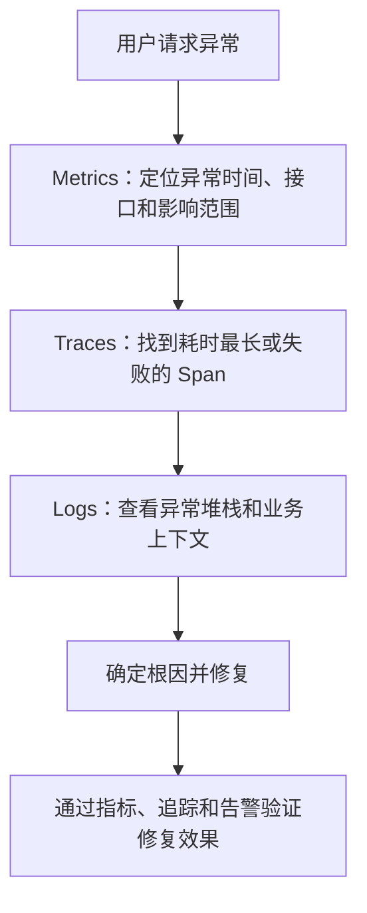
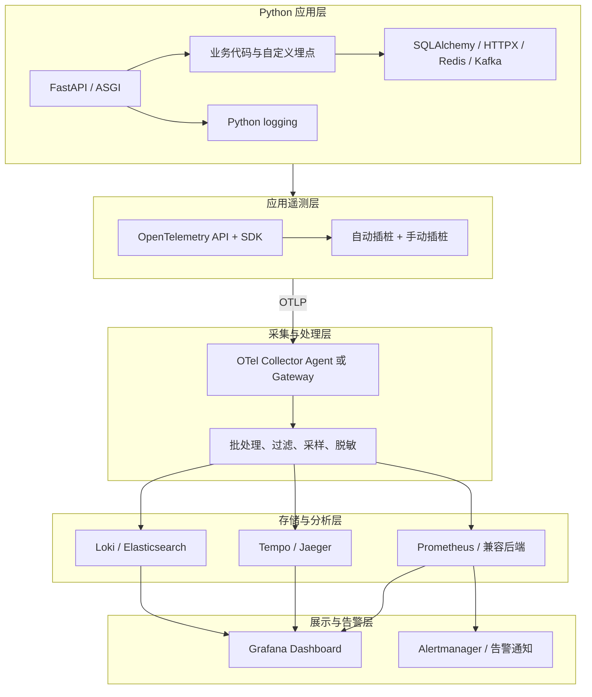
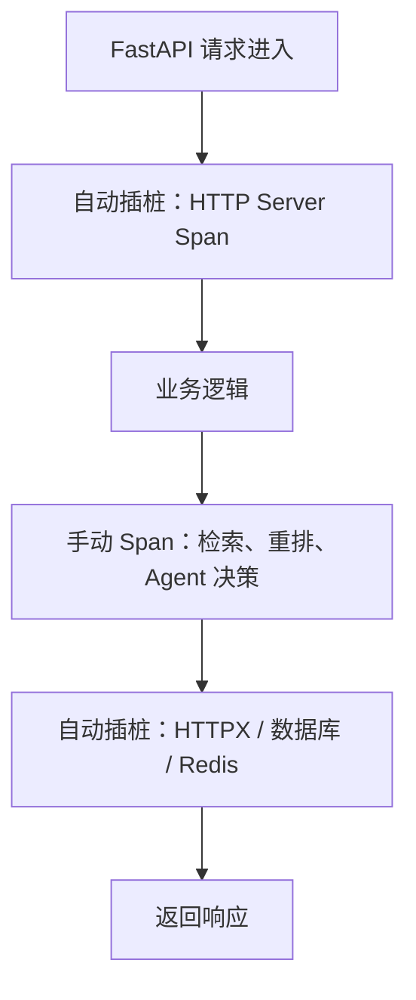
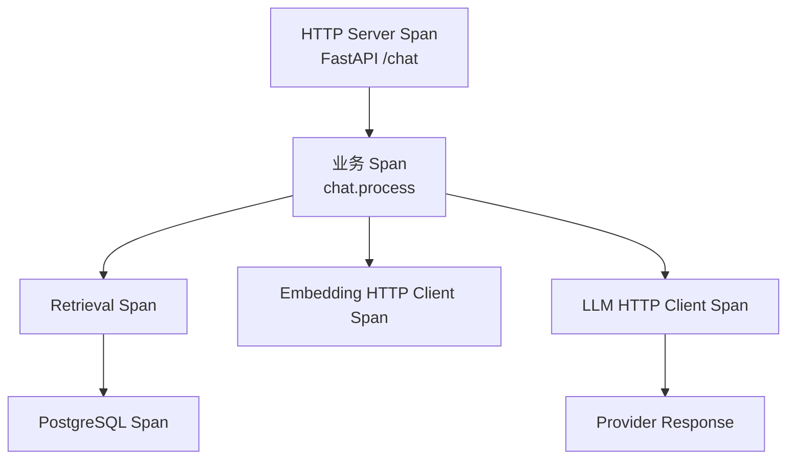
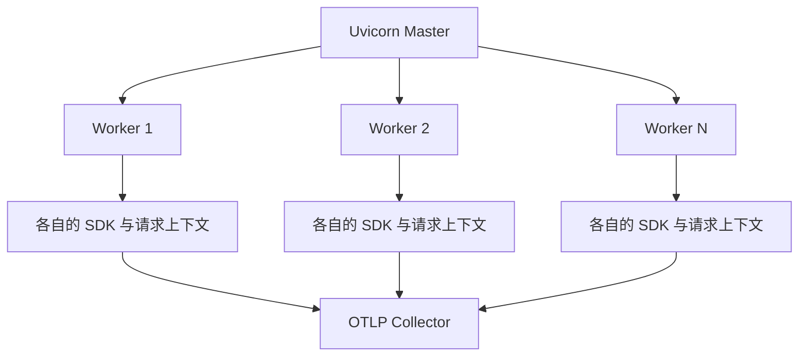
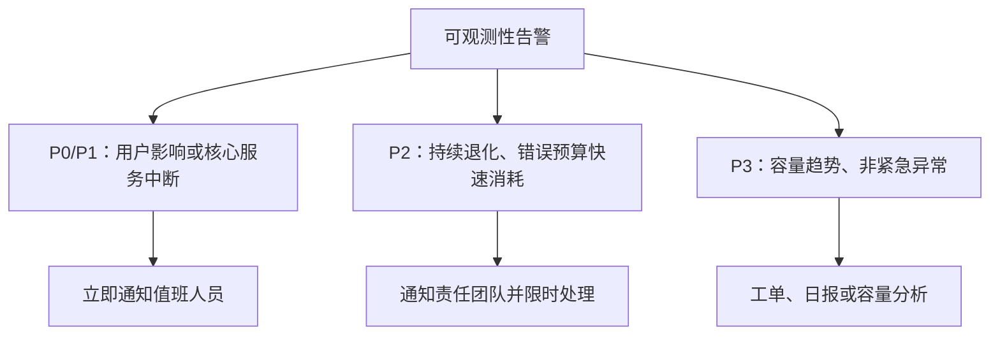

# Python + FastAPI 可观测性最佳实践

> **技术指南｜面向生产环境｜OpenTelemetry、Prometheus、Grafana、结构化日志与分布式追踪**

> 本文从基础概念逐步深入到架构设计、Python/FastAPI 实现、指标与告警、分布式追踪、性能优化和生产落地。目标不是简单接入几个监控 SDK，而是建立一套能够发现异常、定位根因、量化影响并持续改进的可观测性体系。

## 一、先建立正确的认知

### 1.1 什么是可观测性？

可观测性（Observability）是指通过系统对外产生的遥测数据，推断系统内部运行状态的能力。

传统监控通常围绕预先定义的问题，例如 CPU 是否超过 80%、接口是否返回 500。可观测性还需要支持排查事先没有预料到的问题，例如某类用户请求为何突然变慢、某个模型供应商的调用为何导致整个请求链路超时。

可观测性的核心数据通常分为三类。

| 类型            | 核心问题         | 典型内容                                                  | 主要用途             |
| ------------- | ------------ | ----------------------------------------------------- | ---------------- |
| Metrics（指标）   | 整体表现如何？      | RPS、5xx 比例、P95/P99、进程 RSS、连接池使用率                      | 趋势分析、容量规划、告警、SLO |
| Logs（日志）      | 具体发生了什么？     | 异常堆栈、业务操作结果、下游错误码、重试原因                                | 事件调查、错误分析        |
| Traces（分布式追踪） | 请求经过哪里、慢在哪里？ | FastAPI → 检索服务 → PostgreSQL → Embedding API → LLM API | 跨服务链路分析、延迟归因     |


三者不是互相替代的关系，而是协同排障：



  

### 1.2 相关标准和技术规范

需要区分标准、协议、实现和后端产品。

| 层次       | 推荐技术                                       | 作用                           |
| -------- | ------------------------------------------ | ---------------------------- |
| 遥测标准     | OpenTelemetry（OTel）                        | 定义指标、日志、追踪的 API、SDK 和数据模型    |
| 追踪传播     | W3C Trace Context                          | 通过 `traceparent` 等标准头传播追踪上下文 |
| 指标模型     | Prometheus exposition format / OpenMetrics | 指标暴露、抓取及查询生态                 |
| 日志规范     | OpenTelemetry Logs Data Model、结构化 JSON     | 统一日志字段与关联信息                  |
| Web 语义约定 | OpenTelemetry HTTP、ASGI 等语义约定              | 统一 HTTP 服务、客户端等 Span 与指标的命名  |
| 服务目标     | SRE 的 SLI、SLO、错误预算实践                       | 定义可靠性目标及告警策略                 |

OpenTelemetry 不是数据库，也不要求必须使用某个厂商的后端。其价值在于让应用侧的埋点和遥测采集与存储、查询、展示解耦。

## 二、推荐的整体技术架构

### 2.1 生产环境架构

推荐采用应用埋点、OTel Collector 采集与处理、后端存储和统一可视化的分层架构。



  
各层的职责如下：

| 层次                    | 主要职责                       | 设计原则             |
| --------------------- | -------------------------- | ---------------- |
| 应用层                   | 产生业务与运行时遥测数据               | 业务代码不绑定具体监控厂商    |
| SDK / Instrumentation | 自动采集 HTTP、数据库等信息，补充业务 Span | 优先自动插桩，再补充关键业务语义 |
| Collector             | 接收、批处理、过滤、采样、路由、导出         | 统一治理，控制出口与数据成本   |
| 后端                    | 持久化指标、日志、追踪                | 根据查询特点选择存储       |
| 展示与告警                 | 聚合视图、异常检测、通知               | 关注用户影响和可执行动作     |

OTel Collector 可以独立部署为 Gateway，也可以按节点部署 Agent。小型系统可以先直接向后端导出，再随着服务规模增长引入 Collector。

**重要原则：应用应当使用 OTLP 等标准协议导出数据，不要把业务代码直接绑定到某一个日志平台或追踪后端。**

### 2.2 推荐技术选型

| 能力       | 推荐技术                                       | 作用与选型说明                                               |
| -------- | ------------------------------------------ | ----------------------------------------------------- |
| 统一遥测标准   | OpenTelemetry                              | Python 侧统一 Trace、Metrics 和日志关联；结合自动插桩与手动插桩            |
| 指标       | Prometheus                                 | 服务健康度、时序分析、SLI/SLO 计算和告警                              |
| 统一展示     | Grafana                                    | 展示指标、日志和追踪，建立跨数据源关联跳转                                 |
| Trace 存储 | Grafana Tempo 或 Jaeger                     | 根据检索能力、存储成本和运维要求选择                                    |
| 日志存储     | Grafana Loki 或 Elasticsearch               | Loki 适合标签检索和 Grafana 集成；Elasticsearch 更适合复杂全文检索与结构化查询 |
| 告警       | Prometheus Alertmanager 或 Grafana Alerting | 告警路由、分组、抑制和通知                                         |

这些产品不需要一次性全部部署。刚开始建设时，建议先做好应用埋点、Prometheus 指标和结构化日志，再根据排障需求增加 Trace 后端。

## 三、从零搭建 Python + FastAPI 可观测性

### 3.1 安装依赖

建议固定依赖版本，并在升级时检查 Python、FastAPI、Starlette、HTTPX、数据库驱动与 OTel instrumentation 的兼容性。

以下是基础的 Python OTel + FastAPI + OTLP 方案：

```bash

pip install \

fastapi \

"uvicorn[standard]" \

opentelemetry-api \

opentelemetry-sdk \

opentelemetry-exporter-otlp \

opentelemetry-instrumentation-fastapi \

opentelemetry-instrumentation-logging \

opentelemetry-instrumentation-httpx

```


如果还需要自动采集数据库、Redis 等信息，按实际使用的库增加相应 instrumentation 包。例如：


```bash

pip install \

opentelemetry-instrumentation-sqlalchemy \

opentelemetry-instrumentation-redis

```

注意：

- 这里使用官方 Python SDK 与社区维护的 instrumentation 生态，不应假设每个数据库驱动、异步库或第三方 SDK 都有完整支持。

- OTLP 是传输协议；仍然需要配置一个能够接收 OTLP 的 Collector 或后端。

- 若采用 Prometheus 抓取模式，还需配置相应的指标导出器和 HTTP metrics endpoint。

- 日志 API/SDK 的成熟度与 Trace、Metrics 并不完全相同。对于多数现有 Python 服务，先使用标准 `logging` 输出 JSON，再由日志采集链路传输，是较稳妥的起点。

### 3.2 使用环境变量配置 OTLP

推荐将可变的部署配置放到环境变量，而不是硬编码在业务代码中。

```bash

export OTEL_SERVICE_NAME=knowledge-api

export OTEL_RESOURCE_ATTRIBUTES="service.namespace=ai-platform,deployment.environment.name=production,service.version=1.0.0"

  

export OTEL_EXPORTER_OTLP_ENDPOINT=http://otel-collector:4318

export OTEL_EXPORTER_OTLP_PROTOCOL=http/protobuf

```

  

这里的地址是假设 Collector 使用容器网络内的服务名 `otel-collector`。实际部署时需要保证 DNS、网络和端口正确。

OTLP 常见端口：

| 端口     | 用途                                            |
| ------ | --------------------------------------------- |
| `4317` | OTLP/gRPC                                     |
| `4318` | OTLP/HTTP，通常使用 `/v1/traces`、`/v1/metrics` 等路径 |

如果使用 HTTPS，应配置正确的证书验证；跨网络传输时不要默认认为内部网络天然可信。

`service.name`、`service.version`、`deployment.environment.name` 等资源属性应保持稳定、语义明确。不要将用户 ID、请求 ID 等动态值写入 Resource，因为它们不是服务实例的稳定身份。

### 3.3 FastAPI 接入自动追踪

下面是一个可直接改造的基础实现。它覆盖 HTTP 请求自动追踪、业务 Span、异常记录和服务资源标识。


```python

# app.py

import logging

import os

  

from fastapi import FastAPI, HTTPException

from opentelemetry import trace

from opentelemetry.exporter.otlp.proto.http.trace_exporter import (

OTLPSpanExporter,

)

from opentelemetry.sdk.resources import Resource

from opentelemetry.sdk.trace import TracerProvider

from opentelemetry.sdk.trace.export import BatchSpanProcessor

from opentelemetry.instrumentation.fastapi import FastAPIInstrumentor

  

logging.basicConfig(level=logging.INFO)

logger = logging.getLogger(__name__)

  

resource = Resource.create({

"service.name": os.getenv("OTEL_SERVICE_NAME", "knowledge-api"),

"service.version": os.getenv("SERVICE_VERSION", "1.0.0"),

"deployment.environment.name": os.getenv(

"DEPLOYMENT_ENV", "development"

),

})

  

provider = TracerProvider(resource=resource)

provider.add_span_processor(

BatchSpanProcessor(

OTLPSpanExporter(

endpoint=os.getenv(

"OTEL_EXPORTER_OTLP_TRACES_ENDPOINT",

"http://localhost:4318/v1/traces",

)

)

)

)

trace.set_tracer_provider(provider)

  

tracer = trace.get_tracer(__name__)

  

app = FastAPI(title="Knowledge API")

FastAPIInstrumentor.instrument_app(app)

  
  

@app.get("/health/live")

async def liveness():

return {"status": "ok"}

  
  

@app.get("/documents/{document_id}")

async def get_document(document_id: str):

with tracer.start_as_current_span("document.load") as span:

# 只记录必要的、低敏感度的业务属性

span.set_attribute("document.operation", "load")

  

try:

# 替换成真实的数据库或服务调用

if document_id == "missing":

raise HTTPException(

status_code=404,

detail="Document not found",

)

  

logger.info(

"document loaded",

extra={"operation": "document.load"},

)

return {"document_id": document_id, "status": "loaded"}

  

except HTTPException as exc:

if exc.status_code >= 500:

span.record_exception(exc)

span.set_status(

trace.Status(

trace.StatusCode.ERROR,

"document load failed",

)

)

raise

  

except Exception as exc:

span.record_exception(exc)

span.set_status(

trace.Status(

trace.StatusCode.ERROR,

"document load failed",

)

)

logger.exception("document load failed")

raise

  
  

if __name__ == "__main__":

import uvicorn

  

uvicorn.run(app, host="0.0.0.0", port=8000)

```

  

这个示例的几个关键点：

  

1. `TracerProvider` 应在应用启动时配置一次，不应在每个请求中重复创建。

2. `FastAPIInstrumentor.instrument_app(app)` 负责 HTTP 服务侧自动追踪，业务 Span 负责补充业务操作的耗时和上下文。

3. 使用 `BatchSpanProcessor` 批量导出，避免每个 Span 完成后都同步发送网络请求。

4. 不应把所有 4xx 都视为系统故障。示例中，404 是业务结果，不自动标记为 Trace 错误。

5. 示例展示的是追踪链路，尚未配置指标导出、日志 JSON 格式、日志中的 Trace ID 关联、生产采样策略和进程退出时的资源关闭。这些需要在完整生产模板中补齐。


官方文档提供了 FastAPI instrumentation 的接入说明和 Python SDK 的初始化方式，可作为版本升级时的核对依据。

### 3.4 自动插桩与手动插桩如何选择？

推荐组合使用，而不是二选一。



  

| 场景                     | 推荐方式                            |
| ---------------------- | ------------------------------- |
| HTTP 服务端请求             | FastAPI 自动插桩                    |
| HTTPX 下游请求             | HTTPX 自动插桩                      |
| SQLAlchemy 数据库操作       | SQLAlchemy 自动插桩，必要时补充业务 Span    |
| Redis、Kafka 等组件        | 对应 instrumentation + 必要的业务 Span |
| 业务阶段，例如文档切分、检索、重排      | 手动插桩                            |
| Agent 的工具选择、重试、循环、模型调用 | 手动插桩或接入兼容 OTel 的框架集成            |
| 纯计算函数                  | 只在耗时、错误或业务诊断价值足够时插桩             |


自动插桩可以减少遗漏，手动插桩则提供业务可解释性。不要同时用多种 instrumentation 重复包装同一个操作，否则会产生重复 Span、重复计时或上下文错误。


## 四、指标体系设计：哪些指标必须采集？

  

指标设计的目标不是“采集得越多越好”，而是让每一项指标都能够支撑具体的判断或行动。

  

### 4.1 第一层：服务黄金指标

推荐优先建设以下四类指标。

| 指标         | 说明                   | 常用维度          |
| ---------- | -------------------- | ------------- |
| Traffic    | 请求量、吞吐量              | 服务、路由、HTTP 方法 |
| Errors     | 请求错误率、下游失败率          | 服务、路由、错误类型    |
| Latency    | 请求延迟及其分位数            | 服务、路由、操作类型    |
| Saturation | 线程、连接池、CPU、内存等资源饱和程度 | 实例、资源类型       |


对于 FastAPI，至少应能回答：

- 每秒接收多少请求？

- 哪些路由的 P95/P99 延迟上升？

- HTTP 5xx 错误率是否增加？

- 下游 HTTP、数据库和 Redis 的延迟是否异常？

- 是否发生事件循环阻塞、连接池耗尽或内存持续增长？

### 4.2 第二层：Python 运行时指标

除 HTTP 指标之外，Python 服务还应关注运行时特征。

| 类别   | 推荐指标或观察项            | 价值                  |
| ---- | ------------------- | ------------------- |
| CPU  | 进程 CPU 使用量、CPU 时间增速 | 发现计算瓶颈和 CPU 饱和      |
| 内存   | RSS、容器内存使用量、峰值      | 发现内存泄漏、缓存增长和 OOM 风险 |
| GC   | GC 次数、耗时、各代回收情况     | 判断垃圾回收是否影响延迟        |
| 事件循环 | Event loop lag、调度延迟 | 发现同步阻塞和长时间不让出控制权的协程 |
| 并发   | In-flight 请求数、任务数   | 判断积压、并发压力和过载        |
| 连接池  | 当前连接、空闲连接、等待时间、超时数  | 定位数据库及缓存资源瓶颈        |
| 线程池  | 工作线程数、任务队列和等待时间     | 定位阻塞型工作负载的容量问题      |

并非每一项都由 FastAPI 自动导出。进程与容器资源可以通过标准 exporter 或运行时采集获取；事件循环延迟、连接池等待时间等通常需要额外 instrumentation。


**特别注意：Python 的异步编程不代表没有阻塞问题。** 在 `async def` 中执行耗时同步 I/O 或长时间 CPU 运算，仍可能阻塞事件循环。CPU 密集型任务需要考虑进程池、独立 Worker 或其他合适的执行模型。

### 4.3 第三层：业务指标

通用 HTTP 指标只能告诉你接口是否变慢，不能充分说明业务流程哪里出了问题。

如果服务涉及 RAG、Agent、知识库或模型推理，建议补充：

| 业务阶段     | 指标示例                      |
| -------- | ------------------------- |
| 文档处理     | 导入成功率、解析失败率、切分耗时、队列积压     |
| 检索       | 检索耗时、命中率、空结果率、召回数量分布      |
| 重排       | 重排耗时、输入候选数、输出候选数          |
| 模型调用     | 调用成功率、延迟、超时率、重试率、Token 用量 |
| Agent 工具 | 工具调用成功率、失败类型、循环次数、执行耗时    |
| 任务队列     | 消息消费延迟、失败重试次数、死信数量        |
| 质量评估     | 评测通过率、答案相关性、检索上下文质量       |

这里要区分两种监控：

- **运行质量监控**：请求是否成功、延迟多少、是否超时、消耗多少 Token。

- **结果质量评估**：答案是否正确、引用是否忠实于上下文、检索结果是否相关。

  

后者往往需要离线评测、抽样评测或专门的评估 Worker，不能只依靠 Prometheus 指标推断。

  

### 4.4 指标命名与标签基数

Prometheus 建议指标使用清晰的命名、明确的基础单位，并避免高基数标签。

推荐：

```text

knowledge_api_http_requests_total

knowledge_api_http_request_duration_seconds

knowledge_api_model_request_duration_seconds

knowledge_api_model_requests_total

knowledge_api_model_tokens_total

knowledge_api_db_pool_wait_seconds

```

  
标签示例：

```text

service="knowledge-api"

route="/documents/{document_id}"

method="GET"

status_code="200"

dependency="embedding"

```


不要这样设计：

```text

user_id="1000000123"

request_id="550e8400-e29b-41d4-a716-446655440000"

query="如何优化向量检索"

document_id="doc-987654"

```

原因是每个不同的标签组合都会产生新的时间序列。动态值可能导致时序数量快速膨胀，增加 Prometheus 内存、存储和查询成本。用户 ID、请求 ID、文档 ID 等应放在适当的日志或 Trace 属性中，并根据数据敏感性进行治理。

路由必须使用**模板路径**，例如 `/documents/{document_id}`，而不是每次请求的实际路径 `/documents/12345`。

### 4.5 延迟直方图与 P95/P99

不要只监控平均延迟。平均值会掩盖少数极慢请求。

对于 Prometheus，经典 Histogram 可以在服务端聚合计算分位数；Native Histogram 在兼容的采集与存储链路下也值得考虑。实际选型取决于客户端、后端和查询链路的支持情况。

经典 Histogram 的 PromQL 示例：

```promql

histogram_quantile(

0.95,

sum by (le, route) (

rate(knowledge_api_http_request_duration_seconds_bucket[5m])

)

)

```


含义：

- `rate(...[5m])`：计算最近 5 分钟各桶的观测速率。

- `sum by (le, route)`：跨实例聚合，同时保留桶边界和路由。

- `histogram_quantile(0.95, ...)`：估算每个路由的 P95 延迟。

请求成功率示例：

```promql

sum(rate(knowledge_api_http_requests_total{

status_code!~"5.."

}[5m]))

/

sum(rate(knowledge_api_http_requests_total[5m]))

```


该示例将非 5xx 请求视为成功，实际生产中应根据业务契约明确是否将某些 4xx、超时或下游失败纳入坏事件。分母为零时也要正确处理空流量情况。

## 五、日志：让每一条异常都能用于排障

### 5.1 生产日志的基本要求

推荐使用 Python 标准 `logging`，通过 JSON Formatter 或兼容的结构化日志方案输出。

每条日志至少应尽可能包含：

```json

{

"timestamp": "2026-10-27T02:00:00.000Z",

"level": "ERROR",

"service.name": "knowledge-api",

"service.version": "1.0.0",

"event": "retrieval.failed",

"trace_id": "实际的TraceID",

"span_id": "实际的SpanID",

"request_id": "实际的请求ID",

"error.type": "TimeoutError",

"message": "retrieval backend timeout"

}

```

以上仅为字段示例，实际 Trace ID、Span ID 应从当前追踪上下文获取，不能使用固定值。

### 5.2 日志关联 Trace

建议日志同时具备两种上下文：

- `trace_id`：将同一条分布式调用链关联起来。

- `request_id`：用于请求入口、网关、业务日志和外部系统之间的业务级排查。

不要把 `trace_id` 和 `request_id` 当成同一个概念。一个 Trace 可以覆盖多个服务和操作，而请求 ID 的作用范围由系统自身定义。

如果使用 `opentelemetry-instrumentation-logging`，可在日志格式中加入 `%(otelTraceID)s`、`%(otelSpanID)s` 等字段；使用前要确认对应版本的注入行为，并验证没有活动 Span 时的处理方式。

### 5.3 日志级别规范

| 级别       | 适用场景                   |
| -------- | ---------------------- |
| DEBUG    | 开发和受控诊断信息，生产环境通常限制开启范围 |
| INFO     | 关键业务事件、生命周期、任务完成       |
| WARNING  | 可恢复的异常、重试、退化行为         |
| ERROR    | 请求或任务失败，需要排查           |
| CRITICAL | 服务无法继续正常运行的严重故障        |

不建议在每个函数入口和出口都打印 INFO 日志。HTTP 访问日志、Trace 和业务日志应各司其职，避免同一事件重复记录数次。

### 5.4 异常处理规范

使用 `logger.exception(...)` 记录当前异常堆栈时，应位于异常处理上下文内。避免重复打印相同异常：底层记录完整堆栈后，上层可补充必要的业务上下文，而不是无条件重复记录整个堆栈。

以下信息不应直接进入日志：

- 密码、访问令牌、API Key、Cookie。

- 完整的 Authorization Header。

- 未经处理的个人信息、私有文档全文、用户原始 Prompt。

- 不受限制的模型输入输出或数据库查询参数。

应建立统一的字段脱敏策略、日志保留期限和访问权限。

## 六、分布式追踪：定位跨服务延迟和故障

### 6.1 Trace 的结构

一个 Trace 由多个 Span 组成。Span 之间通过父子关系、链接和上下文传播描述调用关系。



通过 Trace 时间线，可以判断耗时主要来自：

- FastAPI 自身排队或业务逻辑。

- 数据库连接池等待或 SQL 执行。

- Embedding 或 LLM 网络调用。

- 下游重试、超时和串行调用。

- 业务代码中的同步阻塞。
### 6.2 必须传播上下文

对于跨服务调用，使用标准传播机制传递 `traceparent` 等上下文。HTTPX、数据库和消息队列的集成需要分别核对其支持情况。

异步任务尤其需要注意：

- HTTP 请求提交任务时，提取当前 Trace 上下文。

- 消息生产端把上下文注入消息 Header。

- 消费端提取上下文，建立消费者 Span。

- 对于一个消息对应多个上游请求等场景，可以考虑 Span Link，而不是强行构造不准确的父子关系。

不要仅依赖进程内的 `ContextVar` 来关联跨进程或跨机器的调用。

### 6.3 Span 应该记录什么？

建议记录：

- 操作名称、组件类型、开始与结束时间。

- 成功或失败状态、标准化错误类型。

- 下游服务名称、重试次数、超时信息。

- 适量且低敏感度的业务维度，例如 `retrieval.mode`、`model.provider`。

不要默认记录完整 SQL 参数、请求正文、完整 Prompt 或模型响应。它们不仅可能包含敏感数据，还可能使 Trace 存储成本显著增加。

  

### 6.4 采样策略

在高流量环境中，保存每一个 Trace 未必经济。建议：

1. 初期在低流量环境使用较高采样率，验证 Trace 完整性。

2. 生产环境根据吞吐量、存储预算和排障需求确定采样策略。

3. 对高价值请求、异常请求和特殊业务流程建立有依据的采样机制。

4. 需要基于 Trace 结果决定是否保留时，评估 Collector 的 Tail Sampling，并保证同一 Trace 的 Span 能正确路由到同一采样决策上下文。


注意：Head Sampling 在请求早期决定是否采样，因此不一定保留后续才出现错误的 Trace。Tail Sampling 能利用完整 Trace 信息，但会增加 Collector 的内存、延迟和部署复杂度。对于 Python SDK，采样器和 Collector 的职责需要明确区分。

## 七、异步、并发与进程模型的特殊问题

FastAPI 的可观测性不能只关注 HTTP 中间件。Python 的执行模型决定了部分重要故障必须通过额外指标才能发现。

### 7.1 `async def` 不等于非阻塞

下面这类代码可能阻塞事件循环：

```python

@app.get("/report")

async def report():

# 错误示例：同步 I/O 可能阻塞事件循环

result = blocking_database_query()

return {"result": result}

```

需要检查：

- 异步接口内部是否调用同步数据库驱动。

- 是否存在 `time.sleep()`、大规模同步文件读写。

- 是否在事件循环中执行长时间 CPU 运算。

- HTTP 客户端是否使用了正确的异步调用方式。

不要仅通过接口 P95 判断问题。建议同时观察 Event Loop Lag、CPU、并发请求数和下游耗时，以区分事件循环阻塞与下游慢调用。

### 7.2 Uvicorn 多 Worker

使用多个 Uvicorn Worker 时，每个 Worker 都是独立进程。指标和 Trace 的初始化必须考虑进程边界。

  



生产注意事项：

- 不要在每个请求中创建 Provider、Exporter 或线程。

- 避免在 Master 进程初始化后台导出线程后再 fork Worker。

- 选择与多进程兼容的指标导出方式。

- 不要把单个 Worker 的计数误认为整个服务的总计数。

- 应验证进程重启、Worker 崩溃和优雅退出时，遥测数据是否正常导出。

如果使用 `prometheus_client`，多进程部署通常需要专门的 multiprocess 模式及其目录管理。它与普通的单进程指标注册方式不同；不要将两种模式混用。

如果使用 OTel SDK + OTLP 导出，建议按官方 SDK 的多进程与 fork 相关说明进行设计和测试，而不是假定任何初始化顺序都安全。

### 7.3 任务队列与后台任务

对于 Celery、Kafka Consumer 或其他后台 Worker，除了执行时间，还需要监控：

- 队列深度与最老消息年龄。

- 消费成功率、失败率和重试次数。

- 消息处理耗时与端到端延迟。

- 死信队列积压、任务超时和 Worker 存活状态。

- 消息上下文传播是否完整。

对 FastAPI 的 `BackgroundTasks` 也要注意：它通常与 Web 请求所在进程绑定，不等同于可靠的持久化任务队列。对长时间、可重试、需要持久化的任务，应考虑独立任务系统。

## 八、告警与 SLO：从“有指标”到“可运维”

### 8.1 定义 SLI 与 SLO

SLI（Service Level Indicator）是服务可靠性的测量指标，SLO（Service Level Objective）是希望达到的目标。


| SLI     | 示例目标                     | 说明             |
| ------- | ------------------------ | -------------- |
| 可用性     | 30 天成功率 ≥ 99.9%          | 先明确哪些请求算成功     |
| 延迟      | 30 天内 95% 的有效请求低于 500 ms | 按业务接口和负载定义合理目标 |
| 任务完成率   | 24 小时任务成功率 ≥ 99.5%       | 适用于异步工作流       |
| 模型调用成功率 | 5 分钟窗口成功率 ≥ 99%          | 更适合下游依赖健康度监控   |

这些数值只是示例，不应直接当作生产承诺。需要结合业务 SLA、流量规模、用户体验和依赖能力设定。

Google SRE 的实践强调：基于 SLO 和错误预算构建告警，通常比对大量 CPU、内存阈值单独告警更贴近用户实际体验。

### 8.2 告警分层

推荐把告警分为三层。



推荐的告警类别：

- **用户影响**：成功率下降、P95/P99 突增、核心业务请求失败。

- **依赖故障**：数据库连接池耗尽、Redis 超时、模型供应商失败。

- **资源饱和**：容器接近内存限制、CPU 长时间饱和、队列积压。

- **遥测自身故障**：Collector 导出失败、Trace 丢失、Prometheus 抓取中断。

  

最后一类很重要：监控链路自身失效时，不能让仪表盘上的“没有异常”被误认为服务健康。

  

### 8.3 生产告警的基本规则

  

1. 优先根据用户影响和 SLO 错误预算告警。

2. 对短暂抖动采用合理的持续时间、窗口和抑制机制。

3. 为每条告警写明触发条件、排查入口、责任团队和处理建议。

4. 将告警分为需要立即响应与可以异步处理的事件。

5. 定期复盘误报、漏报、无人处理的告警，并调整规则。

对于 SLO 告警，可以借鉴多窗口、多燃烧率策略：短窗口发现突发故障，长窗口确认持续的可靠性退化。Google SRE Workbook 提供了相关计算方法和告警设计案例。

## 九、性能开销、采样与成本控制

可观测性本身也会消耗 CPU、内存、网络和存储。生产实践应把它视为一项需要测量的系统功能。

### 9.1 降低开销的措施

- 使用 Batch Span Processor 和批量导出。

- 对低价值、极高频操作避免过度创建 Span。

- 对日志采用合理级别和采样策略，避免大量重复堆栈。

- 限制属性长度、事件数量和单个请求产生的 Span 数量。

- 监控 Collector 的队列、导出失败和丢弃数据情况。

- 使用压测比较启用与关闭 instrumentation 时的延迟、CPU、内存和吞吐量。

  

### 9.2 采样不等于丢弃指标

指标适合统计总体行为；Trace 适合观察请求链路；日志用于记录事件。

| 数据类型 | 推荐策略 |
|---|---|
| 服务请求指标 | 尽量完整统计，避免因随机采样破坏成功率和请求量口径 |
| Trace | 根据流量、成本与排障需求进行采样 |
| 错误日志 | 保留必要错误事件，避免相同异常无限重复 |
| 调试日志 | 限制范围、时长和输出量 |
| 业务质量评估 | 按评估成本与风险采用抽样或全量方案 |

如果要基于错误率、延迟和吞吐量判断服务状态，不要简单地把采样后的 Trace 数量当作完整请求数。

### 9.3 容量规划的思路

可以先测量每个请求平均产生多少 Span、每个 Span 的平均数据大小、Trace 采样率，再估算存储需求。

\[

\text{每日 Span 数}

=

\text{每日请求数}

\times

\text{每请求平均 Span 数}

\times

\text{Trace 采样率}

\]

  

这是一个简化估算式。实际存储成本还受属性大小、事件数量、压缩率、索引、保留期限和后端实现影响。

  

## 十、安全、隐私与数据治理

  

生产可观测性必须明确哪些数据可以采集、谁可以访问、保留多久。

  

### 10.1 数据分类

  

| 数据 | 推荐处理方式 |

|---|---|

| 服务名、版本、环境 | 允许记录 |

| HTTP 路由模板、状态码、耗时 | 通常允许记录 |

| 用户 ID、请求 ID | 仅在必要位置记录，避免作为指标标签 |

| SQL 参数、Prompt、模型输出 | 默认不记录完整内容 |

| Token、Cookie、API Key | 禁止明文记录 |

| 用户文档和个人信息 | 按业务要求脱敏、访问控制和限期保留 |

  

### 10.2 建立统一治理规则

  

建议将以下策略配置化：

  

- 属性和日志字段白名单。

- 敏感字段脱敏规则。

- Trace 与日志采样策略。

- 数据保留期限和删除流程。

- 后端访问权限、审计和跨环境隔离。

- Collector 接收端认证、TLS、网络访问控制。

- 遥测数据导出失败时的缓冲和限流策略。

  

OTel Collector 的过滤与转换可以作为数据治理的一层，但不能替代应用端的最小化采集原则。最好的敏感数据治理方式，是从源头避免生成不必要的数据。

  

## 十一、推荐的项目代码组织方式

  

对于需要长期维护的 Python + FastAPI 项目，建议把可观测性初始化、业务埋点、日志配置和运行时指标拆开，避免 `main.py` 变成所有监控逻辑的集合。

  

```text

app/

├── main.py

├── api/

│ ├── routes/

│ └── dependencies.py

├── services/

│ ├── retrieval_service.py

│ └── model_service.py

├── observability/

│ ├── tracing.py

│ ├── metrics.py

│ ├── logging_config.py

│ ├── runtime.py

│ └── attributes.py

├── middleware/

│ └── request_context.py

├── config.py

└── tests/

├── test_observability.py

└── test_trace_propagation.py

```

各模块的职责：

- `tracing.py`：Provider、Exporter、采样策略及自定义 Span 辅助函数。

- `metrics.py`：业务指标定义、计数器、直方图和 Gauge。

- `logging_config.py`：JSON 格式、日志级别、Trace ID 关联和脱敏。

- `runtime.py`：进程资源、事件循环延迟和其他运行时指标。

- `attributes.py`：统一维护允许采集的属性，防止不同业务模块随意增加高基数或敏感字段。

- `request_context.py`：只在业务确有需要时补充请求上下文，不重复实现 OTel 已提供的上下文传播。

### 11.1 生命周期管理

推荐使用 FastAPI lifespan 管理应用启动和关闭过程：

```python

from contextlib import asynccontextmanager

  

from fastapi import FastAPI

  
  

@asynccontextmanager

async def lifespan(app: FastAPI):

# 启动：初始化应用资源

yield

# 关闭：释放数据库连接池等资源

# 关闭 OTel Provider，并尽可能完成待导出的数据刷新

  
  

app = FastAPI(lifespan=lifespan)

```

这是生命周期结构示例，不是完整的遥测关闭实现。实际项目应在启动阶段完成 Provider 初始化，在关闭阶段对使用的 SDK 执行适当的 `force_flush()` 和 `shutdown()`，并设置合理的超时时间。若运行于多 Worker 环境，还应确保初始化和关闭逻辑在正确的进程中执行。

## 十二、推荐的生产落地顺序

不要一开始就试图建设一个涵盖所有指标、所有依赖和所有业务流程的完整平台。更稳妥的方式是逐步建立基础能力，再针对真实故障补充观测点。

### 阶段一：基础可观测性
- [ ] 统一 `service.name`、版本和环境标识。

- [ ] 接入 FastAPI HTTP 自动追踪。

- [ ] 输出结构化 JSON 日志。

- [ ] 接入请求量、错误率和延迟指标。

- [ ] 验证健康检查与监控链路。

  

### 阶段二：依赖与业务链路

- [ ] 接入 HTTPX、数据库、Redis 等依赖的 instrumentation。

- [ ] 为关键业务阶段补充 Span。

- [ ] 建立日志与 Trace ID 关联。

- [ ] 监控连接池、超时、重试和事件循环延迟。

- [ ] 验证跨服务和异步任务上下文传播。

  

### 阶段三：可靠性工程

- [ ] 定义核心接口的 SLI 与 SLO。

- [ ] 建立错误预算与多窗口告警。

- [ ] 配置 Trace 采样和数据保留策略。

- [ ] 建立 Collector 自身的健康监控。

- [ ] 压测遥测开销并进行故障演练。

  

### 阶段四：业务质量与持续改进

- [ ] 增加检索、模型调用、Agent 工具等业务指标。

- [ ] 建立线上抽样与离线质量评测。

- [ ] 分析模型调用成本和异常重试成本。

- [ ] 定期复盘告警及故障。

- [ ] 维护可观测性规范与自动化测试。

  

## 十三、最终推荐方案

综合可维护性、标准化程度和生产落地成本，推荐采用以下组合：

| 能力 | 首选方案 | 实施要点 |
|---|---|---|
| 统一遥测标准 | OpenTelemetry | 统一 API、SDK、资源属性和上下文传播 |
| HTTP 追踪 | FastAPI Instrumentation | 自动采集请求，业务层补充关键 Span |
| 下游追踪 | HTTPX、数据库等 instrumentation | 避免重复插桩，验证上下文完整性 |
| 指标 | Prometheus + Grafana | 重点关注请求、错误、延迟和资源饱和度 |
| 日志 | Python `logging` + JSON | 关联 Trace ID，严格控制敏感字段 |
| Trace 后端 | Tempo 或 Jaeger | 按存储成本和查询需求选择 |
| 日志后端 | Loki 或 Elasticsearch | 按检索复杂度和现有基础设施选择 |
| 告警 | Prometheus / Grafana Alerting + 通知渠道 | 优先使用 SLO、错误预算和可行动告警 |
| 质量评估 | 独立的离线与在线评估体系 | 不要用系统健康指标替代业务质量指标 |

  
### 生产环境上线前检查清单

- [ ] 所有服务拥有稳定且唯一的服务标识。

- [ ] HTTP 请求指标使用路由模板，避免高基数标签。

- [ ] Trace 可以跨 HTTP、数据库和异步任务正确传播。

- [ ] 日志能够通过 Trace ID 定位关联请求。

- [ ] 不记录密钥、完整 Prompt 或不必要的用户数据。

- [ ] 指标、日志和追踪的保留期限与访问权限已明确。

- [ ] 已测试多 Worker、进程退出和 Collector 故障。

- [ ] 已评估遥测开销、采样率和存储成本。

- [ ] 告警具备责任人、处理建议和用户影响说明。

- [ ] 关键业务流程具有独立的成功率、延迟和质量指标。

  

## 十四、官方文档与标准参考

以下资料适合作为实现、版本升级和规范评审时的主要依据：

1. **OpenTelemetry Python 官方文档**：<https://opentelemetry.io/docs/languages/python/>

Python SDK、Trace、Metrics 与 Logs。

2. **OpenTelemetry Python 手动插桩**：<https://opentelemetry.io/docs/languages/python/instrumentation/>

Instrumentation 指南。

3. **FastAPI 官方 OpenTelemetry 文档**：<https://fastapi.tiangolo.com/advanced/opentelemetry/>

FastAPI 可观测性接入。

4. **OpenTelemetry Python API 参考**：<https://opentelemetry-python.readthedocs.io/en/latest/>

SDK、Exporter 与进程模型相关参考。

5. **Prometheus 指标命名与标签规范**：<https://prometheus.io/docs/practices/naming/>

Metric and label naming。

6. **Prometheus Histogram 指南**：<https://prometheus.io/docs/practices/histograms/>

Histograms and summaries。

7. **Google SRE Workbook：SLO 实施**：<https://sre.google/workbook/implementing-slos/>

Implementing SLOs。

8. **Google SRE Workbook：SLO 告警**：<https://sre.google/workbook/alerting-on-slos/>

Alerting on SLOs。

9. **W3C Trace Context**：<https://www.w3.org/TR/trace-context/>

分布式追踪上下文传播标准。

10. **OpenTelemetry Collector**：<https://opentelemetry.io/docs/collector/>

Collector 的部署、接收、处理和导出能力。

  

## 总结

Python + FastAPI 的生产级可观测性，最重要的是统一遥测标准、完整的跨服务上下文、可解释的业务埋点、低基数的指标设计，以及基于 SLO 的告警机制。

工具的数量不是关键；能够快速定位故障、量化用户影响、控制观测成本，并持续验证修复效果，才是可观测性体系真正的价值。