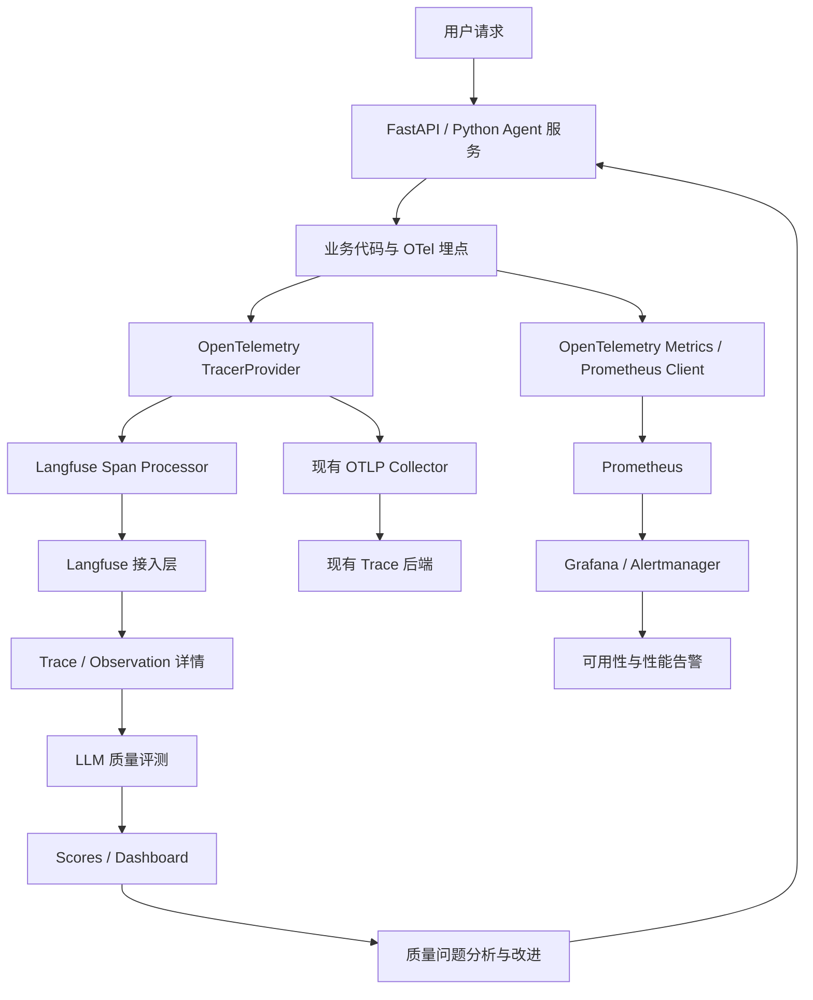
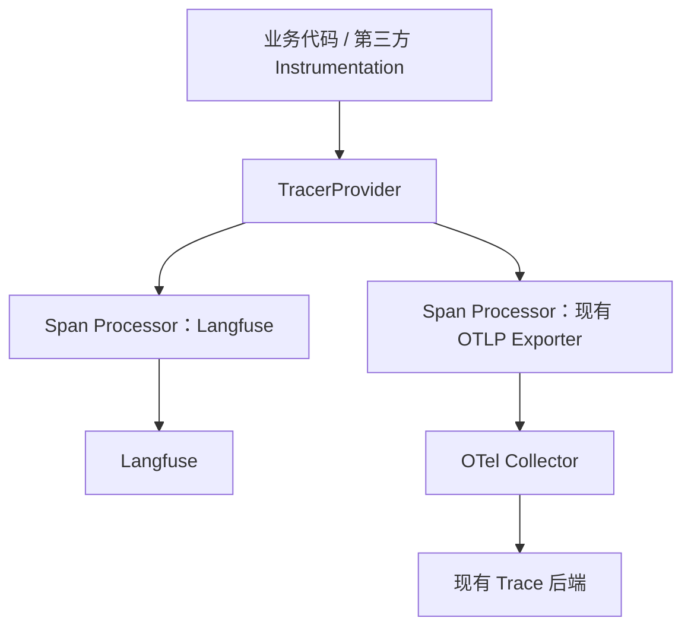
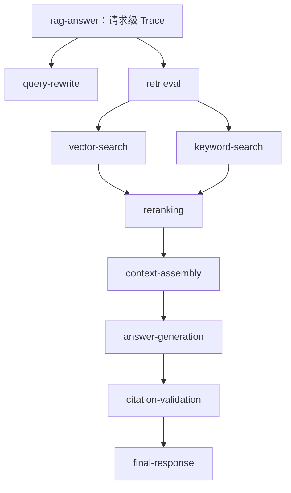
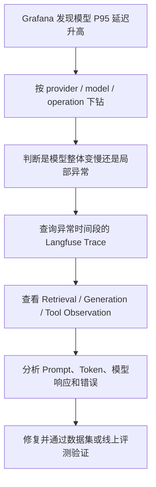
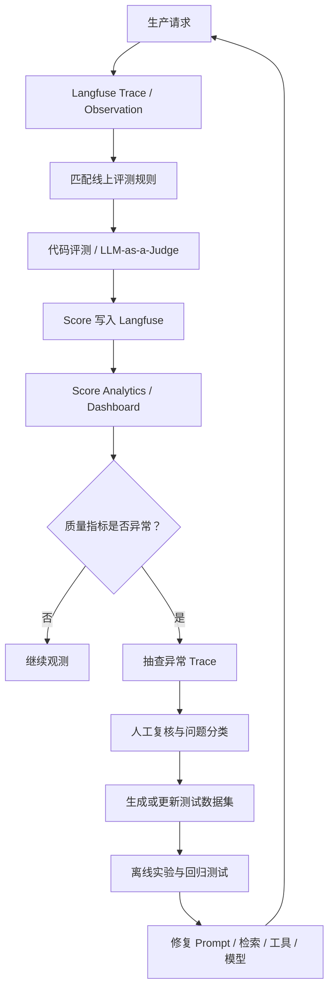
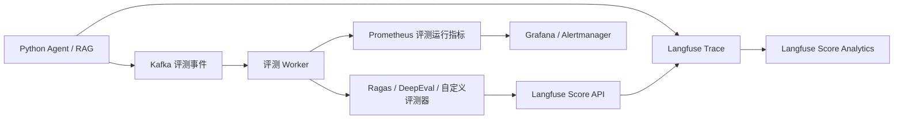
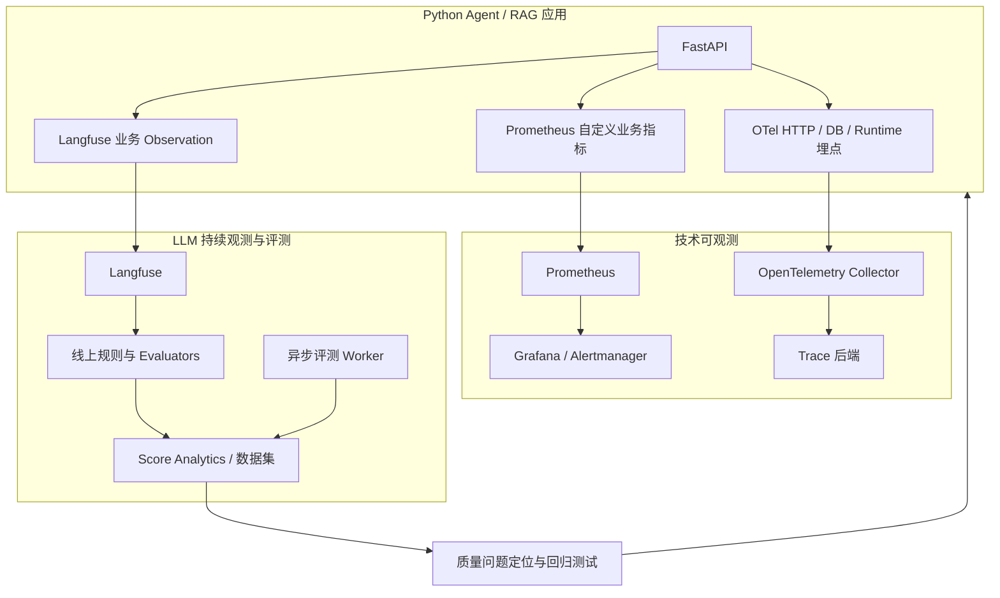

# 可观测体系集成 Langfuse：从 OpenTelemetry + Prometheus 到线上持续观测


## 一、目标与总体设计

在已有 Python 可观测体系（OpenTelemetry + Prometheus）的基础上，集成 [Langfuse](https://langfuse.com/)，重点不是再建立一套重复的基础监控，而是补充现有体系缺少的 **LLM 调用链追踪、模型 Token 与成本分析、Agent 工具调用分析、回答质量评测以及用户反馈闭环**。

Langfuse 基于 OpenTelemetry 构建。对于 Python 服务，官方推荐使用 Langfuse SDK 完成专用的 LLM 观测埋点；如果现有服务已经产生标准 OTLP Trace，也可以通过 OpenTelemetry Collector 转发给 Langfuse。参考：[Langfuse OpenTelemetry 集成](https://langfuse.com/integrations/native/opentelemetry)。

### 1.1 三套能力的职责边界

| 体系 | 核心职责 | 重点回答的问题 |
|---|---|---|
| OpenTelemetry（OTel） | 统一遥测标准、Trace 上下文传播及指标采集 | 一个请求经过了哪些服务和组件？在哪里耗时或失败？ |
| Prometheus + Grafana + Alertmanager | 基础设施、应用、运行时、性能和可用性监控 | 错误率是否上升？P95 延迟是否超标？服务是否可用？ |
| Langfuse | LLM/Agent 观测、Prompt 与模型分析、Token 和成本、线上质量评测、用户反馈 | 为什么模型回答错误？哪个 Prompt 或工具导致质量下降？ |

Langfuse 不是 Prometheus 的替代品，Prometheus 也不是 LLM 质量评测系统。

例如，Prometheus 可以监控 LLM 请求的错误率和延迟，但不能单独判断某条回答是否忠于 RAG 检索到的证据。Langfuse 可以记录回答对应的检索、生成和工具调用过程，并关联自动评测分数和用户反馈。

### 1.2 集成后的整体架构



图中有两个相互配合、但职责不同的通路：

- **技术观测通路：** OTel 产生 Trace，Prometheus 收集运行指标，帮助定位服务和组件的技术故障。
- **LLM 质量观测通路：** Langfuse 记录模型交互和 Agent 执行过程，进一步计算、存储和分析回答质量。

Prometheus 本身不存储完整的分布式 Trace；如果已有 OTel Collector，应继续将 Trace 导出到现有的 Jaeger、Grafana Tempo 或其他 Trace 后端。

## 二、首先确定集成模式

在编写代码前，应先确定由谁负责将 Trace 发送到 Langfuse。

Langfuse 官方文档列出了两条主要集成路径：Python SDK 与标准 OpenTelemetry 导出。多个组件共同使用 OpenTelemetry 时，需要关注全局 `TracerProvider`、Span Processor 的注册顺序及 Span 过滤规则。参考：[Langfuse 与现有 OTel 集成](https://langfuse.com/faq/all/existing-otel-setup)。

### Langfuse Python SDK（当前项目选择）

适合需要完整 LLM 观测能力的 Python Agent、RAG、聊天服务。

主要能力：

- 使用 `start_as_current_observation()` 创建具有父子关系的 Observation。
- 使用 `@observe` 或原生集成自动记录常见 LLM 调用。
- 关联 `user_id`、`session_id`、环境和版本。
- 使用 Langfuse 数据模型处理输入、输出、模型调用、Prompt、使用量以及 Scores。

官方 SDK 的 Python API 以 `get_client()`、Observation 和属性传播方法为主要入口。参考：[Langfuse SDK 快速开始](https://langfuse.com/docs/observability/get-started)。


**推荐策略：**以 Python SDK 作为 LLM 观测的主要埋点方式，保留现有 OTel + Prometheus 体系；在确实需要统一 Trace 出口时，再采用 Collector 转发。

不要在未经设计的情况下同时使用 SDK 直传和 Collector 向 Langfuse 转发相同的 Trace，否则可能产生重复 Observation、增加成本并干扰统计。

## 三、版本与基础配置

### 3.1 版本兼容

Langfuse 的 SDK 与服务端版本需要匹配。部署时应以官方兼容说明和 Release Notes 为准，尤其要区分自托管服务端的大版本及 SDK 版本。参考：[Langfuse SDK 总览](https://langfuse.com/docs/observability/sdk/overview)。

建议：

1. 先确认自托管 Langfuse 的服务端版本。
2. 确认 Python SDK 与服务端 API 兼容。
3. 在依赖锁文件中固定已验证的版本。
4. 升级 SDK 或服务端时，执行 Trace、Score、Prompt 及线上评测回归测试。

不要在生产环境中仅凭 `latest` 标签判断客户端与服务端兼容。

### 3.2 安装 SDK

```bash
pip install langfuse
```

如果项目原本已经集成了 OTel Python SDK、FastAPI 自动埋点和 Prometheus Client，应保留现有依赖与初始化逻辑，而不是再安装一套互相冲突的 OTel 配置。

### 3.3 配置环境变量

以下示例采用自托管 Langfuse，假设 Python 服务和 Langfuse 已能通过容器网络互相访问。

```bash
# Langfuse 项目凭据
LANGFUSE_PUBLIC_KEY=pk-lf-your-project-key
LANGFUSE_SECRET_KEY=sk-lf-your-secret-key

# 应替换为实际可访问的服务地址
LANGFUSE_BASE_URL=http://langfuse-web:3000

# 当前部署环境
LANGFUSE_TRACING_ENVIRONMENT=production

# 应用发布版本
LANGFUSE_RELEASE=rag-service-1.4.0

# 观测采样比例：示例为 100%
LANGFUSE_SAMPLE_RATE=1.0

# 调试时再开启
LANGFUSE_DEBUG=False
```

注意：

- `LANGFUSE_BASE_URL` 应指向 SDK 能正常访问的 Langfuse 服务地址，而不是假设所有部署都使用同一个域名。
- 生产环境的 `LANGFUSE_SECRET_KEY` 只应保存在服务端密钥管理系统或安全的部署配置中。
- 如果现有 OTel 已经有自己的 `OTLP_EXPORTER_OTLP_ENDPOINT`，不要为了 Langfuse 而直接将该全局出口覆盖为 Langfuse 地址。这样可能改变现有 Trace 后端的行为，也可能影响其他信号导出。
- SDK 支持通过采样配置控制 Trace 采集；具体环境变量及默认行为应以所用 SDK 版本的官方文档为准。未被采样的 Trace，其 Observation 和关联 Score 也不会发送。参考：[Langfuse SDK 高级功能](https://langfuse.com/docs/observability/sdk/advanced-features)。

## 四、将 Langfuse 接入现有 OpenTelemetry

这一部分是整个集成最需要谨慎设计的地方。

### 4.1 先理解 OTel 的核心关系



一个 `TracerProvider` 可以挂载多个 Span Processor。它们可以接收同一组 Span，再依据各自的导出策略处理数据。

Langfuse 官方的现有 OTel 集成指南推荐在可以控制初始化过程时，将 Langfuse 的 Span Processor 接入现有 Trace 管道，从而保留父子关系和跨服务 Trace 的一致性。参考：[Langfuse 与现有 OTel 集成](https://langfuse.com/faq/all/existing-otel-setup)。

### 4.2 不要重建已经存在的 TracerProvider

如果项目已经通过以下任一方式初始化 OTel：

- `opentelemetry-instrument` 自动埋点；
- FastAPI 的 OTel Instrumentation；
- 应用内部统一的 OTel 初始化模块；
- 已注册自定义 `TracerProvider` 的其他可观测组件；

就不要在 Langfuse 模块中再次调用 `trace.set_tracer_provider()`，并把原来的 Provider 或 Span Processor 覆盖掉。

应优先让 Langfuse 集成使用现有的全局 Trace 上下文，并通过实际 Trace 验证两个导出通路是否正常。

官方指南指出，其他组件如果更早初始化全局 Provider，或者阻止了后续 Span Processor 的正确注册，可能导致 Langfuse 收不到数据。参考：[Langfuse 与现有 OTel 集成](https://langfuse.com/faq/all/existing-otel-setup)。

### 4.3 Python SDK 接入示例

在应用已经正确配置 OTel 全局 Provider 的前提下，业务代码可以这样初始化 Langfuse：

```python
from langfuse import get_client, propagate_attributes

# 使用 Langfuse Python SDK
langfuse = get_client()
```

随后在业务流程中使用 Langfuse Observation：

```python
with langfuse.start_as_current_observation(
    as_type="span",
    name="rag-request",
    input={"query": sanitized_query},
) as root:
    with propagate_attributes(
        user_id=pseudonymous_user_id,
        session_id=conversation_id,
        environment="production",
        version="rag-service-1.4.0",
        metadata={"pipeline": "rag"},
        tags=["rag"],
    ):
        # 执行检索、重排、模型调用等业务逻辑
        ...
```

这里的关键点不是简单地创建一个 Span，而是让后续 Observation 自动继承当前上下文，并将用户、会话、版本和环境等信息传播到相关 Observation 中。官方 SDK 文档推荐尽早调用 `propagate_attributes()`，这样后续生成的观察记录才能正确携带这些维度。参考：[Langfuse Instrumentation](https://langfuse.com/docs/observability/sdk/instrumentation)。

**特别注意：**上述示例是业务埋点写法，并不代表任何已有 OTel 环境下 `get_client()` 都无需额外检查。应确认 Langfuse Processor 实际注册到了预期的 Provider 上，并检查 `LANGFUSE_DEBUG` 日志和最终 Trace。不同的初始化方式应选择适当的 Processor 注册策略，不能把独立 Provider 与共享 Provider 的配置混用。

### 4.4 明确 Langfuse 应该接收哪些 Span

Langfuse SDK 会根据其集成方式和过滤规则选择要导出的 Span，例如 Langfuse SDK 创建的 Observation、带有 GenAI 语义属性的 Span，以及来自已知 LLM Instrumentation Scope 的 Span。具体匹配逻辑应以当前 SDK 版本文档为准。参考：[Langfuse SDK 高级功能](https://langfuse.com/docs/observability/sdk/advanced-features)。

建议使用如下划分：

| Span 类型 | Langfuse | 现有 OTel Trace 后端 |
|---|---|---|
| HTTP 请求入口 | 根据需求保留必要的根节点 | 保留 |
| RAG 检索与重排 | 建议保留 | 保留 |
| LLM Generation | 建议保留 | 保留 |
| Agent 工具调用 | 建议保留 | 保留 |
| 数据库内部调用细节 | 按业务需要筛选 | 保留 |
| 高频健康检查 | 通常排除 | 按原有策略 |

不能机械地过滤所有 FastAPI 或 HTTP 根节点。假如 Langfuse 接收了子级 LLM Span，却过滤了它唯一需要的父级 Span，就可能出现 Trace 断层或孤立 Observation。应先明确保留哪些层级，再配置过滤规则。参考：[Langfuse 与现有 OTel 集成](https://langfuse.com/faq/all/existing-otel-setup)。

## 五、给 RAG / Agent 增加有业务含义的 Trace

这是从“能够采集数据”走向“能够排查 LLM 问题”的关键一步。

### 5.1 为什么仅有 HTTP Trace 不够？

假设一个 RAG 服务发生了 P95 延迟明显升高的问题。通过 OTel，可以确认 HTTP 请求慢了；但只有在业务流程中增加细粒度 Observation，才能区分问题究竟来自：

- Query 改写或 HYDE；
- 向量与关键词混合检索；
- Reranker；
- Prompt 构造；
- 模型响应；
- Agent 工具调用或重试。

建议的业务 Trace 层级如下：



每个 Observation 都应对应一个明确的业务阶段，而不是为了增加 Span 数量，将每个函数都包装成可观测节点。

### 5.2 FastAPI 业务埋点示例

下面用伪业务接口说明如何在现有异步服务中增加观测。`redact()`、`retrieve_documents()`、`generate_answer()` 及 `MODEL_NAME` 需要由业务项目提供；实际调用参数和对象接口应按所用 SDK 版本调整。

```python
from langfuse import get_client, propagate_attributes

langfuse = get_client()


async def answer_question(
    query: str,
    user_id: str,
    session_id: str,
):
    with langfuse.start_as_current_observation(
        as_type="span",
        name="rag-answer",
        input={"query": redact(query)},
    ) as root:
        with propagate_attributes(
            user_id=user_id,
            session_id=session_id,
            environment="production",
            version="rag-service-1.4.0",
        ):
            with langfuse.start_as_current_observation(
                as_type="span",
                name="retrieve-context",
                input={"query": redact(query)},
            ) as retrieval:
                documents = await retrieve_documents(query)

                retrieval.update(
                    output={
                        "hit_count": len(documents),
                        "document_ids": [doc.id for doc in documents],
                    }
                )

            with langfuse.start_as_current_observation(
                as_type="generation",
                name="answer-generation",
                model=MODEL_NAME,
                input={
                    "query": redact(query),
                    "document_ids": [doc.id for doc in documents],
                },
            ) as generation:
                result = await generate_answer(
                    query=query,
                    documents=documents,
                )
                generation.update(
                    output={"answer": redact(result.answer)}
                )

            root.update(
                output={
                    "answer": redact(result.answer),
                    "retrieved_count": len(documents),
                }
            )

            return result
```

关键原则：

**第一，保留可定位问题的信息。** 对检索结果，优先记录命中的文档 ID、数量、分数和必要的脱敏摘要，而不是将整个知识库文档无限制地复制到 Trace 中。

**第二，避免重复埋点。** 如果 OpenAI、LangChain 或其他 LLM 库的原生集成已经创建了 Generation，就不要再为相同的一次模型请求创建重复的 Generation。可以保留上层的业务 Observation，让自动采集的模型 Observation 成为它的子节点。

**第三，确保上下文与异步执行一致。** 对跨进程、Kafka 消费者、线程池或后台任务，应明确传递 Trace Context 或关联 ID。不能假定所有异步边界都会自动保留完整的父子关系。

Langfuse 提供原生集成和手动 Observation 两种方式，它们可以组合使用，但应明确每一层由谁负责创建。参考：[Langfuse Instrumentation](https://langfuse.com/docs/observability/sdk/instrumentation)。

### 5.3 每个 Observation 应该记录什么？

| 类型 | 建议记录的信息 | 常见排障用途 |
|---|---|---|
| Root Trace | 服务名、版本、环境、会话 ID、脱敏输入和最终输出 | 端到端定位 |
| Retrieval | 查询标识、命中数量、文档 ID、相关性分数 | 判断召回问题 |
| Generation | 模型名、Prompt 版本、必要的输入输出、Token 使用量 | 分析回答质量与模型成本 |
| Tool Call | 工具名称、参数摘要、执行结果、异常类型 | 排查工具失败 |
| Guardrail | 检查结果、拒绝原因类别、结构化验证结果 | 排查合规和格式问题 |
| Evaluation | 评分名称、分数、判定依据 | 持续追踪质量变化 |

建议采用 OTel GenAI 语义约定中的标准属性来表达模型操作、模型标识和 Token 使用量，同时利用 Langfuse 专用属性记录会话、版本和可过滤的元数据。例如，`gen_ai.usage.input_tokens` 和 `gen_ai.usage.output_tokens` 可以表达输入、输出 Token 数量。OTel GenAI 语义约定仍在持续演进，应随所用 Instrumentation 的版本检查兼容性。参考：[OpenTelemetry GenAI 语义约定](https://opentelemetry.io/docs/specs/semconv/registry/attributes/gen-ai/)。

## 六、将 Prometheus 指标与 Langfuse Trace 对齐

两者并行运行的价值，不是复制同一条数据，而是能够从宏观指标快速定位到具体 Trace。

### 6.1 需要哪些业务指标？

建议在现有 Prometheus 指标的基础上补充以下指标，避免无差别重复采集现有的 HTTP 和运行时指标。

| 指标 | 类型建议 | 用途 |
|---|---|---|
| `llm_requests_total` | Counter | 模型调用量与错误率 |
| `llm_request_duration_seconds` | Histogram | 模型调用延迟分布 |
| `llm_tokens_total` | Counter | Token 消耗趋势 |
| `rag_retrieval_duration_seconds` | Histogram | 检索延迟 |
| `rag_retrieval_results` | Histogram | 召回数量分布 |
| `agent_tool_calls_total` | Counter | 工具调用成功与失败情况 |
| `agent_eval_jobs_total` | Counter | 评测任务处理量与失败量 |
| `agent_eval_queue_lag_seconds` | Gauge 或适当的队列指标 | 评测链路积压 |

以上是推荐的业务指标命名示例，不是 Langfuse SDK 会自动创建的全部指标。需要结合现有 OTel Meter、Prometheus Client 及各组件的自动指标，避免重复计数。

### 6.2 指标标签设计

可以使用有限的维度，例如：

- `provider`：模型提供方。
- `model`：模型名称或受控模型别名。
- `operation`：`chat`、`embedding`、`rerank`。
- `status`：`success`、`error`。
- `tool_name`：经过治理的工具名称。

不要将 `user_id`、`session_id`、`trace_id`、原始 Query、完整 Prompt 等高基数或敏感数据设置为 Prometheus 标签。

Prometheus 官方指出，唯一的标签组合会形成新的时间序列，用户 ID、邮箱等高基数字段会显著增加存储负担。详细信息应保存在 Langfuse Trace 中，而不是复制到 Prometheus 每条时间序列中。参考：[Prometheus 指标命名与标签实践](https://prometheus.io/docs/practices/naming/)。

### 6.3 如何从 Prometheus 指标定位到 Langfuse？



两套系统之间应使用明确的时间范围、模型版本、环境和业务关联信息。需要跨系统精确定位时，可以通过应用日志及 Trace ID 关联现有 Trace 后端和 Langfuse 中的观察记录。

不要把 Trace ID 变成 Prometheus 标签；应通过追踪系统或日志检索来查询单条请求。

### 6.4 PromQL 查询示例

以下假设已存在相应指标，且 `status` 标签包含 `success`、`error`。

**模型调用错误率：**

```promql
sum by (provider, model) (
  rate(llm_requests_total{status="error"}[5m])
)
/
clamp_min(
  sum by (provider, model) (
    rate(llm_requests_total[5m])
  ),
  1e-9
)
```

**模型调用 P95 延迟：**

```promql
histogram_quantile(
  0.95,
  sum by (le, provider, model) (
    rate(llm_request_duration_seconds_bucket[5m])
  )
)
```

这些查询用于发现错误率和延迟趋势。P95 告警阈值应根据实际服务 SLO 设定，而不是直接照搬示例。Prometheus 官方推荐对延迟分布使用 Histogram，并通过 `histogram_quantile()` 计算分位数。参考：[Prometheus Histogram 实践](https://prometheus.io/docs/practices/histograms/)。

## 七、Langfuse 线上持续评测与质量监控

到目前为止，系统已经能够回答“请求执行了什么”。接下来需要回答更重要的问题：**模型是否正确完成了任务？质量是否随着模型、Prompt、知识库或工具的变化而下降？**

Langfuse 支持生产流量在线评测、评分存储、人工标注、用户反馈以及基于数据集的离线实验。推荐流程是先对生产 Trace 进行评分，再将有价值的实际案例沉淀为数据集，在离线实验中比较不同 Prompt、模型或代码版本。参考：[Langfuse Evaluation 概览](https://langfuse.com/docs/evaluation/overview)。

### 7.1 线上评测闭环



在线评测规则可以选择符合条件的生产 Observation，控制采样比例并绑定一个或多个评测器。评测结果随后可以用于 Score Analytics 和自定义仪表盘。参考：[Langfuse 线上评测入门](https://langfuse.com/docs/evaluation/get-started/online)。

### 7.2 应评测哪些质量指标？

对于 RAG 系统，建议至少覆盖以下维度：

| 评测维度 | 要回答的问题 | 推荐实现 |
|---|---|---|
| Answer Relevance | 回答是否回应了用户问题？ | LLM-as-a-Judge |
| Faithfulness / Groundedness | 回答是否有检索证据支撑？ | LLM-as-a-Judge，必要时人工复核 |
| Retrieval Relevance | 检索到的材料是否相关？ | 代码评测、检索指标或 LLM Judge |
| Citation Correctness | 引用是否真实且支持对应结论？ | 代码检查与语义评测组合 |
| JSON / Schema Validity | 结构化输出是否合法？ | 确定性代码评测 |
| Tool Success | 工具调用是否成功并产生有效结果？ | 业务规则与运行指标 |
| Policy Compliance | 是否触发不应出现的输出？ | 规则校验、分类器或 LLM Judge |
| User Feedback | 用户是否认为回答有帮助？ | 人工评分、用户反馈 |

不建议只使用一个笼统的 `quality_score`。同一个综合分数可能掩盖“检索失败但模型表达流畅”或“回答正确但引用错误”等不同的问题。

例如，Faithfulness 较高但 Retrieval Relevance 较低时，说明模型可能忠实地使用了有限的证据，却没有找到足够相关的材料。这类问题需要分别查看检索和生成环节。

### 7.3 如何配置线上评测规则？

建议从少量高价值评测器开始，逐步扩大：

**第一步：先建立确定性评测。** 对 JSON Schema、必填字段、引用 ID 是否存在、工具返回码和权限约束等内容，优先使用普通代码评测。这类检查成本低、结果可重复。

**第二步：建立 LLM-as-a-Judge。** 对回答相关性、证据一致性、表达完整性等语义任务建立明确的评分标准，并用人工复核数据校准评测器。

**第三步：设定规则过滤器和采样策略。** 先选择代表性的线上 Observation，检查评测结果与预期是否一致，再逐步开启持续评测。评测器的调用量和成本应在生产启用前估算。

**第四步：沉淀质量回归集。** 对严重错误、用户负反馈、工具失败、检索空结果和人工复核不通过的 Trace，挑选有代表性的案例进入数据集。

Langfuse 支持基于生产 Observation 配置评测规则，并支持通过数据集实验验证代码、Prompt 和模型更改。参考：[Langfuse 线上评测入门](https://langfuse.com/docs/evaluation/get-started/online)。

### 7.4 在线评测需要全量执行吗？

应将两个采样决策分开：

1. **Trace 采样**决定多少请求进入 Langfuse。未采集的 Trace 无法在 Langfuse 中用于后续评测。
2. **评测采样**决定已采集的 Trace 中，多少请求触发某类评测器。

因此，不能简单地将 Trace 采样率和线上评测采样率设为同一个值。

推荐按业务风险分层：

| 流量类别 | Trace 策略 | 质量评测策略 |
|---|---|---|
| 核心生产 Agent | 优先全量或高比例采集 | 核心业务规则较高覆盖率，昂贵的语义评测可按预算采样 |
| 一般低风险请求 | 根据流量和预算采样 | 对代表性样本评测 |
| 错误、异常、用户负反馈 | 重点保证可观测性 | 优先触发相应诊断评测 |
| 已标注的回归数据集 | 稳定保存 | 在离线实验中重复评测 |

上表是建议的策略设计，而不是 Langfuse 默认会为失败请求自动提高采样概率。SDK 的全局采样率本身无法保证错误 Trace 一定会被保留。若需要“正常流量采样，异常流量重点保留”，应在应用或遥测管道设计相应的采集策略。

## 八、如何将 Kafka、Ragas / DeepEval 纳入体系

如果已有独立的异步评测服务，可以把 Langfuse 用作统一的 Trace 和 Score 展示层，而不必让全部评测都运行在用户请求的同步路径中。

在此架构下，Langfuse 原生线上规则负责快速建立基础评测闭环；更昂贵或更复杂的业务评测由异步 Worker 完成，再将得分关联回原始 Trace。

### 8.1 推荐架构



需要区分两种对象：

- **Langfuse Trace / Observation：**记录原始请求及执行过程，是排查问题时的证据。
- **Score：**针对某个 Trace 或 Observation 的评测结果，是衡量质量的量化依据。

Kafka 中建议携带原始 Trace 的关联标识、评测任务类型、数据版本和幂等键等信息。Worker 根据任务需要加载评测材料，执行评测后再写回对应 Score。

### 8.2 异步评测的工程约束

| 关注点 | 实现要求 |
|---|---|
| 请求延迟 | 语义评测不得阻塞用户主请求 |
| 幂等性 | 同一 Trace、同一评测器版本重复消费不能导致重复统计 |
| 可追溯性 | 保存评测器版本、数据版本和评分依据 |
| 队列积压 | 监控消费延迟、失败重试次数和死信消息 |
| 结果关联 | Score 必须关联正确的 Trace 或 Observation |
| 成本治理 | 对昂贵的模型评测单独设定速率和预算 |
| 数据版本 | 评测规则或模型升级时，能辨别不同版本的评分结果 |

在线质量下降时，优先将异常 Trace 转化为回归数据集，而不是只记录告警。后续修改 Prompt、检索参数或模型后，使用相同的数据集进行对比实验，能够区分修复是否有效以及是否引入新的回归。

## 九、Trace、质量评分与告警如何分工？

建议不要把所有告警都塞到 Langfuse，也不要试图让 Prometheus 理解每条自然语言回答。

### 9.1 三类告警

| 告警类型 | 典型事件 | 主要监控渠道 |
|---|---|---|
| 服务可用性与性能 | HTTP 5xx、调用失败率升高、P95 超标 | Prometheus + Alertmanager |
| 组件与任务健康 | Kafka 消费积压、评测 Worker 失败、导出异常 | Prometheus + 日志及组件监控 |
| LLM 质量与业务风险 | Faithfulness 下降、引用错误增多、用户负反馈上升 | Langfuse Score Analytics、线上评测规则及必要的外部告警联动 |

质量问题同样可以进入统一告警系统，但不要在每次请求中直接查询 Langfuse API 来判断是否触发报警。

### 9.2 如何将质量趋势纳入 Prometheus？

当组织需要统一的 SLO 面板，可以增加一个低频、异步的质量聚合任务：

1. 周期性获取指定时间窗口的评测分数。
2. 按受控维度聚合，例如评测器、模型别名、环境。
3. 将聚合结果写入自定义 Prometheus Gauge。
4. 基于连续时间窗口的变化配置告警。

例如，聚合指标可以设计为：

```text
rag_quality_score_avg{evaluator="faithfulness",model="model-a"}
rag_quality_score_pass_ratio{evaluator="citation_correctness",model="model-a"}
```

这些也是业务层的自定义指标示例，而不是 Langfuse 自动暴露的指标。

不要将每条 Trace 的分数直接作为带 `trace_id` 标签的 Gauge，否则会形成大量时间序列。单条异常应在 Langfuse 中排查，Prometheus 只保存适合聚合的质量趋势。

## 十、数据治理、安全和成本控制

线上 LLM 观测会记录模型调用的输入、输出、检索材料及工具参数，因此数据治理必须在上线前完成。

### 10.1 敏感信息治理

建议按照以下顺序处理：

1. 在业务代码中明确允许采集的字段。
2. 对用户标识进行假名化，避免记录不必要的个人信息。
3. 对 Prompt、模型输入输出及检索片段进行脱敏、截断或摘要化。
4. 在导出环节增加二次脱敏。
5. 限制谁可以查看完整输入输出、人工评分和导出数据。

Langfuse Python SDK 支持 `mask_otel_spans`，可在导出阶段修改原始 OTel Span 属性，包括第三方 Instrumentation 产生的属性。该脱敏函数以同步方式运行，因此应避免在其中执行慢速的外部网络调用。参考：[Langfuse SDK 高级功能](https://langfuse.com/docs/observability/sdk/advanced-features)。

导出环节脱敏并不意味着业务内存、应用日志及其他 Trace 后端中的数据也会自动脱敏。应该在所有相应数据路径上验证实际效果。

### 10.2 Session 与用户标识

建议区分：

- `trace_id`：一次请求或一次执行链路的标识。
- `session_id`：同一轮多轮对话所属的会话标识。
- `user_id`：用于分析用户维度表现的假名化标识。
- `version` / `release`：用于判断不同版本的线上质量差异。

Langfuse 支持将拥有相同 `session_id` 的多次 Trace 组合起来，分析一个完整对话中的多次交互。参考：[Langfuse Sessions](https://langfuse.com/docs/observability/features/sessions)。

如果使用 OTel Baggage 跨服务传播这些属性，必须注意 Baggage 会进入下游请求头。不要将密码、访问令牌、原始个人隐私或者其他不应传播的数据放入 Baggage。参考：[Langfuse OpenTelemetry 集成](https://langfuse.com/integrations/native/opentelemetry)。

### 10.3 成本控制

至少应监控四项成本：

| 成本来源 | 优化方向 |
|---|---|
| Langfuse Observation 写入量 | 过滤无关 Span，按业务风险设计 Trace 采样 |
| 模型 Token 消耗 | 分析模型、Prompt 长度和重复调用 |
| LLM-as-a-Judge 费用 | 对评测器单独采样、限速、配置预算 |
| 异步评测积压 | 控制 Worker 并发、重试、单条任务成本 |

Langfuse 官方提醒，发送到 Langfuse 的每个 Observation 都可能计入相应用量统计；如果把所有基础设施 Span 全部导出，应提前评估由此带来的观测数据量与成本。参考：[Langfuse 与现有 OTel 集成](https://langfuse.com/faq/all/existing-otel-setup)。

建议先实现可解释的 Trace 层级和基础评测，再根据观测数据调整采样率。不要一开始就大量采集完整 Prompt、全部检索文档和工具参数。

## 十一、如果使用 OpenTelemetry Collector 转发到 Langfuse

前面主要讨论 Langfuse Python SDK。若希望保留已有应用的标准 OTel 出口，也可以由 Collector 负责向 Langfuse 发送 Trace。

Langfuse 的 OTLP 接口为 `/api/public/otel`。应根据官方文档配置正确的 Basic Auth、当前接入协议以及必要的 ingestion 版本头。Langfuse OTLP HTTP 接入支持的协议与服务端版本相关；不要假定可以将 OTLP gRPC 直接发送到 Langfuse OTLP HTTP 端点。参考：[Langfuse OpenTelemetry 集成](https://langfuse.com/integrations/native/opentelemetry)。

### 11.1 凭据准备

Langfuse OTLP 认证需要将项目 Public Key 与 Secret Key 组合并进行 Base64 编码。

Linux 环境可以这样生成：

```bash
printf '%s' 'pk-lf-your-project-key:sk-lf-your-secret-key' \
  | base64
```

将结果作为 Collector 环境中的 `AUTH_STRING` 使用。不要将真实密钥、编码后的认证值提交到代码仓库。

### 11.2 Collector 配置示例

以下配置展示接收现有应用的 OTLP Trace，再同时发送到 Langfuse 和原有 Trace 后端的模式。示例中的 `otlp/tempo` 代表既有后端出口，应替换成当前实际配置。

```yaml
receivers:
  otlp:
    protocols:
      grpc:
        endpoint: 0.0.0.0:4317
      http:
        endpoint: 0.0.0.0:4318

processors:
  memory_limiter:
    check_interval: 5s
    limit_mib: 512
  batch:

exporters:
  otlphttp/langfuse:
    # 替换为实际部署地址
    endpoint: "http://langfuse-web:3000/api/public/otel"
    headers:
      Authorization: "Basic ${env:AUTH_STRING}"
      x-langfuse-ingestion-version: "4"

  # 示例：保留现有 Trace 后端出口
  otlp/tempo:
    endpoint: "tempo:4317"
    tls:
      insecure: true

service:
  pipelines:
    traces:
      receivers: [otlp]
      processors: [memory_limiter, batch]
      exporters: [otlphttp/langfuse, otlp/tempo]
```

生产环境中应根据实际部署配置 TLS、访问控制、内存限制及重试策略。上面的 `insecure: true` 仅表示示例中使用内部明文连接的配置方式，不能直接作为公网生产配置。

如果既有服务通过 HTTP 向 Collector 发送 Trace，那么 Collector 可以将接收到的 Trace 扇出到多个后端；如果当前出口只使用 OTLP gRPC，则应用依然可以将数据发给 Collector 的 gRPC Receiver，但 Collector 到 Langfuse 的出口必须使用 Langfuse 支持的 OTLP HTTP 协议。具体端点、认证与头部以当前服务端版本的官方文档为准。

## 十二、集成落地与验收清单

建议分四个阶段推进，而不是一次性打开所有埋点与线上评测。

### 阶段一：基础接入

- [ ] 确认 Langfuse 服务端和 Python SDK 的版本兼容性。
- [ ] 配置安全的 Langfuse 项目密钥和服务地址。
- [ ] 确认现有 OTel Provider 没有被重复创建或覆盖。
- [ ] 创建一条包含 Root Observation 的测试 Trace。
- [ ] 验证 Trace 输入、输出和必要元数据已正确显示。

**验收标准：**真实请求可以在 Langfuse 中检索到，且不会影响现有的 Prometheus 指标和 Trace 导出。

### 阶段二：完善业务 Trace

- [ ] 给 RAG 检索、重排、模型生成和关键工具增加 Observation。
- [ ] 使用明确的模型名和应用版本。
- [ ] 正确关联 `user_id`、`session_id` 和环境。
- [ ] 验证 Prompt、输出和 Token 使用量的采集方式。
- [ ] 检查是否有重复 Generation 或孤立 Observation。
- [ ] 为输入输出设定脱敏、字段白名单及数据保留策略。

**验收标准：**能够从一次异常的模型回答定位到对应的检索、Prompt 和模型执行过程。

### 阶段三：建立持续质量评测

- [ ] 建立 Schema、引用检查等确定性评测器。
- [ ] 为 Answer Relevance、Faithfulness 等维度配置语义评测。
- [ ] 在 Langfuse 中设置线上规则和合理的评测采样率。
- [ ] 将典型错误 Trace 沉淀到数据集。
- [ ] 配置离线实验，验证 Prompt、检索策略或模型版本的改动。
- [ ] 如果已有异步评测服务，将评分与原始 Trace 正确关联。

**验收标准：**质量问题能够被识别、复核，并转化为可重复执行的回归用例。

### 阶段四：完善告警和运营

- [ ] 保留现有 Prometheus 服务可用性、错误率和延迟告警。
- [ ] 监控 Token 消耗、工具失败和评测 Worker 积压。
- [ ] 建立 Langfuse 质量评分趋势和版本对比仪表盘。
- [ ] 明确质量告警如何进入现有告警通知渠道。
- [ ] 定期检查 Langfuse 导出错误、数据量及存储成本。
- [ ] 对 SDK 升级、模型升级和 Prompt 变更执行回归测试。

**验收标准：**既能够及时发现系统性能问题，又能够发现模型回答质量下降，并为两类问题提供不同的排查路径。

## 十三、最终推荐架构

综合考虑可维护性、可追溯性和线上质量闭环，推荐采用以下结构：



这个架构的核心在于：**OpenTelemetry 统一采集与传播技术上下文，Prometheus 管理运行指标与 SLO，Langfuse 专注于 LLM 执行过程与质量评测，再通过数据集与回归测试形成持续改进闭环。**

上线初期应优先保证 Trace 完整、业务阶段可定位、敏感数据受控；随后再逐步加入线上质量评测、异步评测、质量趋势与告警联动。这样可以避免一开始就陷入大量指标、重复埋点或昂贵的全量语义评测之中。

## 官方参考文档

| 文档 | 用途 |
|---|---|
| [Langfuse SDK 总览](https://langfuse.com/docs/observability/sdk/overview) | Python SDK、初始化及版本兼容 |
| [Langfuse Instrumentation](https://langfuse.com/docs/observability/sdk/instrumentation) | Observation、属性传播及业务埋点 |
| [Langfuse 与现有 OTel 集成](https://langfuse.com/faq/all/existing-otel-setup) | Provider、Span Processor、过滤及上下文关系 |
| [Langfuse OpenTelemetry 集成](https://langfuse.com/integrations/native/opentelemetry) | OTLP 接入、实时数据及属性映射 |
| [Langfuse 线上评测](https://langfuse.com/docs/evaluation/get-started/online) | 评测器、规则与生产流量评分 |
| [OpenTelemetry Python](https://opentelemetry.io/docs/languages/python/) | Python 遥测采集、SDK 和导出 |
| [Prometheus 命名与标签规范](https://prometheus.io/docs/practices/naming/) | 指标命名、标签和高基数治理 |
| [Prometheus Histogram 实践](https://prometheus.io/docs/practices/histograms/) | 延迟分布与分位数分析 |
