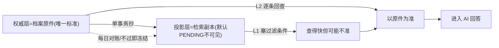

## 第 0 层：一句话先讲透

这个系统里有**两份数据**（README §2.3 叫"一个真相源"）：

- **权威层**＝**档案原件**（`knowledge` / `chunk_filter`），是"谁到底能看什么"的**唯一标准答案**；
- **投影层**＝**给 LightRAG 用的检索副本**（那些 `LIGHTRAG_*` 表），是为了查得快而抄出来的，**本身不作数**。

于是你问的两件事就变成了：

1. **回填准不准** ＝ **副本有没有抄对**；
2. **谓词注入准不准** ＝ **每次拿副本去查东西时，那道"权限过滤条件"有没有写错、有没有被绕过**。

一句话总结设计哲学：**我们默认副本可能会抄错，所以不指望它一定对——而是"抄的时候尽力抄对（对账兜底）＋ 发东西之前再拿原件核对一次（L2）"，两道保险。** 出问题时永远偏向"**宁可少给、绝不多给**"（术语叫 fail-closed）。

---

## 第 1 层：副本怎么"抄对"——回填准确性

### (1) 只从一个地方抄，不允许自己发挥
"权限过滤条件"里的每个值，都来自 `chunk_filter` 这张原件表。系统规定：**投影层的 scope 只能从 `chunk_filter` 单向抄，不许自己算**（README 约束 6）。而且原件表本身有数据库级铁规矩（CHECK 约束＋触发器），把"必须填全授权维、签名要一致"钉死在库里。源头干净，抄出来的才可能干净。

### (2) 抄的动作"要么全成、要么全废"
真正抄的那一下，是在**一个数据库事务**里完成的：写原件快照、刷两张 chunk 副本表、更新图候选表，一起提交或一起回滚（README §2.4 的阶段④，代码 `pipeline.py:363-401`）。不会出现"原件改了、副本没改"的半吊子状态。

### (3) 抄之前先"盖个未发布的章"，抄完才"放行"
副本表新增的权限列，**默认值是 `PENDING`（没发布）**。这意味着：一条数据只要没被正确刷成 `PUBLISHED`，在检索时会被**直接看不见**。
👉 关键：**抄错了的后果是"漏"（该给的没给），而不是"漏网"（不该给的给出去了）。** 方向是安全的。

### (4) 提交前当场自检三件事
在这笔事务里，还会立刻核对：① 该更新的行数对不对；② 两张 chunk 副本表是不是逐行一模一样（`assert_same_scope`）；③ 还有没有残留 `PENDING`。任何一条不过，整笔发布直接失败回滚。

### (5) 事后每天"盘点"——对账
光当场查不够，还有**对账**（README §2.3"一致性靠 Nightly 对账兜底"，代码 `reconcile.py`）：定期拿**原件 vs 副本**逐项比——分块数对不对、两张副本表有没有分叉、版本号有没有滞后、有没有该有却没抄到的悬空行、图候选表的权限算得对不对……**核心项对不上，直接冻结该语言的发布队列**，不让继续发。口诀是"**对账只读原件，修复只动副本**"（`reconcile.py:1`），标准答案永远是原件。

> 小结第 1 层：**源头唯一 + 单事务原子 + 默认不可见 + 当场自检 + 每日盘点(对账)**，五招保证副本尽量抄对。

---

## 第 2 层：拿副本查东西时，"过滤条件"怎么保证对——谓词注入准确性

先理解"注入"是什么：每次用户提问，系统会带着一张"这个用户能看哪些范围"的**通行证**（`FilterAST`），在**数据库查询语句里**塞一段 `AND (权限条件)`，让越权的内容**根本查不出来**（README §2.2 的 L1 pre-filter）。保证这段塞得对，靠以下几点：

### (1) 全系统只有一支"生成分过滤条件的笔"
所有地方的权限条件都由**同一个函数** `render_scope_sql` 生成（README §2.5"铁律 3：手写 WHERE 视为缺陷"，代码 `scope.py:139`）。因为只有一个地方写这段 SQL，就不会出现"这里对、那里错"的不一致。

### (2) 值全部走参数，绝不用字符串拼
过滤条件里的具体取值（比如 `product=SPOT`）都是 `$1/$2/$3` 这种**参数占位符**填进去的，不是把用户输入拼进 SQL。既防注入攻击，也避免拼错。（`scope.py` 里每个维度都是 `&& $n` 参数化。）

### (3) 通行证在"办证时"就检查过一遍
`FilterAST` 这个对象**构造的瞬间**就会自校验：授权维不许空、发布态只能 `PUBLISHED`、可放松的维度只能是偏好维……（`scope.py:58-68`）。**一张畸形的通行证根本造不出来**，也就到不了 SQL。

### (4) 想绕过这道门？门焊死在框架上
- 权限过滤是**塞进检索框架的存储层**里生效的（README §2.5 用 `install_scoped_backends()` 把框架的存储类换成带过滤的版本）；
- **服务启动时会自检**："这些类真的换成我带过滤的那套了吗？"没换成就直接**拒绝启动**（`backends.py`）。所以不可能因为配置疏忽"忘记加过滤"。

### (5) 写和读严格隔离，别让"读取过滤"污染了"写入"
读的时候带通行证，但**删/改/重建时绝不能带**（否则越权数据会被"看成不存在"，导致该删的没删干净）。所以每个写操作入口都有一道哨兵 `ensure_write_path()`：发现还带着通行证就**当场报错**（README §2.5 铁律 1）。

### (6) 最狠的一道：过滤完还不算，发之前再拿原件核一遍（L2）
**这是"谓词注入准确性"的真正底气**——即便上面的 L1 过滤万一漏了，系统在把内容拼进 AI 回答之前，还会对**每一条幸存内容**，拿 `(块ID, 版本号)` **回查档案原件** `chunk_filter` 逐条再判一次权限，"查不到原件就丢弃"，丢弃率超标就**整批拒答**（README §2.2 的 L2，代码 `l2.py`）。

> 所以逻辑是：**L1 用副本做粗筛（快），L2 用原件做终判（准）。** 即使副本抄错、即使 L1 过滤写漏，L2 也能兜住，越权内容进不了 prompt。

---

## 第 3 层：再往深看一层——为什么这样"几乎不会出越权"

把两道保险合起来看，它的设计取向特别"偏执"：

- **标准答案只有一个**（原件）：所有"到底能不能给"的最终裁决都回到原件，副本只是加速用的缓存。
- **默认偏向"看不见"**：新拷贝的行、没抄全的行、查不到原件的行，一律当"无权"处理。
- **错误只会朝"少给"的方向偏**：抄错、漏过滤、版本滞后，表现都是"这个没找到/拒答"，而不是"把别人的给了你"。

---

## 第 4 层：怎么防止"改着改着就把保险改没了"——CI 存活测试

这类"权限焊在框架上"的方案，最怕**框架升级后注入点挪位置、被人不小心删掉**。所以有一组验收测试专门盯着（`test_m7_injection_survival.py`）：

- 9 个方法 / 10 个注入点**必须都还在**（防框架升级悄悄移走）；
- 三个存储子类**必须真的重写了**那几个读方法；
- 生成的 SQL 里**必须能看到权限条件**；
- 带着通行证去调任何一个写方法，**必须立刻报错**。

相当于给"门禁系统"本身又装了**防拆报警器**。

---

## 回到你的两个问题（最短版）

1. **回填数据准不准？** ＝ 只从档案原件抄 ＋ 一笔事务要么全成要么全废 ＋ 没抄对默认看不见 ＋ 提交前当场自检 ＋ 事后每天对账、对不上就冻结发布。**而且真错了也只会"少给"不会"越权"。**

2. **查询时谓词注入准不准？** ＝ 全系统只有一支生成过滤条件的笔 ＋ 值全走参数 ＋ 通行证构造时就校验 ＋ 过滤焊在框架上且启动自检 ＋ 读写严格隔离 ＋ **最关键：过滤完还会用原件逐条再判一次（L2）** ＋ CI 专门防保险被拆。

一句话：**它不赌"副本一定抄对、过滤一定写对"，而是用"原件终判 + 默认不可见 + 每日对账 + CI 防拆"四重保险，把任何一处失误的后果都摁在'宁可少给、绝不越权'这一侧。**