# 授权合规知识管理方案

源代码地址（当需要获取相关的代码实现细节时，必须阅读以下仓库）：
> LightRAG：https://github.com/HKUDS/LightRAG/tree/v1.5.7

> PostgreSQL：https://github.com/postgres/postgres/tree/REL_18_6

> PGvector：https://github.com/pgvector/pgvector/tree/v0.8.7

---

## 目录

- [一、已锁定的前提与边界](#一已锁定的前提与边界)
- [二、架构总览](#二架构总览)
  - [2.1 结论先行](#21-结论先行)
  - [2.2 主链](#22-主链)
  - [2.3 五层分工](#23-五层分工)
  - [2.4 a、b 是授权强度等级，不是执行顺序](#24-ab-是授权强度等级不是执行顺序)
  - [2.5 为什么图谱路必须有 L1a](#25-为什么图谱路必须有-l1a)
  - [2.6 一个真相源](#26-一个真相源)
- [三、L0：Workspace 路由隔离（仅 language）](#三l0workspace-路由隔离仅-language)
  - [3.1 命名与注册](#31-命名与注册)
  - [3.2 收益](#32-收益)
  - [3.3 代价](#33-代价)
  - [3.4 RLS 的定位（非强制点）](#34-rls-的定位非强制点)
- [四、L1：Pre-filter——把 scope 注入 SQL](#四l1pre-filter把-scope-注入-sql)
  - [4.1 L1 的定位与注入点地图](#41-l1-的定位与注入点地图)
  - [4.2 数据前提：哪些表要有 scope 列](#42-数据前提哪些表要有-scope-列)
  - [4.3 scope 取值语义：谓词只有一种形态](#43-scope-取值语义谓词只有一种形态)
  - [4.4 scope 注入机制](#44-scope-注入机制)
  - [4.5 召回预算：什么是预算、为什么要预算](#45-召回预算什么是预算为什么要预算)
  - [4.6 运行时参数：影响面有哪些、怎么配](#46-运行时参数影响面有哪些怎么配)
  - [4.7 取证：图谱路的深度与排序](#47-取证图谱路的深度与排序)
- [五、L2：后置断言（三条内容通道，fail-closed）](#五l2后置断言三条内容通道fail-closed)
  - [5.1 为什么要断言](#51-为什么要断言)
  - [5.2 对哪些属性断言](#52-对哪些属性断言)
  - [5.3 怎么断言](#53-怎么断言)
  - [5.4 取证与实现细节](#54-取证与实现细节)
- [六、L3：松弛阶梯（必须与 L2 同构）](#六l3松弛阶梯必须与-l2-同构)
  - [6.1 为什么要松弛](#61-为什么要松弛)
  - [6.2 什么时候松弛](#62-什么时候松弛)
  - [6.3 怎么松弛](#63-怎么松弛)
- [七、缓存策略（按调用面区分）](#七缓存策略按调用面区分)
  - [7.1 结论：哪些地方该缓存，哪些绝对不能](#71-结论哪些地方该缓存哪些绝对不能)
  - [7.2 框架和数据库各提供了什么](#72-框架和数据库各提供了什么)
  - [7.3 怎么用这些缓存](#73-怎么用这些缓存)
  - [7.4 收益与成本](#74-收益与成本)
  - [7.5 取证与实现细节](#75-取证与实现细节)
- [八、入库与发布流水线](#八入库与发布流水线)
  - [8.1 整体：六个阶段与失败出口](#81-整体六个阶段与失败出口)
  - [8.2 三条贯穿全流程的取舍（先说清，再看步骤）](#82-三条贯穿全流程的取舍先说清再看步骤)
  - [8.3 投影事务内部：顺序与约束](#83-投影事务内部顺序与约束)
  - [8.4 对账判据（发布闭环的验收线）](#84-对账判据发布闭环的验收线)
- [九、检索链路（一次请求的完整调用序）](#九检索链路一次请求的完整调用序)
  - [9.1 整体：八步，一处回环](#91-整体八步一处回环)
  - [9.2 各步的输入产出与失败处置](#92-各步的输入产出与失败处置)
  - [9.3 四条取舍（为什么链路长这样）](#93-四条取舍为什么链路长这样)
  - [9.4 三条实现约束（写代码时必踩的点）](#94-三条实现约束写代码时必踩的点)
- [十、离线质量评估](#十离线质量评估)
  - [10.1 两轨制与三个执行层次](#101-两轨制与三个执行层次)
  - [10.2 代码轨：四维与阈值](#102-代码轨四维与阈值)
  - [10.3 模型轨：指标与判据](#103-模型轨指标与判据)
  - [10.4 评测集建立](#104-评测集建立)
  - [10.5 门禁矩阵与节奏](#105-门禁矩阵与节奏)
- [十一、线上持续观测](#十一线上持续观测)
  - [11.1 能力边界：三套能力不互相替代](#111-能力边界三套能力不互相替代)
  - [11.2 采集与传输](#112-采集与传输)
  - [11.3 指标：三层、命名与基数纪律](#113-指标三层命名与基数纪律)
  - [11.4 Trace 结构与断言落点](#114-trace-结构与断言落点)
  - [11.5 告警、采样与成本](#115-告警采样与成本)
  - [11.6 三条红线](#116-三条红线)
- [十二、监控、对账与 CI](#十二监控对账与-ci)
  - [12.1 按 workspace × 按通道打点](#121-按-workspace--按通道打点)
  - [12.2 Nightly 对账](#122-nightly-对账)
  - [12.3 CI 越权矩阵与护栏](#123-ci-越权矩阵与护栏)
- [十三、风险清单（按优先级，本版重排）](#十三风险清单按优先级本版重排)
- [十四、实施计划](#十四实施计划)
- [十五、PostgreSQL 18 专项](#十五postgresql-18-专项)
  - [15.1 RLS 的定位：非强制点](#151-rls-的定位非强制点)
  - [15.2 `scope_sig` 的生成](#152-scopesig-的生成)
  - [15.3 按 workspace(=lang) 声明式分区（可选，M8 决策）](#153-按-workspacelang-声明式分区可选m8-决策)
  - [15.4 `MERGE` 幂等写](#154-merge-幂等写)
  - [15.5 pgvector 调优](#155-pgvector-调优)
- [附录 A：权威层表定义](#附录-a权威层表定义)
  - [A.1 公共约定与前置函数](#a1-公共约定与前置函数)
  - [A.2 卡片与 scope：`knowledge` / `knowledge_version`](#a2-卡片与-scopeknowledge--knowledgeversion)
  - [A.3 `chunk_filter`](#a3-chunkfilter)
  - [A.4 `workspace_registry`](#a4-workspaceregistry)
  - [A.5 `dim_*` / `dim_registry`](#a5-dim--dimregistry)
  - [A.7 投影层加列 DDL（与 A.3 同名同型，M3 执行）](#a7-投影层加列-ddl与-a3-同名同型m3-执行)
- [附录 B：注入点速查（10 个注入点 / 9 个子类方法，签名级）](#附录-b注入点速查10-个注入点--9-个子类方法签名级)
- [附录 C：未取证项与实测里程碑（7 项）](#附录-c未取证项与实测里程碑7-项)

---

## 一、已锁定的前提与边界

| 项         | 取值                                                                                           |
| --------- | -------------------------------------------------------------------------------------------- |
| RAG框架     | LightRAG 1.5.7                                                                               |
| 数据库       | PostgreSQL 18.6（KV + 向量 + 图谱 + 文档状态 ）                                                        |
| 存储扩展      | pgvector 0.8.7（HNSW）                                                                         |
| Workspace | `{lang}`（仅语言）                                                                                |
| 过滤维度      | 六个过滤维 ＝ 授权四维（`product` / `year` / `security_level` / `publish_state`）＋ 偏好两维（`asset` / `region`）；五个集合维为 `text[]` 重叠语义，`publish_state` 为单值枚举闸；有效期时间窗另计 |
| 容量基线      | 卡片总量 ≤ 10,000；单卡 chunk ≤ 1,000；**一张卡只支持一个语言** |
| 服务目标      | QPS = 1,000，P95 ≤ 5s（M0 压测标定，含外部 rerank 链路） |
| 部署形态      | 单进程多 workspace，**不按 lang 拆进程**；RLS 不作强制点（§十五.1） |
| 目标        | 使用框架原生API                                                                                    |

---


## 二、架构总览

### 2.1 结论先行  

**框架没有授权概念，授权只能由本方案补在框架的输入与输出两侧。** PG 侧框架原生的检索 SQL 只带 `workspace`，没有任何维度条件（§4.1）；四道防线（L1a/L1b 合称 L1）都落在这两侧，框架层只是被夹在中间的处理过程：

- **L0 入口**：按语言锁定 workspace，非法语言在网关拒收——语言之间不共享召回面（§三）。
- **L1 检索**：把请求侧 scope 渲染成 SQL 谓词；① 与 ② 是正文闸，其余 8 个注入点只收窄候选集（§四）。
- **L2 出口**：对三条内容通道逐条回查权威层，fail-closed；L1 只是投影层上的过滤，不能自证（§五）。
- **L3 不足时**：只在偏好维放宽，重查后必须再过 L2；授权维永不参与（§六）。

判据只有一份：权威层；投影层只是召回用的副本（§2.6）。

  

### 2.2 主链

  

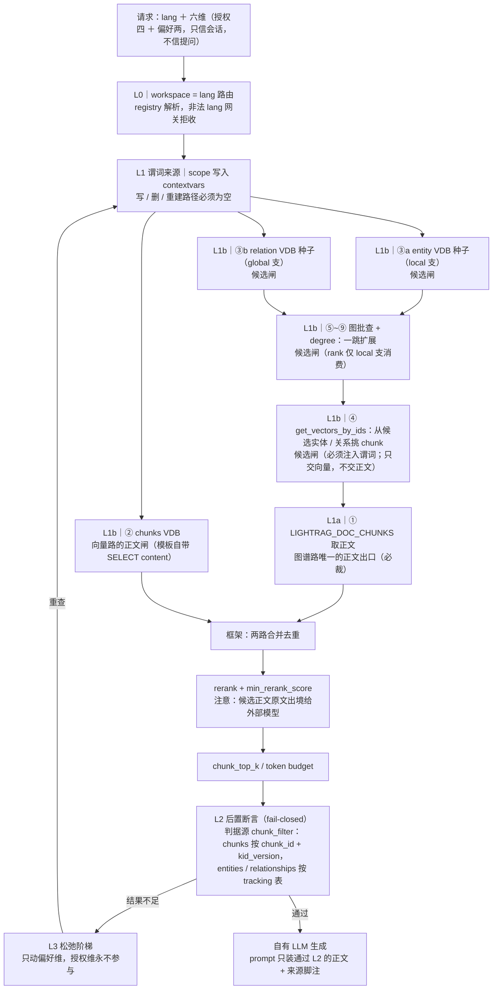

  

**标注口径**：前缀 `L1a｜`／`L1b｜` 是**授权强度等级**（§2.4），不是执行顺序。① 属 L1a，是图谱路唯一的正文出口；其余 **9 个注入点**（②③a③b④⑤⑥⑦⑧⑨）属 L1b，其中只有 ② 是正文闸（向量路正文随结果一起返回），其余 **8 个是候选闸**。`L1 谓词来源` 是请求上下文里的 scope 谓词，同时喂给 L1a 与 L1b。

  

### 2.3 五层分工

  

「五层」= L0 / L1a / L1b / L2 / L3；L1a 与 L1b 合称 L1（pre-filter）。框架层列在这里是为了标明它**不能**当防线。

  

| 层       | 挡什么                 | 落点                                                                                 | 失败时                                |
| ------- | ------------------- | ---------------------------------------------------------------------------------- | ---------------------------------- |
| **L0**  | 跨语言串料               | `workspace = {lang}`，必须经 `workspace_registry`（§三）                                  | 非法 lang 拒收；workspace 列隔离，无放宽路径               |
| **L1a** | 图谱路的越权**正文**        | `LIGHTRAG_DOC_CHUNKS` 加 scope WHERE（§4.1 ①）                                        | 由 L2 兜住并报警                         |
| **L1b** | 向量路的越权**正文** + 越权候选 | 三张向量表 + 图批查 / degree 方法（§4.1 ②③a③b④⑤~⑨）                                            | 同上；其中只有 ② 与 L1a 同强度                |
| （框架）    | —                   | mix 三路召回（图谱路＝实体 + 关系，向量路＝chunk）/ 一跳扩展 / 去重 / rerank / `chunk_top_k` / token budget | 不设防，且自带出境面（§4.5）                   |
| **L2**  | 框架的一切漏点             | 三条内容通道逐条回查 `chunk_filter`（§五）                                                      | 逐条丢弃；丢弃率超阈值则整批丢弃 + 报警，**绝不记日志后放行** |
| **L3**  | 结果不足                | 只重算偏好维谓词（§六 归组）                                                                    | 重查后必须再过 L2；授权维永不参与                 |

  

生成层在五层之外：prompt 只装通过 L2 的 chunk 正文，脚注 `[i]` = `knowledge.biz_key`。

  

### 2.4 a、b 是授权强度等级，不是执行顺序

  

实际时序是**先召回、后取正文**；授权强度是另一回事：

| 分类视角 | 分组 |
|---|---|
| 授权强度 | 正文闸：①、②；候选闸：③a、③b、④、⑤~⑨（共 8 个） |
| 发生时序 | 先召回：②、③a、③b、⑤~⑨、④；后取正文：① |

  

拆成两层的真正理由是**两条召回路的正文出口不是同一张表**：

- **图谱路**：正文只从 `LIGHTRAG_DOC_CHUNKS` 出 ⇒ L1a（①）是它唯一的正文闸。

- **向量路**：正文在召回阶段就随 `chunks_vdb.query` 的结果一起返回（`operate.py:5122` → `:5133-5139`，向量模板自带 `content`，`postgres_impl.py:9888-9898`）⇒ **L1a 兜不到它**，所以 ② 必须与 L1a 同判据同强度，尽管它归在 L1b。

- 其余（③a/③b 种子、④ `get_vectors_by_ids`、⑤~⑨ 图批查与 degree）只是**候选闸**：改变召回集，不改变能否读到越权正文。② 虽发生在召回阶段，但它随结果返回正文，所以强度上是正文闸。

- 记法：**a ＝ 正文闸（图谱路）；b 里的 ② ＝ 正文闸（向量路）；b 的其余 ＝ 候选闸**。把 L1 合成一层会推出一个错误结论——「裁了候选侧就安全」，而向量路的正文从没被候选闸碰过。

  
  

### 2.5 为什么图谱路必须有 L1a

  

图谱侧的 scope 不做精确归属：**实体取来源并集、边取两端交集**（§8.3），这是刻意选择。于是一个实体只要来源跨权限域，它的来源标识（`source_id` / `chunk_ids`）就必然包含其他权限域的分块标识；图谱路再拿这批标识去分块正文表取正文，而那条 SQL 原生只有 `workspace`。L1a 就是给这条 SQL 补上 scope 谓词。三条结论：

  

- **裁不干净的是实体层，能裁干净的是 chunk 层**——这就是 L1a 存在的理由；六个过滤维都适用，不是某一维的特性。

- **易犯的错**：以为正文出口在向量表，于是只裁向量路；图谱路的正文其实从分块正文表流出（§4.1 ①）。

- **不要改成在实体层做精确过滤**：实体并集语义下只有两种收口——整条实体弃用（多丢：本域内合法的内容一起没了），或整条实体放行（漏放：并集里仍含其他权限域的来源，其正文随即被读出来）。chunk 粒度断言既不多丢也不漏放，所以授权判定必须落在 chunk 层。

**结论：图谱层默认只做召回优化；图谱文本若入 prompt 必须逐条过 L2。授权判定只认 chunk 粒度。**

  

### 2.6 一个真相源

  

| 层   | 表                                                                                                                                                                       | 角色                         |
| --- | ----------------------------------------------------------------------------------------------------------------------------------------------------------------------- | -------------------------- |
| 权威层 | `knowledge`（六个过滤维是它的**行内列**，不存在 `knowledge_scope_*` 表）、`knowledge_version`、`chunk_filter`、`workspace_registry`、`dim_scope_value` / `dim_registry` | 唯一授权判据；管理面只查它              |
| 投影层 | LightRAG 原生表（KV / 向量 / `lightrag_graph_nodes` / `lightrag_graph_edges`）                                                                                                 | 召回用的副本；scope 列从权威层抄入，不作判据 |

  

**三条红线**：

- ① 投影层 scope 列只能从权威层**单向**抄入、同一事务同值（§8.3）；

- ② 管理面只查权威层，禁止 JOIN / UNION LightRAG 表；

- ③ 两层一致性由 §十二.2 nightly 对账保证——投影层没有外键 / CHECK 兜底。

  

---

  

## 三、L0：Workspace 路由隔离（仅 language）

**L0 只做一件事：按语言把请求锁定到一个 workspace；它不承担授权判定，同一语言内的可见性仍由 L1/L2 负责（§四 / §五）。**

### 3.1 命名与注册

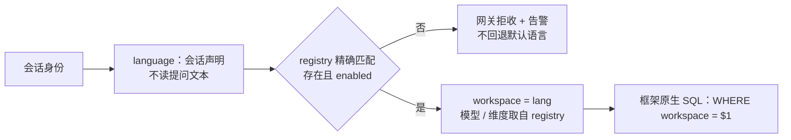

- **唯一路由键是语言**：L0 只按 language 切，不按用户、租户或提问文本切；language 取自会话，不从 URL / 请求体推断。workspace 不按用户/租户切，用户不是 workspace 维度。workspace 名 = `{lang}`（当前 `zh-CN` / `en-US` / `ja-JP`）；字符约束由 `validate_workspace` 兜底（`utils.py:7117-7155`，拒绝 `/`、`\`、`.`/`..`），语言是否合法只认 registry，不靠字符校验。

- **唯一入口是 `resolve(lang)`**：按 language 精确命中 `workspace_registry`，返回 `enabled` / `embedding_model` / `embedding_dim`；未命中或 `enabled=false` 一律网关拒收并告警，不回退默认语言、不做大小写归一（`zh-cn` ≠ `zh-CN`）。`corpus_generation` / `next_boundary` 也在 registry，但只服务 §7.3 的答案缓存代次，不参与路由。

- **`enabled` 是语言级总开关**：`false` = 该语言下线，读写都不进入；全量重建期（新增语言/换模型）的只读降级是运行态，不要用 `enabled=false` 表达。

- **workspace 是框架表的列，不是分表**：框架原生检索 SQL 自带 `workspace=$1`；本方案只负责把合法的 lang 赋给 workspace，不重写这条谓词（L1 只在其后追加 scope 谓词，§四）。只有 §15.3 的分区方案才会带来物理隔离。

- **模型可按语言选型**：`embedding_model` / `embedding_dim` 决定向量表后缀 `<model>_<dim>d`（`base.py:275-300`）；换模型即换表，该语言全量重灌。

- **索引参数是池级**：`POSTGRES_HNSW_M` / `HNSW_EF` / `vector_index_type` 由进程级 `ClientManager` 持有（`postgres_impl.py:2951-2971`、`:2868-2881`），不能按语言差异化；同进程所有实例的 `vector_storage` 必须一致。

- **写路径同样按卡语言路由**：一张卡只投一个 workspace（一卡一语言，§8.3）；请求期 scope 不得带入写路径（§4.4）。

- **语言清单与改名**：语言域以 A.2 `ck_k_lang` + A.5 `dim_scope_value` 的 languages 种子为准；启用后 `lang` 不可改名（改名 = 全量重建）；新增语言按 A.5 清单执行（改 CHECK + 补种子 + 建 registry + 全量重建）。

### 3.2 收益

- **跨语言串料在入口被切断**：不同语言不共享召回面；某语言的发布冻结（§12.2）不会波及其他语言；索引维护默认是表级窗口，M8 分区后才可按语言隔离。

- **写放大最小**：一卡一语言 ⇒ 每张卡只投一个 workspace；若按 region 复制，副本数会随 region 取值成倍放大。

- **运维可分开**：发布与回滚可按语言分批（§14）；索引维护默认是表级 `REINDEX CONCURRENTLY`，M8 启用分区后才可按语言独立重建。

- **模型可按语言选型**：不同语言可使用不同 embedding 模型，互不影响（向量表按模型后缀分表，3.1）。

### 3.3 代价

- **不能跨语言复用**：同一知识若要做多语言，必须按语言各建一份卡与索引；没有跨语言共享，成本随语言版本数增长。

- **语言不可改名**：启用后 `lang` 即 registry 主键，改名 = 全量重建。

- **换模型 = 全量重灌**：`embedding_model` 决定向量表后缀，换模型即换表（§7.3）。

- **索引参数不能按语言差异化**：HNSW 参数与 `vector_storage` 是池级 / 进程级（3.1）。

- **新增语言有固定动作**：改 `ck_k_lang` + 补 `dim_scope_value` 种子 + 建 registry + 全量重建（A.5）。

### 3.4 RLS 的定位（非强制点）

RLS **不是本方案的强制点**，原因见 §15.1：LightRAG 自建表、应用角色即表 owner（默认绕过 RLS），且池化连接没有可靠的按请求 `SET LOCAL` 落点。**部署形态已定案：不按 lang 拆进程**（单进程并发多 workspace），所以「一 workspace 一部署」形态不成立；即便启用 RLS，也只隔离 workspace(=lang)，**从不隔离授权维**。强制点统一为：**子类 + contextvars 拼 SQL（L1a/L1b）+ L2 fail-closed**；RLS 仅保留为日后改拆进程时的可选深度防御。

---

  

## 四、L1：Pre-filter——把 scope 注入 SQL

**L1 只做一件事：把请求侧 scope 变成 SQL 谓词，让越权行在进结果集之前就不被选出。** 本章按四问展开：注入哪些点（4.1）、需要哪些列（4.2）、谓词是什么形态（4.3）、怎么注入与配置（4.4–4.6），最后给出图谱路的取证（4.7）。

### 4.1 L1 的定位与注入点地图

  

**L1 注入的是 SQL 谓词，不是数据、也不是配置。** 在自有的存储层子类方法里，把请求侧 scope 渲染成 SQL 条件（连同它的 `$n` 参数），插进框架那条只带 `workspace` 的查询——目标是让**越权行根本不被选出**，而不是选出来再在内存里丢。五个集合维用重叠谓词 `AND (col = '{}'::text[] OR col && $n::text[])`；`publish_state` 走单值相等、有效期走区间（4.3）。

  

- **只能做在 SQL 层**：LightRAG 没有任何查询期 hook，SQL 由存储实现内部拼好。唯一可改点就是重写那几个方法（机制见 §4.4），并把 `STORAGES` 重指向自有模块（后端类名不许改，见附录 B 约定）。

- **与 L2 的分工**：L1 ＝ 不让它进结果集；L2 ＝ 进了结果集再逐条复核并 fail-closed（§五）。两者共用同一套 `render(FilterAST)`，这正是 §六「阶梯必须与 L2 同构」的技术前提。

- **只做 L2 不做 L1 的三个代价**：正文已离开 DB、可能被 rerank 发给外部模型（§4.5 归因约束）；越权 chunk 白占 `chunk_top_k` 名额、结果集被动短缺（§4.5）；`rank` 与可见边集不自洽（§4.7）。

- **三个数字**：10 个注入点 / 9 个子类方法 / **2 个正文闸（① 与 ②）**。其余 8 点是**候选闸**——不直接决定正文可见性；其中 ④ 影响 chunk 选择，⑧⑨ 影响 local 的 rank 口径（见下表）。

  

**术语（全章统一，只用这两个词）**：

  

- **图谱路** = 召回单元是「实体 / 关系」的路径 —— `local`（`ll_keywords` → 实体 VDB，`operate.py:5182`/`:5235`）、`global`（`hl_keywords` → 关系 VDB，`:5183`/`:5246`）、`hybrid`（两者并跑，`:5258`/`:5268`），以及它们在 `mix` 内的合称。正文出口 = `LIGHTRAG_DOC_CHUNKS`（`:6273` / `:6568`），即 **L1a ①**。

- **向量路** = 召回单元是「chunk 本身」的路径 —— `mode=naive` 的整条路径与 `mix` 内的向量召回（`operate.py:5122` → 调用点 `:5283` / `:6663`）。正文出口 = `LIGHTRAG_VDB_CHUNKS_<suffix>`（模板自带 `SELECT content`，`postgres_impl.py:9888-9898`），即 **L1b ②**。

- 两条路**都用向量检索**，区别只在召回单元与正文出口。全文只用「图谱路 / 向量路」两个词：图谱路含 local/global 两支（实体/关系两路），与向量路（chunk）合起来是 mix 的三路召回；源码标识符 `kg_query` / `_perform_kg_search` / `kg_chunk_pick_method` / `KG_CHUNK_PICK_METHOD` 不改名，不得再引入「KG 路」「向量支」等第三种叫法。

  

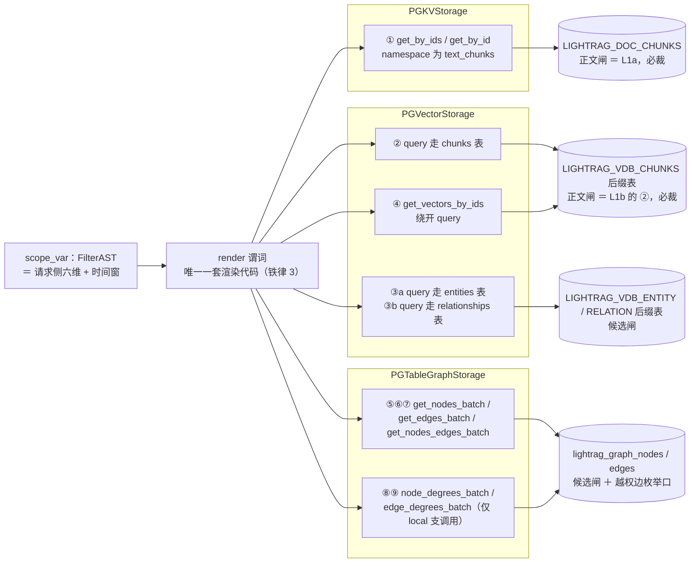

  

**注入点清单**（① ② 是仅有的两个正文闸；④ 与 ① 同源、选 chunk；⑤~⑦ 收窄一跳扩展；⑧⑨ 决定 local 的 rank 口径）

  

| # | 注入点 | 位置 | 作用 | 是否强制 |
|---|---|---|---|---|
| ① | `PGKVStorage.get_by_ids` / `get_by_id`，仅当 `namespace == KV_STORE_TEXT_CHUNKS` | `postgres_impl.py:3316-3322`；模板 `get_by_ids_text_chunks` / `get_by_id_text_chunks`（`postgres_impl.py:9651/9675`） | chunk 正文读取处：图谱路为 `operate.py:6273`、`:6568`；另有 `operate.py:5561`（`_attach_content_headings` 对最终 chunk 回填 heading，**覆盖所有路，含向量路**） | **是（主）** |
| ② | `PGVectorStorage.query`（chunks 表） | `postgres_impl.py:4869-4898`，模板 `SQL_TEMPLATES[self.namespace]`（`postgres_impl.py:4888`，向量模板 key 为 `chunks`/`entities`/`relationships`，见 `:9869-9898`） | **向量路**——同一函数 `_get_vector_context`（定义 `operate.py:5092`，内部发 query 于 `:5122`；调用点 `operate.py:5283`（mix 内的向量召回）与 `operate.py:6663`（`mode=naive` 整条路径）） | **是**（向量模板自身就 `SELECT content`，越权正文可不经 KV 表直接返回） |
| ③a | `PGVectorStorage.query`（`entities_vdb` → `LIGHTRAG_VDB_ENTITY_<suffix>`） | 模板 key `entities`（`postgres_impl.py:9879-9887`），执行处同上 | **local 路种子闸**：`_get_node_data` 的 `entities_vdb.query`（`operate.py:6031`）；裁它只收窄 local 的入口实体集 | 否（召回优化；实体并集语义不可作唯一 Enforcement） |
| ③b | `PGVectorStorage.query`（`relationships_vdb` → `LIGHTRAG_VDB_RELATION_<suffix>`） | 模板 key `relationships`（`postgres_impl.py:9869-9878`），执行处同上 | **global 路种子闸**：`_get_edge_data` 的 `relationships_vdb.query`（`operate.py:6306`）；裁它只收窄 global 的入口关系集 | 否（同上；关系描述同样是并集文本，且 global 排序不吃 degree） |
| ④ | `PGVectorStorage.get_vectors_by_ids` | `postgres_impl.py:5199-5235`，唯一查询期调用方 `utils.py:6032` | 图谱路 `pick_by_vector_similarity` 选 chunk；**绕开 `query()`** | 是（与 ① 同源；**返回 dict、且先读 pending 缓冲，只裁 SQL 分支不够。裁行会使返回条目少于入参，触发框架的条目数不一致保护：分块挑选法静默从 VECTOR 降级为 WEIGHT，且日志会打印被裁掉的 chunk id**） |
| ⑤⑥⑦ | `PGTableGraphStorage.get_nodes_batch` / `get_edges_batch` / `get_nodes_edges_batch` | `pgtable_impl.py:1357-1366` / `:1401-1428` / `:1430-1458`，谓词均只有 `workspace+namespace` | 一跳扩展（`operate.py:6043`/`:6086`/`:6107`/`:6316`/`:6371`）决定哪些边/实体进入，其 `source_id` 再喂给 ① | 建议（漏 ⑦ 会让越权边被枚举，放大 ① 的输入集） |
| ⑧⑨ | `PGTableGraphStorage.node_degrees_batch` / `edge_degrees_batch`（后者内部转调前者，`pgtable_impl.py:1392-1399`） | `pgtable_impl.py:1368-1390`，一个 `COUNT(*)` 聚合内含 src/tgt 两个 `UNION ALL` 子查询，均只带 `workspace+namespace` | 查询期调用点 `operate.py:6044`（与 ⑤ 并发 gather）、`operate.py:6108`，**两处均在 local 支**（global 支不调 degree 方法，`operate.py:6330`/`:6370` 有源码注释）；**degree 直接成为 `rank`**（`operate.py:6124`）并决定一跳扩展排序（`operate.py:6129`） | **是**：不裁 → 排序仍由全集边决定，与 ⑤⑥⑦ 的可见边集自相矛盾；裁 → 必须与 ⑤⑥⑦ 同一套谓词。注：rank 不出现在对外结构里（`utils.py:6874-6895`/`:6911-6921` 不输出 rank），所以这是**正确性**问题而非直接泄漏面 |

  
  

### 4.2 数据前提：哪些表要有 scope 列

  

谓词得有列可查——L1 能在 SQL 层生效，前提是投影表里存在与权威层同值的 scope 列。所以扩列属于注入机制本身，不是可选优化。

  

| 表 | 真实名 | 扩列 | 必要性 |
|---|---|---|---|
| chunk 正文 KV 表 | `LIGHTRAG_DOC_CHUNKS` | `kid_version` + 五个集合维数组（product / year / security_level / asset / region） + `publish_state` + valid_from/valid_to + `scope_sig`（A.7；**不加 `kid`**，用框架自带的 `full_doc_id`） | **必须（主强制点）** |
| chunk 向量表 | `LIGHTRAG_VDB_CHUNKS_<suffix>` | 与上行**完全同列同名**（同源同值，A.7） | **必须**（向量路自身 `SELECT content`） |
| entity 向量表 | `LIGHTRAG_VDB_ENTITY_<suffix>` | 五个集合维数组（A.7，无 publish_state/valid） | 推荐（召回优化；实体并集语义不可作唯一 Enforcement） |
| relation 向量表 | `LIGHTRAG_VDB_RELATION_<suffix>` | 五个集合维数组（A.7） | 推荐（同上） |
| 图谱节点/边 | `lightrag_graph_nodes` / `lightrag_graph_edges` | 五个集合维列（同 A.7） | 建议（控制一跳扩展规模 + ⑧⑨ 的 degree 口径；节点/边表**无后缀**，PK 含 namespace，`pgtable_impl.py:80-97`） |
| 其余 KV/状态表 | `LIGHTRAG_DOC_FULL` / `LLM_CACHE` / `DOC_STATUS` / `FULL_*` / `*_CHUNKS` | 不改 | 靠 workspace + `full_doc_id`（＝ kid）反查权威层；实体/关系类经 tracking 表回落 chunk id（§5.2） |

  

两张 chunk 表的 scope 列必须**同源同值**（同一事务从 `chunk_filter` 抄入），否则 ① 与 ② 会给出互相矛盾的答案；nightly 对账（§12.2）负责发现漂移。

  

**列名与类型见附录 A.7（投影层加列 DDL）**。口径统一为：五个集合维全部是 `text[]`（含 `year`，年份以 4 位字符串代码登记）；`publish_state` 是单值 `text` 枚举；集合维的枚举域登记在 `dim_scope_value`，`publish_state` 的取值域见 A.2/A.3。不使用位掩码或 `region_mask`，本文其余小节按 A.7 的列名书写。加列与框架自身迁移不冲突：LightRAG 在启动迁移里用的就是 `information_schema` 守卫的 `ALTER TABLE ... ADD COLUMN`（`postgres_impl.py:1346-1951`），只检查它自己要的列，不关心多出来的列。

  

### 4.3 scope 取值语义：谓词只有一种形态

  

**唯一口径：卡片侧存「允许值集合」，请求侧给「用户持有值集合」，命中 = 两边重叠。** 六个过滤维 = 授权四维（`product` / `year` / `security_level` / `publish_state`）＋ 偏好两维（`asset` / `region`）；其中五个是集合维（`text[]`，重叠语义），`publish_state` 是单值枚举闸（相等语义）。五个集合维的枚举域集中在 `dim_scope_value`（每个 dim 一行，A.5），不使用区间语义或位掩码。

- **授权/偏好分组（§六 归组定案）**：`product`、`year`、`security_level`、`publish_state` 为授权维（L2 永久断言、阶梯永不放宽）；`asset`、`region` 为偏好维（只影响召回与排序，可按 §六 阶梯放宽）。

- **枚举取值（已锁定）**：`product` ∈ {SPOT（现货）, CONTRACT（合约）}；`security_level` ∈ {TopSecret（绝密）, Confidential（机密）, Secret（秘密）, Public（公开）}；`asset` ∈ {BTC, ETH, USDT}；`region` ∈ {USA（美国）, JP（日本）, KR（韩国）, HK（中国香港）, TW（中国台湾）, UK（英国）}（业务代码，不强制 ISO-3166）；`publish_state` ∈ {DRAFT, IN_REVIEW, PUBLISHED, DEPRECATED, ROLLBACK_PENDING}（查询期只取 `PUBLISHED`）；`year` 为 4 位年份代码（如 `'2024'`），字典按业务日历逐年补登。

- **多值支持（五个集合维）**：`product` / `year` / `security_level` / `asset` / `region` 均为 `text[]`，一张卡可同时携带多个取值——例如同一张英文卡同时适用于 USA 与 UK 两个地区，或同时覆盖 BTC、ETH 两个资产，或适用 2024、2025 两年；请求侧同样可持有多个取值，命中 = 交集非空。

  

**维度计数口径（全文统一）**：**六维 ＝ 授权四维（product / year / security_level / publish_state）＋ 偏好两维（asset / region）**。`valid_from` / `valid_to` 是生效时间窗，独立闸、不计入维度数；全文判据表述为「六维 ＋ 有效期」。

  

- **集合维谓词**（`render(FilterAST)` 对五个集合维只产出这一种形态，L1a/L1b/L2/阶梯共用；`publish_state` 走同一函数的单值相等分支）：

`(card_col = '{}'::text[] OR card_col && $req::text[])` —— 空数组 = 通配（全集群可见），非空 = 与请求值有交集即可。用 `&&`（数组重叠）而不是 `= ANY`，因为用户可能同时持有多个 product/asset 维值；GIN 可服务 `&&`。

- **PG18 起 GIN 支持并行构建**（18.0 notes: "Allow GIN indexes to be created in parallel"），大表建索引成本可接受；配合 `max_parallel_maintenance_workers`。

- **security_level（保密等级，序关系）**：谓词仍是重叠 `(security_level = '{}'::text[] OR security_level && $req::text[])`，但密级是**层级**，不是并列集合——会话侧把用户的单一密级展开成「可读集合」（自身及以下，如 Confidential → {Confidential, Secret, Public}），卡片侧只存自身密级。层级映射是**会话侧展开规则**（配置化），谓词、列与 L2 判据不动；若业务要求严格相等，只改展开规则。

- **year（年份）**：`year text[]`，年份以 4 位字符串代码存（如 `'2024'`），重叠语义同通用谓词；跨年度卡片可存多值，请求侧给用户可查询的年份集合。

- **publish_state（授权维之一，单值枚举）**：查询期要求 `publish_state = 'PUBLISHED'`；它不参与 `&&` 重叠，也不进 `dim_scope_value`（取值域由 A.2 的 `ck_k_publish` 定义）。投影层该列默认 `'PENDING'`（A.7 deny 默认值），未回填行在 L1 即被挡。

- **三个集合授权维禁止空数组**：通配（空数组）只对偏好两维合法；`product` / `year` / `security_level` 在权威层由 `ck_k_auth`（A.2）与 `ck_cf_auth`（A.3）强制非空；`publish_state` 必须显式 `'PUBLISHED'`。投影层没有同等 CHECK：若回填把授权维写成空数组，SQL 会按通配放行；因此回填只能从 `chunk_filter` 抄值，并由 §12.2 对账兜住（A.7 亦注明该残余风险）。

- **请求侧空集 = 该维零授权**：用户在某一维的持有集为空集时，`card_col && '{}'` 恒为 false，该维只剩卡片侧空数组（通配）行可见；请求侧**不存在**「全部」通配写法，需要全量授权时由会话侧显式展开字典全集。通配只属于卡片侧，请求侧一律是显式集合。

- **有效期时间窗（独立闸，不计入维度）**：`valid_from/valid_to` 必须落在区间内，不做空值放行。投影层的 `valid_from` 默认 `'-infinity'` 仅配合 `publish_state='PENDING'` 使用，回填时写权威快照值；二者缺一不可。

- `scope_sig`：六列（product / year / security_level / publish_state / asset / region；publish_state 为单值）各自排序归一后拼接取哈希，见 §十五.2（**PG18 核心内建 `sha256(bytea)`**，入参必须 `::bytea`）。

  

### 4.4 scope 注入机制

  

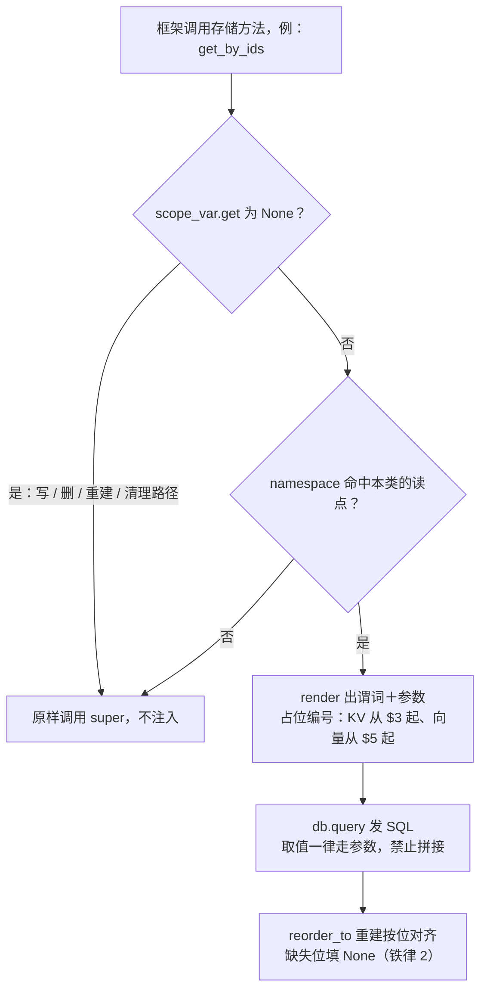

  

**scope 必须走 `contextvars`，不能走模块级全局或线程局部。** 智能客服是 asyncio 单线程高并发；`SCOPE.set(...)` 若为进程全局，A 用户的谓词会被 B 用户的查询读到——**这本身就是越权 bug**。

  

```python
# my_rag/scope.py
from contextvars import ContextVar

scope_var: ContextVar[FilterAST | None] = ContextVar("rag_scope", default=None)


class ScopedPGKVStorage(PGKVStorage):
    async def get_by_ids(self, ids):
        if not ids:
            return []
        ast = scope_var.get()
        if ast is None or self.namespace != NameSpace.KV_STORE_TEXT_CHUNKS:
            return await super().get_by_ids(ids)  # 写路径 / 清理路径 / 非正文 namespace：原样
        sql, extra = render(ast, base=SQL_TEMPLATES["get_by_ids_text_chunks"])
        # 位置参数顺序必须与 $ 编号一致：workspace, ids, 然后谓词
        rows = await self.db.query(
            sql, params=[self.workspace, ids, *extra], multirows=True
        )
        return reorder_to(ids, rows)  # 保持 get_by_ids 的按位对齐契约

    # get_by_id 同型（单条读点），此处略。
```

  

**SQL 构造方式决定了注入可行性（两类模板不同）**：

- **向量模板**：`SQL_TEMPLATES[self.namespace].format(table_name=..., vector_cast=...)` + `params=list(params.values())`，现有 4 个位置参数依次为 workspace / `(1-cosine_threshold)` / top_k / embedding（`postgres_impl.py:4891-4897`）。谓词必须用 `$5+` 占位接在其后，插在 `ORDER BY` 之前（模板见 `:9888-9898`）。

- **KV 模板**：`SQL_TEMPLATES["get_by_ids_" + self.namespace]`，参数只有 `[workspace, ids]` 两个（`postgres_impl.py:3321-3323`），谓词从 `$3` 起。**注意 KV 模板的表名是硬编码 `FROM LIGHTRAG_DOC_CHUNKS`，不走 `{table_name}` 格式化**（`postgres_impl.py:9651-9683`）——别在 KV 模板上期待 `.format(table_name=...)` 生效。

- 两类都**禁止字符串拼接取值**：product / security_level / publish_state 等枚举值一律走 `$n` 参数。

  

**表名与列名的解析**：所有 DDL/校验代码必须走 `namespace_to_table_name(ns)`（`postgres_impl.py:9463`）+ `_generate_collection_suffix()`（`base.py:275-300`）拼真实表名；图/KV 表无后缀，直接常量。**禁止**在方案文档与迁移脚本里出现裸 `LIGHTRAG_VDB_CHUNKS`。

**表名长度约束**：`table_name` 超过 `PG_MAX_IDENTIFIER_LENGTH`（63）时框架在初始化即 `ValueError`（`postgres_impl.py:3911-3916`）。最长基表名 `LIGHTRAG_VDB_RELATION` 占 21 字符，`table_name = base + "_" + suffix` ⇒ 规范化后的 `<model_name>_<dim>d` 后缀 **≤41**（`LIGHTRAG_VDB_CHUNKS` / `ENTITY` 的基名是 19，较宽裕；规范化 = 小写 + 非 `[a-zA-Z0-9_]` 替换为 `_`，`base.py:299`）。§八 的 `[KNOWLEDGE:{kid}]` 前缀、workspace 名都不影响表名，只有 `model_name` 影响 —— 模型选型时必须算这一项（`model_name` 必须非空且稳定：空值会让表名回落成裸基表、只发一条 warning，改名＝换表＝该维度全量重建）。

  

三条铁律：

1. **只在查询期置值**。写路径（`ainsert` / `adelete_by_doc_id`（`lightrag.py:5718`）/ rebuild / purge / `_flush_pending_vector_ops`）必须在 `scope_var=None` 下运行。若删除/重建路径被 scope 污染，越权 chunk 会被读成「不存在」，直接违反该版本 purge 的 fail-closed 不变量（见仓库 `AGENTS.md:94`：purge 缺 recovery anchor 时抛 `RecoveryAnchorMissingError`（`exceptions.py:281`）/ HTTP 409）。→ 后台任务启动前用 `scope_var.set(None)` 显式清空；`asyncio.create_task` 会复制当前 context，别指望隔离。**运行时护栏**：三个子类的全部写方法（`upsert` / `delete` / `drop` / flush 路径）入口处断言 `scope_var.get() is None`，非 None 即抛错——写路径被 scope 污染必须当场炸出来，而不是等对账发现；该断言同步进 §12.3 CI（置值时调用任一写方法必须抛错）。

2. **`get_by_ids` 契约是「按入参顺序逐位对齐，缺失填 None」**（`postgres_impl.py:3325-3343` 的 `_order_results`）。裁切后必须重建对齐，否则 `operate.py:6277`（实体路）与 `operate.py:6572`（关系路）两处 `zip(unique_chunk_ids, chunk_data_list)` 会错位——这是**静默数据错配**，不是报错。例外：`operate.py:5561` 那处调用用 `if not isinstance(data, dict): continue` 兜住 None（`_attach_content_headings`），裁切只会丢 heading 元数据，不会错位。

3. **谓词渲染只有一套代码**（FilterAST）。L1a/L1b/L2/阶梯共用，任何一处手写 WHERE 都视为缺陷。

  

### 4.5 召回预算：什么是预算、为什么要预算

  

**定义：召回预算是「名额」，不是时间。** 它由三层串联的名额组成——

  

1. **候选名额**：每一路各自被允许产出多少条。

2. **竞争名额**：两路合并去重后，经过重排与分数下限，再被一个统一条数上限切一刀。

3. **上下文名额**：进入 prompt 的 token 上限，按整条保留或丢弃来截。

  

所以「预算」既不等于 token、也不等于时间：**token 只是第三层，时间与费用是这三层的下游结果**。只调第三层（给更大的 token 预算）而不给前两层补偿的设计，在窄权限用户身上必然空返回。

  

**两个名额旋钮 + 一个挑选法（互相独立）**

  

| 路 | 旋钮 | 默认 | 语义 |
|---|---|---|---|
| 向量路 | 分块条数上限 | 20（置空回退 top_k=40） | 一次向量召回最多交出的分块数 |
| 图谱路 | 每条命中实体／关系带回的分块数 | 5 | 候选池上限；VECTOR 挑选时总量按 `5 × 命中数 / 2` 估算 |
| 图谱路 | 分块挑选法 | 按向量相似度（VECTOR） | 从每条实体的候选分块里挑哪几条；取不到向量时退化为 WEIGHT（按出现次数加权轮询） |

  

**抬其中一个旋钮不会让另一条路多出一个候选**——这是容量推断里最容易犯的错。

  

**为什么要做这个预算**

  

- **预过滤按比例削减候选**：不预留补偿名额，窄 scope 用户的召回会被自己的权限宽度掐死。命中率 10% 时，默认扫描宽度（`hnsw.ef_search=40`）平均只剩 4 行。

- **名额就是成本与出境量的乘数**：每多一条候选，等于多一段正文发给外部重排模型、多一次断言回查、多一份上下文。预算不只是性能旋钮，**同时是风险旋钮**。

- **两路抢同一批槽位**：不做「合并后重排」的建模，任何单路 top-N 的容量结论都是错的。

- **断言口径依赖它**：L2 看到的永远是预算切完的那批，所以 L1 与 L2 的丢弃率不可互推（§12.1）。

  

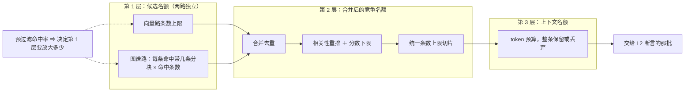

  

**四道串联筛（只有第一道之前存在 scope 谓词）**

  

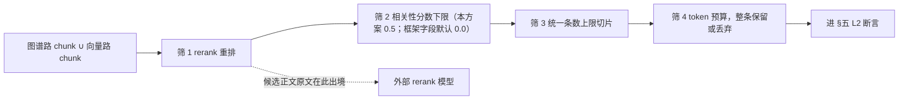

  

**rerank 关闭时**（首发按 §14）：筛 1/2 不存在，只剩「统一条数上限 → token 预算」；候选正文不出境，下面关于出境与分数下限的条目只对 rerank 开启时成立。

**归因约束**

  

- **与授权无关的静默清空必须单列**。相关性分数全低时框架返回空集，现象与「被权限裁干净」一模一样；不分开归因，就会把「阈值设低了」误判成「权限太窄」，白走一轮松弛阶梯——放宽偏好维对这类短缺完全无效。

- **出境面在预算链上有固定位置**：重排那一道会把候选正文原文发给外部模型，且发生在 L2 之前。预算每放大一档，出境量同步放大，这条要进数据出境评估，不只是性能评估。

- **待实测**：两路竞争的相对占比、分数下限与丢弃率的联动，尚未用真实数据标定（附录 C）。

  

### 4.6 运行时参数：影响面有哪些、怎么配

  

**定义：运行时参数 ＝ SQL 发出之后、由数据库执行层自己决定的那组参数**（扫描宽度、是否继续扫描、扫描上限、内存倍数、建索引参数、维护并行度）。它们**不改变「哪些行有资格」**——那是谓词的事；只改变「在有资格的行里能捞出多少、花多少代价」。所以它们是**召回率与延迟的旋钮，不是授权的旋钮**：当成安全配置来调，方向就错了。

  

**参数清单**

  

| 阶段 | 参数 | 默认 | 归谁设 |
|---|---|---|---|
| 查询期 | `hnsw.ef_search`（每次搜索候选宽度） | 40 | 我们（框架不设） |
| 查询期 | `hnsw.iterative_scan`（不够就继续扫） | `off`（关闭） | 我们 |
| 查询期 | `hnsw.max_scan_tuples`（续扫上限） | 20000 | 我们 |
| 查询期 | `hnsw.scan_mem_multiplier` | 1 | 我们 |
| 建索引期 | `POSTGRES_HNSW_M` / `POSTGRES_HNSW_EF` / 向量索引类型 | 见框架默认 | 池级，按部署而非按语言 |
| 维护期 | 维护并行度、并发重建 | 单进程 | 我们 |

  

**影响面（四类，按重要性排）**

  

| 影响面 | 机制 | 配错的表征 |
|---|---|---|
| 过滤后的召回率 | 索引先按距离取固定宽度、再套谓词，命中窄谓词的行数远少于预期 | 权限越窄越容易查不到，且不是空表而是「明明有」 |
| 延迟与扫描量 | 续扫会一直扫到凑够名额或触到上限 | P95 尾部变长，最坏退化成近邻扫描 |
| 索引质量与体积 | 建索引参数决定图的度数与构造搜索宽度 | 上线后才发现召回不足，只能重建索引 |
| 写放大与维护成本 | 索引对死元组敏感，删除式写入会持续退化 | 召回随发布次数缓慢下滑，全程无报错 |

  

**框架不提供查询期的执行层调优入口**：`hnsw.*` 这一组 LightRAG 一个都不设，必须我们在角色／库／连接池层自己配；建索引参数由框架的 `POSTGRES_HNSW_M` / `POSTGRES_HNSW_EF` 提供，但仍是池级。这也是「参数归谁管」的分界线——不要指望升级框架会带来它们。

  

**配置层次（唯一需要记住的规则）**：**随请求变的进谓词参数，不随请求变的进角色／库级默认值。** 因为连接是每查询借还、归还时清空会话态（含预编译语句与会话级设置），所以写在连接回调里、`SET` 或 `SET LOCAL` 进去的值都不可靠——下一次借出时已经没了。

  

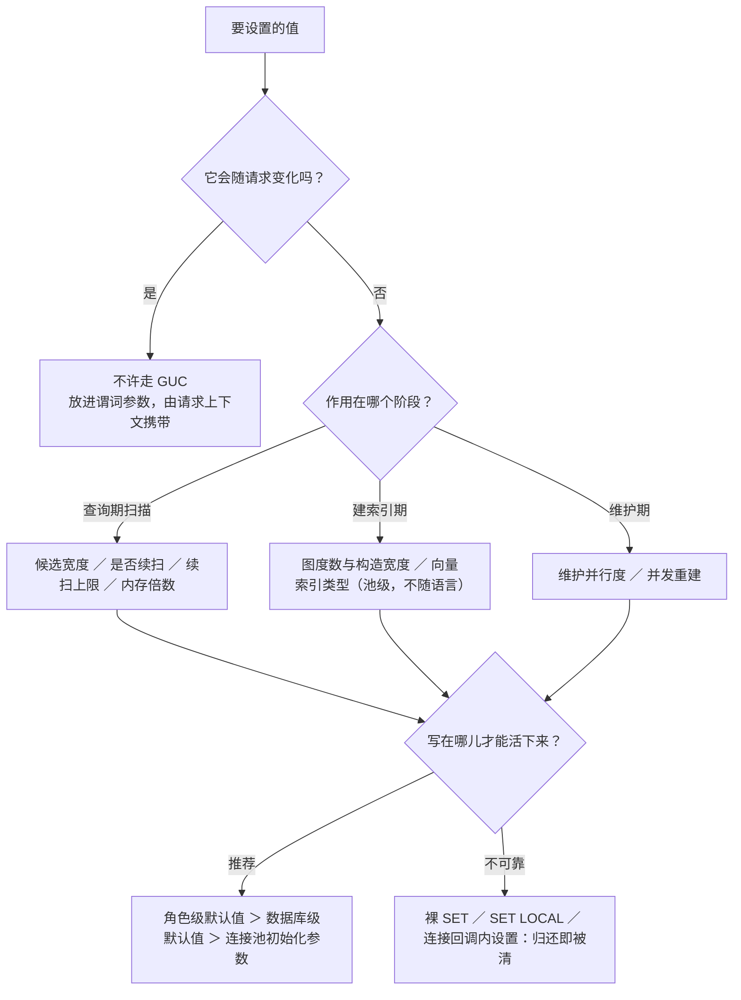

  

**取值建议**

  

| 场景 | 建议 | 代价 |
|---|---|---|
| 窄权限（单 product ＋ 单 region 这类） | 开启续扫并取「宽松顺序」 | 结果不再严格按距离升序返回 |
| 必须保持严格距离序 | 续扫取「严格顺序」 | 召回增益明显更小 |
| 谓词命中率极低 | 先抬候选宽度与续扫上限，再考虑候选名额的预放大 | 尾部延迟上升 |
| 建索引耗时过长 | 提高维护并行度（数组维用的倒排索引在新版本可并行构建） | 占用维护窗口资源 |
| 想按语言差异化 | 只有 embedding 模型可按语言选；建索引参数是池级的，做不到 | — |

  

**红线**：**禁止用会话级参数传 scope 或 workspace**。同一条物理连接跨请求复用，设过的值会泄漏给下一个用户的查询——这也是行级安全在本部署形态下不可用的同一理由。

  

**上线判据**：**必须带真实过滤条件测召回率**，不带谓词的裸测结论对线上毫无意义。「命中率—候选宽度—名额预放大」这条曲线属于未实测项，要在 M0（机制级）与 M7（真实数据定稿）两次标定后才能定阈值。

  

### 4.7 取证：图谱路的深度与排序

  

本节是「图批查只能当候选闸」的结论依据，也是 §4.2 里图节点/边列只标「建议」的理由；被追问「LightRAG 不是多跳吗」「global 不是深层遍历吗」时，答案在这一节。

  

**图谱路的三段流程（1.5.7 实测；这也是 L1a 标「a」却排在时序后段的根因）**

  

| 段 | 手段 | 解决什么 | 打的表 / 调用点 |
|---|---|---|---|
| ① 入口定位 | 关键词 → **向量**检索实体 / 关系的描述向量 | 语义匹配、模糊查询、别名与缩写命中 | `LIGHTRAG_VDB_ENTITY_*`（`operate.py:6031`）、`LIGHTRAG_VDB_RELATION_*`（`:6306`） |
| ② 一跳补全 | **图**批查：命中实体 → 其邻边；命中关系 → 两端节点 | 关联完整性 + 结构显著度排序（`rank` ＝ degree、边 `weight`；**degree 只有 local 路消费**，见下注） | `lightrag_graph_nodes` / `lightrag_graph_edges`（`:6043`/`:6044`/`:6086`/`:6107`/`:6316`/`:6371`） |
| ③ 正文回填 | 用节点/边属性里的 `source_id` 批量回取 chunk | 交付可引用正文；**scope 授权的落点 = L1a ①** | `LIGHTRAG_DOC_CHUNKS`（`:6273` 实体路 / `:6568` 关系路；末端 `:5561` 只回填 heading） |

  

三条关于段② 的硬事实，后文多处依赖：

- **段② 只有 1 跳**：local 与 global 两条分支都是「向量命中的种子 → 恰好一层」后直接返回，新加载的那一层不再展开——检索链路里没有递归、也没有循环。`hybrid`／`mix` 只是把两支的一跳结果做去重并集，种子始终是向量命中集、不是上一层的产物。框架另有按深度展开的图遍历接口，但它只服务 SDK 的图导出与可视化路由，**不在检索路径上**：按标签精确取子图、无相关性排序、无 scope 谓词、被节点数上限截断，且绕过 L1 与 L2，因此不得当检索通道使用。

- **段② 不产生新的语义相关性。** 排序输入是 degree/weight 这类结构量，语义判断全部在段① 完成；所以图批查（注入点 ⑤~⑨）只算「召回优化 + 越权边枚举口」，不能当授权判据——能当判据的是段③ 的 chunk 粒度（实体是并集语义，§2.5）。

- **`degree` / `rank` 只有 local 路消费**：local 把节点与边的度数当作 `rank`，并按 `(rank, weight)` 给一跳扩展排序；global 保持向量相似度顺序，源码里明确不取度数。⇒ 注入点 ⑧⑨ 只影响 local 支的顺序，对 global 支只需断言「未调用度数方法」；两条支路的分块挑选默认按向量相似度（`VECTOR`），取不到向量时才退化为按出现次数（`WEIGHT`）；两种方式都与 `rank` 无关，所以 ⑧⑨ 漏裁是**排序正确性**缺陷，不新增泄漏面。§12.2 的 degree 口径一致性与 §12.3 的 rank 断言因此**只对 local 支成立**，写成通用断言会误报。

**术语澄清：dual-level ≠ 多跳，上游文档的措辞不能当机制依据（评审必问）。** 所谓「双层检索」指**关键词分层**（低层关键词打实体、高层关键词打关系），不是遍历深度；两支深度对称、都是一跳，**别把 local / global 读成「浅层／深层」两级遍历**。上游 README 里「关系链、覆盖宏观主题、跨文档推理」的说法与实现不符——代码不构造链，据它设计召回会直接落空。真正的「跨文档／宏观」来自两处，且都不在查询期遍历里：① 抽取期把同一对实体的边跨 chunk 合并描述与来源，所以**一条边自带多卡多文档的证据**；② hybrid／mix 对两支结果集做去重并集，共享节点让结果**看起来**成链，实为两次独立一跳的重叠。⇒ **链式完整性不能依赖 `mode=mix`**：链上任一环没被向量召回就断，框架也不校验两环端点是否相连。确需链式判定（如 设备→账户→权限等级→可执行动作）必须在检索之外另定手段——查询分解后多次 mix、应用层显式关联表，或受控地物化边（该入口无变更日志、不预写恢复锚点，须配对账与图谱修复工具）。

  

---

  

## 五、L2：后置断言（三条内容通道，fail-closed）

**L2 只做一件事：对框架返回的每条内容，用权威快照重新判一次；判不了就丢，绝不放行。** 本章回答：为什么需要（5.1）、判什么（5.2）、怎么判（5.3）、证据在哪（5.4）。

### 5.1 为什么要断言

  

L1 的强度等价于一个假设：**10 个注入点全部生效、且投影层的 scope 副本与权威层同值**。这个假设不可自证，所以必须有 L2。

  

1. **注入点会静默失效。** 任一处漏实现、框架升级后方法改名或被内联、新调用面绕过自有子类、渲染代码与列名漂移——症状都是「查得到、放行了」，而不是报错。L2 把这些单点失效变成可观测的丢弃事件。

2. **L1 的判据住在副本上。** 投影层的 scope 列是从权威层抄来的，一致性靠对账而非约束保证；副本停在旧值时，L1 会按**过期授权**放行。L2 用权威快照复核，是唯一能发现「副本漂移已被利用」的地方。

3. **有些内容通道根本不在注入点管辖内。** 实体与关系的描述是多卡合并的并集文本，它的可见性不能由图节点自带的来源视图证明（那个视图是截断过的），只能回落到 chunk 粒度重新判一次。

4. **授权语义要求 fail-closed。** 默认动作必须是「查不到即丢弃」，而不是「查不到即放行」。L1 是尽力而为的裁剪，L2 才是最终裁决——承诺是否成立取决于后者。

5. **只有 L2 可举证。** 合规要回答「这条回答凭什么给他看」，需要逐条、可复现的放行/丢弃记录（内容、依据的 chunk、不通过的维度）。L1 的丢弃发生在 SQL 内部，做不出这种归因。

  

一句话：**L1 决定召回质量与出境风险，L2 决定合规承诺是否成立。** 因此 L2 不能被「L1 已全绿」的测试结论替代。

  

### 5.2 对哪些属性断言

  

断言的对象是「**这一段内容能不能给这个用户看**」，与相关性、排序分、来源类型一律无关。判据是绑在 chunk 上的完整授权快照：**授权四维（product / year / security_level / publish_state）＋ 有效期时间窗**（偏好两维 asset / region 由 L1 谓词约束，L2 只按维打点、不做 fail-closed 判定，见下条与 §6.1）；另加两条前置——该 `chunk_id` 在权威快照里**查得到**，且快照的 `kid_version` **不落后于** `knowledge.current_version`。

  

- **不纳入断言的属性**：lang（由框架的 workspace 列过滤保证，不参与逐条复核）；任何相关性/权重/rerank 分数（不是授权判据）；正文文本本身（描述里出现别国名称不构成越权，判定只看来源集合，不做关键词扫描）。

**三条通道的判据落点不同**：

  

| 通道 | 判据对象 | 说明 |
|---|---|---|
| chunks | 该 `chunk_id` 自己的快照 | 直接判授权四维（含 publish_state）＋ 有效期（偏好维只打点） |
| entities | 该实体**贡献 chunk 的全集**回落后的快照 | 以 tracking 清单为准，不用描述自带的来源视图 |
| relationships | 同上 | 同上 |

  

- **图谱两通道的口径定案「全部来源均通过授权四维＋有效期」**，而不是「至少一个来源通过」。偏好维不参与（见下条）。代价是多丢一些有用实体，收益是与并集文本的实际暴露面对齐。

- **偏好维不进 L2 断言（与 §6.1 不变量同构）**：能放宽的维度就不能参与 fail-closed 断言——L2 只裁决授权四维（含 `publish_state`）＋ 有效期；偏好两维（asset / region）由 L1 谓词约束，L2 仅记录其取值命中情况用于短缺归因，不据此丢弃。

  

### 5.3 怎么断言

  

- **时机**：框架返回之后、自有 prompt 组装之前；必须晚于框架自身的 rerank、阈值筛、切片与 token 截断，否则 L1/L2 两套丢弃率口径混算（§12.1）。

- **方式**：把三条通道回落出的全部 `chunk_id` 汇成一个集合，**一次批量回查**权威快照（join 键 = `chunk_id + kid_version`，取与投影行同版本的快照；`chunk_id` 全局唯一，无需 workspace）；谓词由与 L1 同一套渲染代码产出（同构是 §六 阶梯成立的前提）。禁止逐条循环查询，禁止在任何地方手写第二套 WHERE。

- **处置阶梯**：逐条不通过 → 丢弃该条；批次丢弃率超阈值 → 整批丢弃 + 重查 + 报警；**「查不到」一律按不通过处理**。L2 的失败绝不允许只记日志后放行。

- **丢弃后不原地补位**：数量不足走 §六 的松弛阶梯，且只动偏好维。

- **最小暴露**：默认只把通过 chunks 通道的正文送进自有 LLM；实体/关系结果仅用于打点与越界定位。

- **可观测**：按 workspace × 通道记录丢弃率与不通过维度；这些指标同时是越权 CI 的断言对象。

- **不留缓存侧门**：断言结果不得进入任何跨用户缓存；自有 LLM 的缓存 key 必须按 §7.3 含 `scope_sig` ＋ 语言 ＋ `corpus_generation`（可见集合代次，含有效期边界）＋ 模型/提示版本 ＋ 检索参数。

  

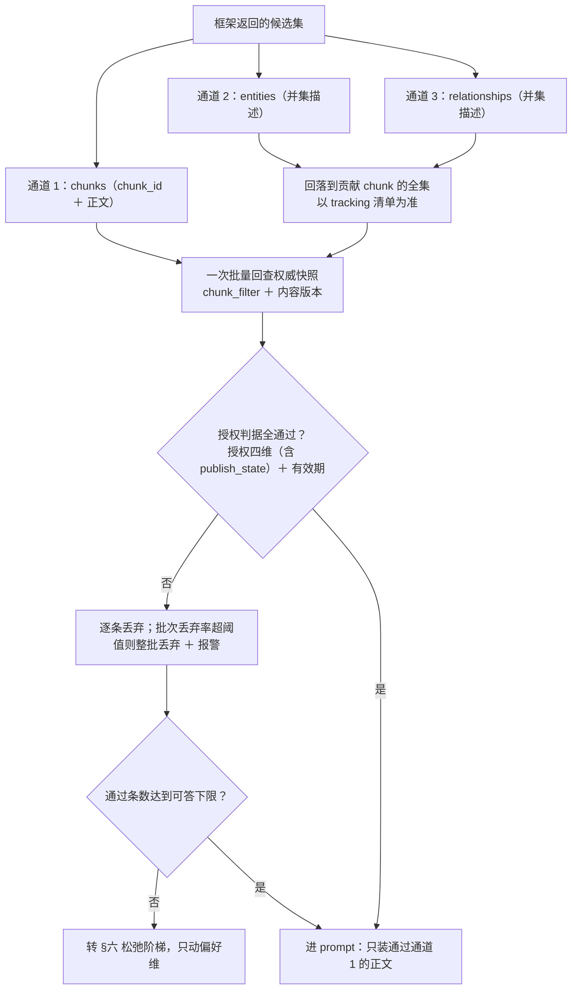

  

### 5.4 取证与实现细节

  

上面三节的每条结论在这里落到具体行号；本节不新增任何口径。

  

**断言的输入形态（凭什么能按 chunk_id 判）**

  

`rag.aquery_data(q, QueryParam(mode="mix", top_k=..., chunk_top_k=..., user_prompt=...))` 返回 `data.chunks[].chunk_id` 已核实：向量路取 `LIGHTRAG_VDB_CHUNKS.id`（`operate.py:5139`），图谱路取 `LIGHTRAG_DOC_CHUNKS.id`（`operate.py:6281`、`:6576`），经 `convert_to_user_format` 原样透传（`utils.py:6940-6947`）；`references` 由同一函数固定返回（`utils.py:6969` 的 `"references": references`），不需要额外开关。

  

**三通道判定表（① ② ③ 与 §5.2 的 chunks / entities / relationships 一一对应）**

  

| 通道 | 数据 | 断言方式 | 不通过处置 |
|---|---|---|---|
| ① chunks | `data.chunks[].chunk_id` + `content` | join `chunk_filter`（键 = `chunk_id + kid_version`，A.3）复核 §5.2 的授权判据（授权四维，含 publish_state）＋ 有效期 | 逐条丢弃；丢弃比例超阈值 → 整批丢弃 + 报警 |
| ② entities | `data.entities[].description` | 权威来源是**分块跟踪清单** `LIGHTRAG_ENTITY_CHUNKS`，据此回落到 chunk id 集再 join `chunk_filter`；`source_id` 是被截断的视图，**不可当判据**（用它即 fail-open）。tracking 表主键本就是 `(workspace, id)`（`postgres_impl.py:9622`），回落天然按语言隔离。任一来源未通过授权四维＋有效期即整条丢弃（全部来源均须通过） | 默认：**不入 prompt**；启用图谱文本时按左列丢弃 |
| ③ relationships | `data.relationships[].description` | 同上，权威来源为 `LIGHTRAG_RELATION_CHUNKS`；任一来源未通过授权四维＋有效期即整条丢弃（全部来源均须通过） | 默认：**不入 prompt**；启用图谱文本时按左列丢弃 |

  

**为什么图谱两通道必须单独取证**

  

- 实体/关系描述是**多卡合并的并集文本**。并集发生在**摄取期**（以实体合并为例：`operate.py:2483-2485` 合并 description、`:2511-2545` 合并 source_id 并按 cap 取舍，含 `:2539`「跳过被 cap 丢弃的 chunk 贡献的 description」；关系同型），查询期只是把存好的整段 `description` 原样取出（`pgtable_impl.py:1357-1366` 无 scope 批查 → `utils.py:6878`/`6915` 输出）；`operate.py:5867-5872` 是 `_build_context_str` 拼 prompt 模板，不是并集点。只断言 chunk_id 完全覆盖不到它。

  
  

**落点：在框架裁剪之后、自有 prompt 组装之前**

  

- **落点顺序**：L2 在框架的 rerank / `min_rerank_score` / `chunk_top_k` / token 截断**之后**，所以「被框架丢掉的」不会进 L2 统计；且分母不同（L2 只看预算切完的那批），L2 丢弃率与 L1 不可直接比较，两套指标不要混算（§12.1）。分通道阈值须注明这一点。

  

- 落点在自有 prompt 组装之前；但注意 `aquery_data` 已在框架内完成预算筛选与 context 组装（`utils.py:6324-6369`，`operate.py:5867` 的 `_build_context_str`），我们拿到的是结构化 `data`。丢弃后**数量不足走 §六**，不要原地补位。

  

**处置与阈值**

  

- 任一条不命中 → 该条丢弃；同一批次丢弃率 > 阈值（见 §12.1，按通道分别统计）→ 整批丢弃 + 重查 + 报警。**L2 的失败绝不能只记日志后放行。**

  

**默认策略与严格度选择**

  

- **默认策略（推荐）**：自有 LLM 的 prompt **只装通过 ① 的 chunk 正文**。`data.entities/relationships` 仅用于内部诊断（打点、越界定位），不进生成。这样 ②③ 的「并集文本」不可能泄漏，且不需要在实体层做精确过滤（与「不在实体层 fork merge 逻辑」的取舍一致）。

  

- 需要图谱文本入 prompt 时，必须逐条走 ②③ 断言，并在文档/代码注释里留痕：并集语义下实体描述**可能包含其他权限域取值的文案片段（六个过滤维都一样，不是某一维的特性）**，判定标准按 §5.2 定案为「全部来源均通过授权四维＋有效期」；成本是多丢一些有用实体。

  

---

  

## 六、L3：松弛阶梯（必须与 L2 同构）

  

**L3 只动偏好维，每放一阶都必须重查并重跑 L2；它不放宽任何授权条件，也不产生新的可见内容。** 本章回答：为什么松（6.1）、何时松（6.2）、怎么松（6.3）。

  

### 6.1 为什么要松弛

  

授权过滤天然让窄权限用户的命中集变小。如果「结果不足」只能靠加大 top-N 来解决，代价是把不相关内容塞进上下文——**合规与体验的张力不在「给多少」上，而在「按什么条件给」上**。松弛阶梯就是把这条张力限定在业务偏好这一侧释放，授权那一侧永不参与。

  

- **不松弛的两种塌法**：直接空返回（用户体感是「问不到」），或转人工兜底（成本不可控）。阶梯让不足变成**可度量、可解释、可回放**的降级序列，而不是二值结果。

- **核心不变量（同构的根据）**：**放宽只改 L1 谓词，不改 L2 判据**。由此得到两条硬约束——可松维不能出现在 L2 断言里，否则放宽空转（结果仍会被 L2 丢掉）；L2 断言的维度不能放宽，把授权维从断言里撤下再放宽就是绕过授权。偏好两维本来就不在 L2 判据，授权四维＋有效期则永不撤下，两者天然满足。

- **默认安全**：维度分组由 `dim_registry` 登记决定，**未登记的维度一律按授权维处理**（不可松）。

- **松弛不产生新数据**：每一步只是去掉一个偏好维的谓词约束，授权维谓词始终在场；因此阶梯的任何一步都不可能让越权内容通过。

  

### 6.2 什么时候松弛

  

触发判定只看一个量：**L2 断言之后的通过条数**低于可答下限。**可答下限**＝可入 prompt 的正文条数下限：只数通道 ① 的 chunk（图谱文本默认不进 prompt，不计入），取业务配置且不得低于 1；计数发生在框架重排与预算截断之后（§5.4）。不在 L1 之后判（L1 有丢弃是设计预期），也不在框架裁剪之前判（框架自己还会丢）。

  

**先归因，再决定放不放宽。** 归因依据是 L2 逐条丢弃记录中的失败维度（§5.2 偏好维只打点）与 L1 谓词命中数；两者任一缺失即视为归因不成立。短缺只有三类原因，其中只有一类能靠阶梯解决：

  

| 归因 | 处置 | 是否进阶梯 |
|---|---|---|
| 授权四维 / 有效期 / lang 裁切 | 停止放宽，报警；**空结果对该用户合法** | 否，永不 |
| 相关性阈值筛掉、或 token 预算截断 | 调相关性阈值或上下文预算 | 否（放宽 scope 完全无效） |
| 偏好维裁切（asset / region） | 进入阶梯 | **是** |

  

- **不触发的两种情形**：① 授权四维 / 有效期 / lang 导致不足——立即返回空结果并报警，不进阶梯；② 归因不成立（打点缺失或三类混算）——按「不放宽」处理并补打点，宁可空返回也不猜。

- **有上限**：阶梯固定两阶（asset → region），每阶只走一次；走完仍不足则返回「暂无可答复内容」＋兜底话术，不做无限重查（避免成本失控与放大越权面）。

- **频繁触发即配置问题**：某一偏好维被反复放宽，说明该维的取值配置或归组有误，应修配置而不是继续放宽（单维放宽率初值 30%，§12.1）。

  

### 6.3 怎么松弛

  

**第 0 步：先归组，再谈放宽。** 每个集合维必须登记在 `dim_registry`，标注授权维或偏好维；`publish_state` 是独立闸、`lang` 是 workspace 路由，两者不进字典但同属不可松：

  

| 组 | 维度 | L2 是否断言 | 阶梯可否放宽 |
|---|---|---|---|
| 授权维 | `product`、`year`、`security_level`、`publish_state`；另加有效期时间窗 | **是，永久** | **永不** |
| 路由维 | `lang`（=workspace） | 否（L0 路由隔离，§三） | **永不** |
| 偏好维 | `asset`、`region` | 否（只影响召回/排序，仅打点） | 可，按 `asset → region` |

  

> 归组互斥：登记为 `authorization` 的维度自动进入不可松清单；要改归组（可松 ⇄ 不可松）必须走合规签字并同步 A.5 的 `dim_registry` 种子。`dim_registry` 只登记五个集合维（A.5）；`publish_state` 与 `lang` 按不可松硬编码。

  

- **放开顺序固定且逐阶**：asset → region。一步只去掉一个维的谓词，其余不动；已是通配的维直接跳过（空转无意义）；顺序写进配置，运行期不得自适应。

- **同构执行**：阶梯的每一步都复用同一套谓词渲染与同一条 L2 断言，形成「放宽一阶 → 重查 → 再断言 → 再计数」的闭环。**任何一步都不许跳过 L2**——这是「L3 必须与 L2 同构」的确切含义。

- **重查不得复用旧结果**：阶梯每步的 scope 已变化，自研答案缓存按 `scope_sig` 分键，天然不会命中上一阶（§7.3）；重查结果本身也永不入缓存（§7.1）。关键词由 NLU 前置传入（策略 A 关闭框架 keywords 缓存），跨用户缓存一律不得参与。

- **全程打点**：记录阶梯步数、被放宽的维、最终是否可答；这些指标同时是「配置有误」的告警源（§12.1）。

  

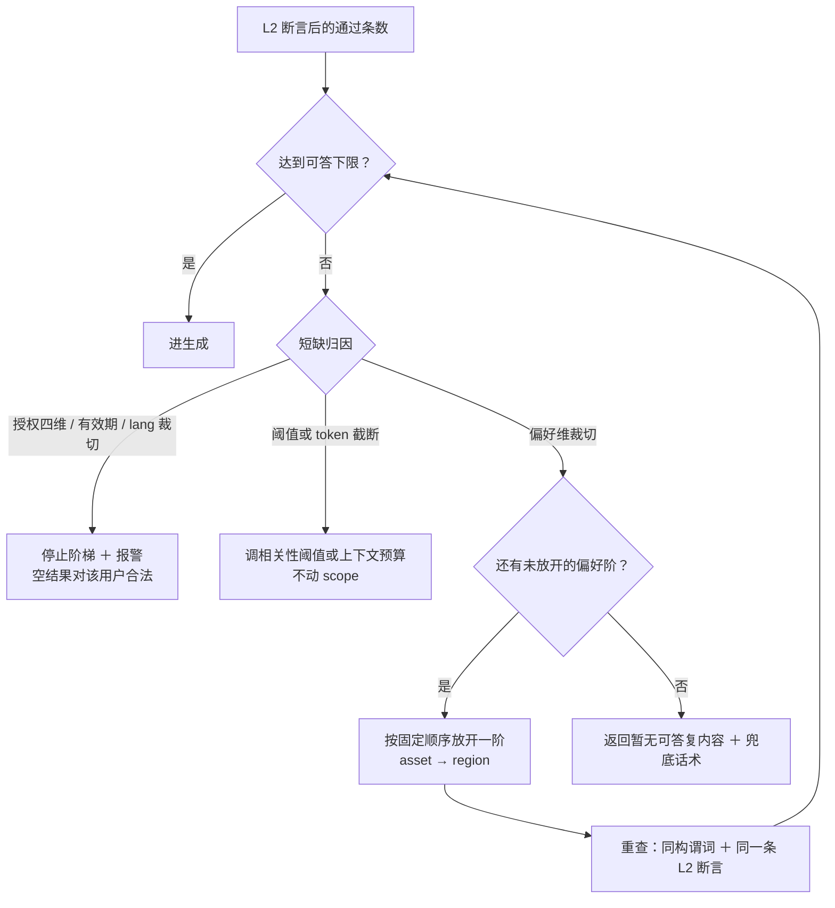

  

---

  

## 七、缓存策略（按调用面区分）

### 7.1 结论：哪些地方该缓存，哪些绝对不能

**一句话判据：缓存值是否随「可见集合」变化——会变（正文、答案、空结果/拒答、L2 结论，含有效期到点带来的进出）就必须按 scope ＋ 可见集合代次分键；不会变（抽取、embedding）才可跨用户复用。**

- **可跨用户复用**：写入期的实体/关系抽取（属发布过程，不存在跨用户读）；embedding / 向量复用（读取仍受 workspace ＋ L1 谓词约束）。keywords 值不含正文，单独看无授权风险，但**策略 A 下随查询侧缓存一并关闭**（§7.3），由自研 NLU 前置传入抵消（§9.3）。
- **必须按 scope ＋ 可见集合代次分键**：最终回答、空结果/拒答。它们取决于当时可见的那批 chunk；只按问题文本缓存，等于把别人的可见范围讲给他听。
- **永不缓存**：L2 断言的判定结果（判定本身就是授权裁决）；松弛阶梯的重查结果（每步必须重新走 L1/L2，命中上一阶结果等于阶梯白走）。
- **一切只以问题文本为 key 的自研缓存都禁止**：上下文缓存、prompt 缓存、检索结果缓存、空结果缓存。

### 7.2 框架和数据库各提供了什么

- **框架侧：三类 LLM 缓存 ＋ 一张持久投影表**。`keywords` / `extract` / `query` 同住 `LIGHTRAG_LLM_CACHE`，按 `cache_type` 分；向量/embedding 是持久投影，不是缓存。查询侧缓存的 key **不含 scope，也不含检索上下文**——框架按「一套部署＝一个权限域」设计，该假设在本方案的多权限域形态下不成立。
- **两个独立开关**：`enable_llm_cache` 管查询侧（keywords ＋ answer，`utils.py:4161-4162`）；写入期抽取由 `enable_llm_cache_for_entity_extract` 单独控制（`utils.py:4163-4165`、`:5299`）。策略 A 只关前者，不动后者。
- **数据库侧没有结果缓存可用**：pgvector 只提供索引与预计算；共享缓冲区只加速字节读取；连接归还清空会话态（`postgres_impl.py:636-665`），任何依赖「连接残留状态」的技巧都不可靠（同 §4.6 禁止 session GUC 传 scope）。
- 归纳：**可复用的是「计算」，不可复用的是「授权判定」。**

### 7.3 怎么用这些缓存

**定案（策略 A）：`enable_llm_cache=False` 关闭查询侧 keywords ＋ answer；`enable_llm_cache_for_entity_extract` 保持开启（默认 True），写入期抽取缓存保留。** keywords 由自研 NLU 通过 `hl_keywords` / `ll_keywords` 前置传入（`base.py:137-141`、`operate.py:4866-4867`），每查询可省一次抽取调用；任何绕过开关的内建旁路（塞会话历史等）一律禁止。

**决策表**

| 缓存对象 | 用不用 | key 必须包含 | 失效／淘汰 |
|---|---|---|---|
| 写入期抽取（extract） | 用（独立开关） | chunk 内容 ＋ 模型/提示版本（框架自带） | 换模型/提示 → 新 key；无授权维度 |
| keywords（框架） | 不用（策略 A 关） | — | — |
| query-answer（框架） | 不用（策略 A 关；`aquery_data` 不生成） | — | — |
| 自研答案缓存（可选，默认不启用） | 条件启用 | `question_norm` ＋ `language` ＋ `scope_sig` ＋ `corpus_generation`（可见集合代次，含有效期边界） ＋ `model_id` ＋ `prompt_version` ＋ 检索参数（mode / top_k / chunk_top_k / rerank 开关） | 代次推进即失效（发布/撤回/回滚/有效期边界）；旧代次整批淘汰 |
| embedding / 向量 | 用（持久投影，不是缓存） | 内容 ＋ 模型名 | 换模型名＝换表＝该维度全量重灌 |

**自研答案缓存（若启用）的 key 规则**

- `scope_sig` 覆盖六个过滤维（§十五.2），`language` 是 workspace；两者缺一即串权限域。
- `corpus_generation` 是**按语言的可见集合代次**，不是「内容版本」：只要可见集合变了就必须推进。发布/撤回/回滚在**每个可见性变化点**自增（`workspace_registry.corpus_generation`，A.4；§8.3）：删除旧投影之前、回填事务内各推进一次（新卡只有后者，撤回只有前者）；多段提交不能只在最后一段推进。框架 answer 缓存的 key 不含检索上下文，只靠 TTL 会在改版/撤卡后返回旧答案。
- **有效期边界也算可见集合变化**：`valid_from` 到点卡片进入、`valid_to` 到点卡片退出，二者都不伴随任何写事务。做法：`workspace_registry.next_boundary` 持有该语言最早的未来边界（写事务内重算，A.4／§8.3）；查询入口在**读缓存之前**做条件推进——`UPDATE workspace_registry SET corpus_generation = corpus_generation + 1, next_boundary = <按该语言 PUBLISHED 卡片重算> WHERE lang = $1 AND next_boundary IS NOT NULL AND next_boundary <= now()`，随后再读代次。并发下同一行的锁序保证「先推进、后查缓存」，两个实例不会同时命中旧代次。
- `question_norm` 只做 trim、空白折叠、按语言的大小写归一；key 存哈希，不落原文。
- 检索参数（mode、top_k、chunk_top_k、rerank 开关/模型/阈值）必须进 key；否则同一问题在不同预算下会串结果。
- **失效只认代次，TTL 只能做容量回收兜底**；key 里不放时间桶——时间桶要么漏掉桶内的边界失效，要么把缓存切成时间片。新代次开始后旧代次条目可整批删除。

**两种调用面**

| 调用面 | 用法 | 必须同时成立 |
|---|---|---|
| `aquery_data` ＋ 自有 LLM（当前架构） | 策略 A：框架 answer/keywords 缓存不触发 | 自研答案缓存按上表 key；不缓存 L2 结论 |
| 改用 `aquery` 或框架 `/query` | 同样显式 `enable_llm_cache=False` | keywords 用 `hl/ll_keywords` 预传；生成前仍须完成 L2 |

**两条禁止**

- 不得用「塞一段会话历史」绕缓存（它会顺带改变模型行为，旁路不能当机制）。
- 不得在 keywords 缓存的命中分支里做任何 scope 相关判断（策略 A 下该分支不存在；若单独开启，值也不得携带 scope 语义）。

### 7.4 收益与成本

| 项 | 收益 | 成本 / 风险 |
|---|---|---|
| keywords 抽取缓存 | 策略 A 下不启用；若单独开启，每查询省一次 LLM 调用 | 值不含正文、无授权风险；但开关是全局的，策略 A 选择关闭并由 NLU 预传替代 |
| 写入期抽取缓存 | 重灌与改版时省大量抽取调用 | 仅在发布过程使用，无跨用户读 |
| 向量 / embedding 复用 | 省 embedding 调用与写入 | 换模型名＝换表＝该维度全量重灌，扩容前先定名 |
| 自研答案缓存（可选） | 重复问题命中率可观 | key 按 scope × 代次分裂：条目数上升、命中率下降；容量按「语言 × scope_sig × 代次」估算，旧代次整批淘汰；漏一个 key 维度＝串答案或陈旧（P0） |
| 关闭框架查询缓存（策略 A） | 消除跨用户串答案面 | 每查询多一次关键词抽取，可由 NLU 预传抵消 |

**净结论**：当前架构（`aquery_data` ＋ 自有 LLM）默认不启用自研答案缓存；性能收益主要来自写入期抽取。若启用答案缓存，其 key 设计是本方案唯一一处「写错就泄漏或陈旧」的自研代码，命中率与条目数须按语言/代次打点（§12.1）。

### 7.5 取证与实现细节

| 缓存 | 位置 | key 实际内容 | 结论 |
|---|---|---|---|
| embedding / 向量 | 投影表 | — | 读取受 workspace ＋ L1 谓词约束，无需额外处理 |
| keywords | `LIGHTRAG_LLM_CACHE`（keywords） | `mode + text + language + llm_identity`（`operate.py:5003-5013`） | 无 scope；值仅关键词，不构成披露面；**策略 A 关闭** |
| extract（写入期） | 同上（extract） | chunk 内容；`mode='default'` 走独立开关（`utils.py:5299`） | 由 `enable_llm_cache_for_entity_extract` 控制，策略 A 保留 |
| query-answer | 同上（query） | `mode + query + response_type + top_k/chunk_top_k + token 预算 + keywords + user_prompt + rerank + llm_identity`（`operate.py:4738-4765`） | 无 scope、无检索上下文；`aquery_data` 不生成（`lightrag.py:4120`）→ 当前架构不触发；策略 A 关闭 |
| 自研答案缓存（可选） | 自有存储 | 见 §7.3 | 唯一按 scope ＋ 代次分键的自研缓存；默认不启用 |

**证据**：`enable_llm_cache=False` 只让查询侧（`mode != 'default'`）缓存不命中（`utils.py:4161-4162`）；抽取（`mode='default'`）走 `enable_llm_cache_for_entity_extract`（`utils.py:4163-4165`、`:5299`）。keywords 预传由 `QueryParam.hl_keywords/ll_keywords` 承接（`base.py:137-141`、`operate.py:4866-4867`）。

  

  
  

---

  

## 八、入库与发布流水线

  

### 8.1 整体：六个阶段与失败出口

  

入库不是「把内容塞进 RAG」，而是**把一次发布变成一份带授权快照的投影**。①–③ 是发布闸，任何一道不过都不进入投影；④–⑥ 负责投影、验收与按需维护，失败不回滚已提交内容，而靠 deny 默认、对账重放与维护窗口收敛。

  

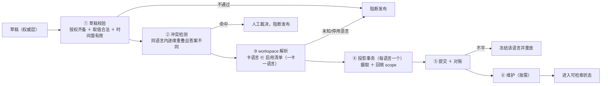

  

| 阶段 | 管什么 | 通过条件 | 不通过处置 |
|---|---|---|---|
| ① 草稿校验 | 授权数据是否完备可信 | 授权四维齐全（`product` / `year` / `security_level` 三个集合维非空、`publish_state = 'PUBLISHED'`）、偏好两维可空（空＝通配）、五个集合维取值都在 `dim_scope_value` 内、`security_level` 层级可解析、有效期时间窗自洽（`valid_to IS NULL OR valid_to > valid_from`）且未整体过期（`valid_to IS NULL OR valid_to > now()`） | 直接阻断，不进入发布队列 |
| ② 冲突检测 | 同一权限域内是否存在互相矛盾的答案 | 同语言内，两卡六维逐维相交（集合维：空＝通配，与任意值相交；`publish_state` 相等）、有效期时间窗有交集（`valid_to IS NULL` 视为 +∞），且**去前缀后的正文哈希不同** → 判为冲突 | 人工裁决；裁决结论回写前保持阻断，否则下次仍拦 |
| ③ 路由解析 | 这张卡属于哪个语言 | 卡片的**唯一语言**在 `workspace_registry` 启用清单内（一卡一语言，A.4） | 未知/停用语言拒收，不进入投影 |
| ④ 投影事务 | 内容进框架表、scope 进投影列 | 见 8.3 的顺序与约束全部满足 | 摄取由框架自管连接与事务、先于回填**已提交**，外层事务回滚不掉框架行；失败残留靠 A.7 deny 默认值（`publish_state='PENDING'`）保证查询期不可见，再由 §12.2 对账重放收敛 |
| ⑤ 对账 | 投影与权威是否等价 | 见 8.4 的判据全部归零 | 告警 ＋ 冻结该语言发布队列 ＋ 重放该卡 |
| ⑥ 维护（按需） | 索引与统计不因写入退化 | 无待处理的维护，或维护已排期 | 排期 `ANALYZE` / `REINDEX CONCURRENTLY`；不阻塞发布，也不改变已提交数据的可见性（默认表级，M8 分区后才可按语言） |

  

### 8.2 三条贯穿全流程的取舍（先说清，再看步骤）

  

1. **正文在系统里存在四份是设计使然，不是冗余**：权威内容（`knowledge_version.content`，结构化草稿）、整篇投影副本（`LIGHTRAG_DOC_FULL`）、分块投影正文（`LIGHTRAG_DOC_CHUNKS`）、分块向量表正文（`LIGHTRAG_VDB_CHUNKS_<suffix>`）。`chunk_filter` 只存授权快照、不含正文，不计入副本数。其中**整篇投影副本是框架摄取与重放的原文账本**：pipeline 从 `full_docs` 取原文做准入与一致性检查（`pipeline.py:2339` / `:2899`），§12.2 的渲染漂移对账也以它为比对对象；删掉它，失败重放、跳过图谱的分块通道与漂移对账会同时失效。成本只在写入侧，约等于正文总量的一份增量。

2. **内容前缀化是防「同文吞卡」的兜底**：框架按 `(workspace, content_hash)` 去重，与卡号无关（`postgres_impl.py:5761`）；被吞的后发文档在 `LIGHTRAG_DOC_STATUS` 留下 `metadata.is_duplicate=true` 与 `original_doc_id`（`pipeline.py:1347-1395`），§12.2 直接查这个标记。前缀 `[KNOWLEDGE:{kid}]` 改变正文摘要从而避开命中，**始终开启、没有运行期开关**。副作用是前缀会随正文进入上下文并被模型复读，所以生成前必须清洗（§9.1 ⑦）。业务已确认不存在同一文案多卡复用 ⇒ 该兜底不会实际触发；前缀保留为回归防线，成本仅是清洗一步。只有把「同语言内正文唯一」正式写进发布校验后，才能整体移除前缀与清洗——那是设计变更，不是开关。

3. **实体的 scope 取来源并集、边的 scope 取两端交集，且每次发布/撤回都按当前来源全量重算**：不做「只加不减」的增量修补——撤回后若只并集不回算，实体会保留旧 scope，等于让撤下的卡继续放大可见面。这是刻意选择，配合 L2 在 chunk 粒度收口；写进文档是为了防止后人出于「精确」的直觉在实体层强加过滤——那会同时毁掉召回与可解释性。描述文本仍是来源并集（§5.4）。

  

### 8.3 投影事务内部：顺序与约束

  

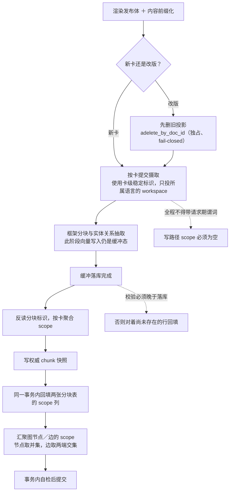

  

- **顺序不可调换**：先摄取落库、再反读分块标识、再写权威快照、最后回填投影列。反过来会让快照与框架实际生成的行对不上。

- **current_version 推进与回填同事务**：`knowledge.current_version` 的 bump 必须与 `chunk_filter` 快照写入、投影列回填放在**同一个事务**里提交。若 bump 先行提交，投影行尚未回填（PENDING 或 `kid_version` 落后），L2 的版本判据会把它们全部判死——那是可用性塌陷，不是泄漏。同一事务内还要自增 `workspace_registry.corpus_generation` 并重算该语言的 `next_boundary`（§7.3）。改版/撤回在**删除旧投影之前**还要先推进一次代次：删除一旦提交，可见集合已经变化；只在回填事务推进，会让「删除成功、回填失败」窗口里的答案缓存继续返回旧答案。

- **一卡一语言、一 workspace**：一张卡只支持一个语言，只投影到其语言对应的 workspace，不存在多语言多投影、也不存在同名 chunk_id 跨语言复用；doc_id 恒为纯 kid，卡级标识全局唯一。`chunk_filter` 以 **`(chunk_id, kid_version)` 为主键**（A.3，历史版本分行保留），**不落 workspace 列**——一卡一语言，`chunk_id` 全局唯一，join 与对账都按卡语言（`kid → knowledge.language`）分组。

- **一卡一标识，标识中途不可变**：卡级标识变更等于全量重建；分块标识由「卡标识 ＋ 序号」决定，**与内容无关**，因此改版时分块标识会被复用。

- **`chunk_filter` 保留历史版本行**：发布事务按 `(chunk_id, kid_version)` 插入新版本行，不覆盖旧行。投影表不是原地覆盖：改版先删后投、撤回只删（见下条），新行按位置复用 chunk_id（数量变化时新增或减少），因此回填必须同时重写 `scope` 与 `kid_version`。L2 只取与投影行同版本的快照行。

- **图 scope 全量重算**：H 的并集/交集必须按受影响节点/边的**当前全部来源**重算，发布与撤回同一规则；禁止只加不减，否则撤回的卡会通过旧 scope 继续放大可见面。

- **撤回与更新是独占操作**：改版先 `adelete_by_doc_id`（独占、fail-closed）再以同一 `doc_id` 重投，撤回只做删除；enqueue 对任何已存在的 doc_id 直接过滤（`pipeline.py:1169-1178`），不先删会静默 no-op。删除只清投影与框架状态，`chunk_filter` 历史行与权威内容不删；删除失败不继续，删除成功而重投失败时该卡暂不可答，由重试/人工通道恢复。

- **两类文档走不同入口**：常规卡走 `ainsert`（固定 F 分块，`process_options` 不暴露）；以原文条款检索为主的卡（法规、产品册、流程、条款类）走 `apipeline_enqueue_documents` ＋ `apipeline_process_enqueue_documents`，传 `process_options='F!'`（`PROCESS_OPTION_SKIP_KG`，`constants.py:458`）只做分块与向量、不建图谱。这是框架内建的分流，不是约定；`ainsert` 不能用于第二类（`lightrag.py:1794-1821`）。

- **自定义分块入口要慎选**：`ainsert_custom_chunks` 已被上游标注为 deprecated（`lightrag.py:1878-1905`）；它带 doc_status 内的操作日志、patch 语义是「并集不覆盖」（`lightrag.py:2399-2430`），分块 id 按 `(doc_id, 内容)` 哈希（`utils_pipeline.py:415-425`）——内容变则 id 变，与默认路径的「位置复用」不同；它还自带一层按内容去重。选它就要把这几条一并纳入用例与对账口径。

  

### 8.4 对账判据（发布闭环的验收线）

  

提交不等于成功，**平账才算发布完成**。回填与 bump 同事务：失败则整卡新投影保持 PENDING（不可见），不会出现半套新 scope，代价是该卡暂不可答。以下各项必须全部成立；任何一项不成立即告警并重放该卡：

  

- 各语言正文投影表分块数 ＝ 该语言 `knowledge.publish_state = 'PUBLISHED'` 卡片的当前版 `chunk_filter` 行数（只计 `kid_version = 权威 current_version`）；

- 两张 chunk 表中三个集合授权维任一为空的行数 ＝ 0（空数组＝通配，会把行放大成全可见；候选表无 CHECK，其空值残留风险见 A.7，不计入本判据）；

- 悬空边 ＝ 0（关系至少一端节点不存在）；

- 四张候选表的 scope 反聚合 ＝ 0：节点取来源并集、边取两端交集（§12.2 补充巡检）；

- 两张 chunk 表的六维、`valid_from/to`、`kid_version` 按 `(workspace, chunk_id)` **逐行一致**（NULL 用 `IS NOT DISTINCT FROM` 比较）；

- 两张 chunk 表中 `kid_version IS NULL OR kid_version < 权威 current_version` 的行数 ＝ 0（显式 NULL 分支，§12.2）；

- `knowledge.publish_state = 'PUBLISHED'` 卡片的当前版（`kid_version = 权威 current_version`）悬挂分块 ＝ 0：`chunk_filter` 有行、而**该卡语言对应**的正文表无对应行（历史版本行按设计无投影行，不计入）；

- 投影行 `publish_state = 'PENDING'`（摄取已提交、回填未完成/失败残留）的行数 ＝ 0；

- `PUBLISHED` 卡片在 `LIGHTRAG_DOC_STATUS` 中 `metadata->>'is_duplicate' = 'true'` 的行数 ＝ 0；

- 图谱 `source_id` 与分块跟踪清单的**未解释差异** ＝ 0（截断形态按 §12.2 登记规则豁免；L2 ②③ 以 tracking 为权威，§5.4）。

  
  

---

  

## 九、检索链路（一次请求的完整调用序）

  

### 9.1 整体：八步，一处回环

  

责任链一句话：**授权来自会话、路由只看语言、谓词活在请求上下文、结果必须复核、不足先归因再降级、正文进模型前先清洗、出处用业务编号回指。** 框架只承担「召回与裁剪」，不承担「可见性」。

  

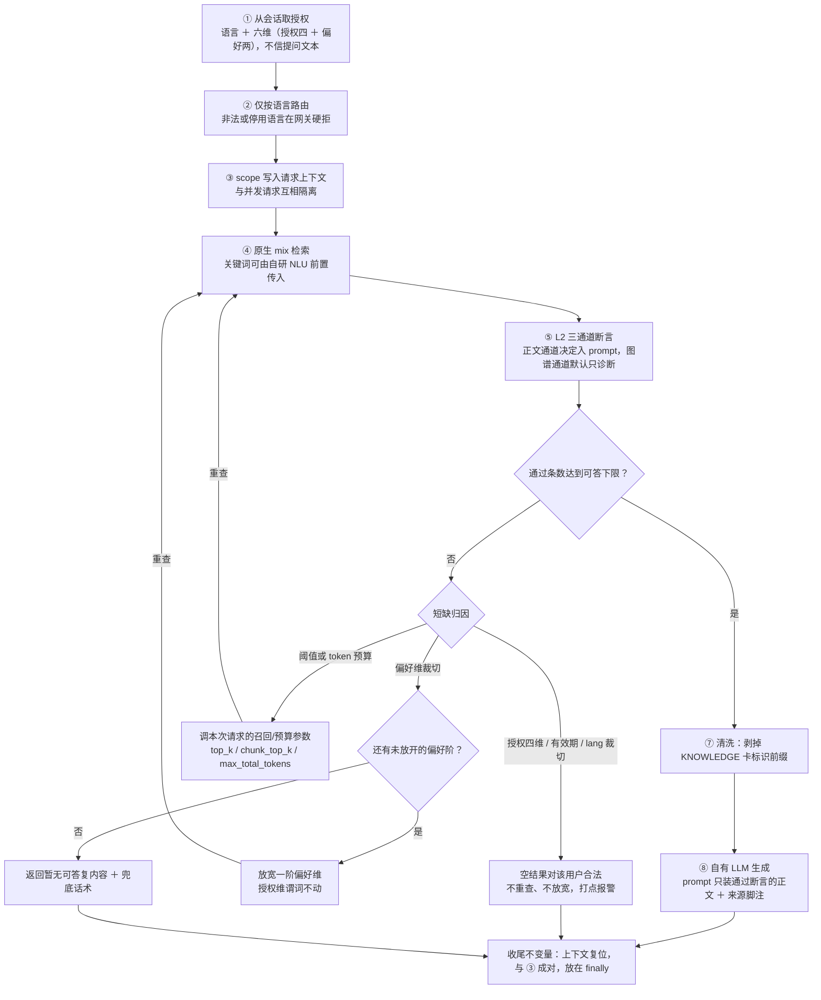

  

- **一处回环**：两种重查（调本次请求参数、放宽偏好维）都回到 ④，不新增检索入口；每一轮都必须重新过 ⑤，不能复用上一轮候选。
- **可选旁路（默认不启用）**：启用自研答案缓存时，② 之后、③ 之前先做代次惰性推进并查缓存；命中直接返回，不进入 ③–⑧；未命中继续 ③（§7.3）。

  

### 9.2 各步的输入产出与失败处置

  

| 步 | 输入 | 产出 | 失败处置 |
|---|---|---|---|
| ① 取授权 | 会话身份 | 请求侧 scope | 会话无效或维度缺失 → 拒答，**绝不回退成「全部可见」** |
| ② 路由 | 语言 | 目标 workspace | 未知或停用语言 → 网关拒收 ＋ 告警，不进检索 |
| ③ 置谓词 | 请求侧 scope | 请求期谓词 | 谓词构造失败 → 拒绝该查询，不得以空谓词放行 |
| ④ 检索 | 问题 ＋ 谓词 ＋ 关键词 | 候选集（正文 ＋ 图谱两类结果） | 框架异常 → 有限重试，仍失败按服务不可用降级 |
| ⑤ 断言 | 候选集 | 通过集 ＋ 逐条丢弃记录 | 任一通道丢弃率超阈值 → 整批丢弃 ＋ 重查 ＋ 报警，不进入生成 |
| ⑥ 降级 | 通过条数 ＋ 丢弃维度 ＋ L1 命中数 | 重查候选或合法空结果 | 授权四维 / 有效期 / lang 裁切 → 空结果合法；阈值/预算 → 调本次请求参数（`top_k` / `chunk_top_k` / `max_total_tokens`）后重查，`min_rerank_score` 属全局项不在请求内改；偏好维 → 按 §6.3 逐阶放宽；阶梯走完仍不足 → 9.1 兜底 |
| ⑦ 清洗 | 通过集正文 | 可直接入 prompt 的上下文 | 清洗不干净 → 该条不入 prompt（宁缺勿漏） |
| ⑧ 生成 | 干净上下文 ＋ 来源映射 | 回答 ＋ 脚注 | 无可引来源 → 明确拒答，不允许无出处作答 |

  

- **通过条数只数通道 ① 的 chunk**（§6.2 可答下限）；图谱通道默认不入 prompt，不计入。
- **⑤ 的整批丢弃不走 ⑥**：它是断言层安全事件，按 §5.4 重查一次，仍失败即报警并返回兜底；不与「条数不足」混为一谈。
- **⑥ 的归因依据**：L2 逐条丢弃记录中的失败维度（§5.2 偏好维只打点）＋ L1 谓词命中数；任一缺失即按「不放宽」处理并补打点（§6.2）。只有偏好维裁切才进阶梯；授权裁切永不重查成「更大范围」。
- **重查有界**：调参重查每请求最多一次；偏好阶梯按 §6.3 最多两阶；两者都不得形成无界循环。
- **缓存旁路**：插入点与 key/失效规则见 §7.3；命中不重新跑 L2 的前提是 key 含 `scope_sig` ＋ `corpus_generation`，且代次推进先于查询。

  

### 9.3 四条取舍（为什么链路长这样）

  

1. **继续用原生 `mix`，不自组装检索**。强制点落在存储层而非调用代码里，自组装换来的只是「可审计」而不是「可过滤」，却要长期维护一条与上游并行的高风险路径。判断标准：数据接口给出的字段够不够断言与引用（图谱通道经 tracking 回落，见第 3 条）——够就不自组装。
2. **关键词由自研 NLU 前置传入**。`mix` 每次查询都要跑一次 LLM 关键词抽取，这是 P95 里的一笔固定开销；通过 `hl_keywords` / `ll_keywords` 传入即跳过（`operate.py:4866-4867`），且不改变后续行为（策略 A，§7.3）。
3. **断言按分块标识收口，出处按卡标识回指**。正文通道用候选自带的 `chunk_id` join `chunk_filter`；图谱两通道**不能**用候选的 `source_id`（它是截断视图），必须经 `LIGHTRAG_ENTITY_CHUNKS` / `RELATION_CHUNKS` 回落 chunk id 再断言（§5.4）。出处走 `full_doc_id → knowledge.biz_key`，不用分块文本或正则反查。入库前缀只服务于去重兜底，**禁止**拿正则反查当断言或出处手段。
4. **框架截断的方向对断言安全**。分块正文的上下文预算按整条保留或丢弃来截断、不改写内容（`utils.py:7065-7114`），所以被截掉的分块根本不出现在结果里——断言不会因此偏宽松。代价是：断言看到的永远是「框架最终交出的那批」，其计数与 L1 的丢弃率口径不同，两套指标不得互推。

  

### 9.4 三条实现约束（写代码时必踩的点）

  

- **set / reset 成对**：复位必须放在 `finally`，异常路径也要复位；后台任务启动前显式清空上下文，不能指望子任务天然隔离。
- **只信会话**：提问文本里出现的语言（lang）、国家/地区（region）、产品（product）、资产（asset）、等级（security_level）、年份（year）一律不作为授权输入；越权诱导（把参数写进问题里）必须无效。
- **顺序不可颠倒**：断言在生成之前、清洗在断言之后。颠倒等于把未复核、或带内部标记的文本交给模型与用户。

  
  

---

  

## 十、离线质量评估

**本章只回答两件事：评什么、拿什么数据评。与 §十二.3 的 CI 越权矩阵是互补关系而非重复——矩阵证明「防线还在、签名没漂」，离线评测评「效果达标」：该召回的真召回得到、不该答的答得出拒绝、答案有据可引。机制细节见 `docs/0-离线质量评测体系设计-代码.md`、`docs/1-离线质量评测体系设计-模型.md`、`docs/2-离线质量评测集设计-模型.md`，本章只落定选型、阈值与门禁。**

### 10.1 两轨制与三个执行层次

**结论：代码轨与模型轨必须分开评，因为本项目的失效模式有两类，单一轨抓不到另一类。** 代码轨抓「实现回归」——注入点被改写、谓词没进 SQL、回填事务顺序改了；模型轨抓「效果回归」——谓词都对但召回质量掉了、断言都对但答案没依据。前者靠 §十二.3 的存活断言与越权矩阵，后者靠本章的评测集。

| 层次 | 触发 | 评什么 | 目标 |
|---|---|---|---|
| 本地 | 提交前 | 静态检查 ＋ 类型 ＋ 单测 ＋ 核心用例冒烟 | 速度优先，尽早暴露 |
| 持续集成 | PR / 合并请求 | 四维代码质量 ＋ 契约回归 ＋ 核心评测集 | 可重复、可阻断 |
| 定期与发布前 | 夜间 ／ 发布前 | 全量黄金集 ＋ 公开基准子集 ＋ 生命周期用例 | 趋势对比与历史基线 |

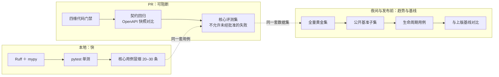

### 10.2 代码轨：四维与阈值

| 维度 | 本项目落点 | 工具与配置 | 阈值 | 阻断 |
|---|---|---|---|---|
| 静态质量 | 全仓 `src` / `tests` | Ruff，`line-length = 100`，规则集 `E,F,W,I,B,UP,S,SIM,RUF` | 圈复杂度 **10** 作为审查参考、函数 **> 50 行**触发审查；`# noqa` / `# type: ignore` 必须带理由，必要时设到期时间与责任人 | 是 |
| 类型与契约 | 核心业务模块、存储子类、编排层 | mypy：`warn_return_any`、`check_untyped_defs`、`no_implicit_optional`、`warn_unused_configs`；新增模块逐步到 strict | 契约用 `TestClient` 三类用例：输入校验 / 输出契约 / OpenAPI 快照回归 | 是（删字段、改类型、缩取值范围、新增必填请求字段一律按破坏性变更） |
| 测试分层 | 单元 / 集成 / API / E2E / 非功能 | pytest；**集成测试不得全 Mock**：存储层必须打真实 PG（pgvector ＋ LightRAG 存储子类） | E2E 只覆盖关键链路：发布→可检索、撤回→不可检索、越权请求→空结果 | 是 |
| 覆盖率与变异 | 新增业务代码优先 | `pytest-cov`＋`mutmut` | 行 **≥ 85%**、分支 **≥ 75%**、新增业务代码行 **≥ 90%**（`fail_under = 85`、`branch = true`）；变异测试定期跑，优先 `scope` 注入点、断言层、回填事务 | 覆盖率为是；变异得分不作全项目强制，只跟踪趋势 |

门禁命令固定为一条链，顺序即依赖：`ruff check` → `ruff format --check` → `mypy` → `pytest --cov --cov-branch --cov-fail-under=85` → `bandit -r -ll` → `pip-audit`。

- **为什么集成测试不能全 Mock**：mock 掉存储后，「谓词是否真的进了 SQL」就测不到了——而这正是 §12.3 存活断言要防的最坏失效模式（功能全绿、防线消失）。
- **写路径护栏同时是单测**：`scope_var` 有值时调用任一写方法必须抛错（§8.3），这条断言同时进 CI 与单测两层。

### 10.3 模型轨：指标与判据

**被测对象不是一个模型，而是「检索 → 断言 → 生成」三段链路，所以指标必须按段归位。** 硬约束：`retrieval_context` 必须取自真实检索结果，不允许手写理想上下文，否则测的是理想链路而不是本方案。

| 指标（DeepEval 类名） | 量的是什么 | 对应段 | 失败含义 | 优先级 |
|---|---|---|---|---|
| `FaithfulnessMetric` | 回答是否被实际检索内容支持 | 生成 | 无据陈述 / 幻觉 | P0 |
| `ContextualRelevancyMetric` | 检索内容与问题的相关度 | 检索（L1 谓词之后） | 召回噪音，白占 `chunk_top_k` | P0 |
| `ContextualRecallMetric` | 上下文是否含回答所需信息 | 检索 | 该可见的没召回 | P0 |
| `ContextualPrecisionMetric` | 相关内容在结果中的排序 | rerank ＋ 预算 | 排序退化，预算先被噪音吃掉 | P1 |
| `AnswerRelevancyMetric` | 回答与问题是否相关 | 生成 | 答非所问 | P0 |
| `HallucinationMetric` | 是否与给定事实冲突 | 生成 | 与给定事实矛盾 | P1 |
| 安全 / PII | 敏感信息泄漏 | 全链路 | PII 出现在回答或 Trace | P1 |

本项目另设三条**硬指标**，口径直接沿用 §12.1，避免两套数字互相打架：

- **越权泄漏率 ＝ 0**：评测样本自带六维授权，问题指向不该可见的内容，正确行为是空结果或明确拒答；任何非零都按 P0 处理。与 §12.3 的分工是：矩阵断言「结果集里绝不出现」，评测度量「整体召回与拒答行为」。
- **合法空结果单列**：授权四维 / 有效期 / 语言裁切导致的空结果**不是缺陷**，必须与「该召回没召回」分开计数（对应 §12.1 的短缺三因），否则越收越紧会把评测逼成放水。
- **前缀清洗率 ＝ 100%**：进入生成 prompt 的正文不得含 `[KNOWLEDGE:{kid}]`（§9.1 ⑦ 的清洗步）。

评判侧记录要求：每条样本必须落「被测模型 / Prompt 版本 / 评判模型标识 / 指标配置 / 数据集版本」五项，缺一项则分数不可比。评判模型与被测模型可以不同，但不得全量塞进每次 pytest——快速门禁只跑核心集，完整评测放夜间，并统计错误率、耗时与成本。

### 10.4 评测集建立

**结论：三层来源各管一件事——公开基准验通用能力，业务黄金集验业务正确性，生命周期用例验软件可靠性。** 任何一层都不能替代另外两层。

| 层 | 公开基准（选相关子集） | 用途 |
|---|---|---|
| 文档解析 | OmniDocBench（＋ PubTables-1M） | 解析保真：标题层级、表格、脚注、阅读顺序 |
| Embedding 与检索 | MTEB、BEIR | 模型选型与检索器基线（NDCG@K / Recall@K） |
| RAG 端到端 | RAGBench、CRAG；中文用 RGB / CRUD-RAG | 端到端质量与拒答行为 |
| 更新删除与索引一致性 | **无公开集，必须自建** | 见下「生命周期用例」 |

业务黄金集的规格（第一阶段目标，不是行业标准）：

- 规模 **100–300 条**；分层必须覆盖语言、授权四维、偏好两维、有效期末端、`publish_state` 非 PUBLISHED，以及单跳 / 多跳 / 表格 / 数字 / 版本 / 不可回答 / 证据冲突各类型——**不要平均分配给容易生成的题型**。
- 三个逻辑集合分开存放与使用：**开发集**（可调参）、**锁定测试集**（只用于发布前回归，不得用于调参）、**线上回流集**（脱敏后的失败样本持续补入）。
- 生成方式二选一作主生成器：Ragas（从文档建图谱扩展，覆盖单跳 / 多跳 / 表格 / 版本 / 不可回答 / 证据冲突）或 DeepEval Synthesizer（`generate_goldens_from_docs` / `generate_goldens_from_contexts`）。生成不等于可用，必须走六步审核：可回答性 → 证据充分性 → 答案正确性 → 去重（含语义近似）→ 补难例 → 固定版本。权限、资金、法律类样本必须「确定性规则 ＋ 人工复核」，不接受纯模型审核。

每条样本至少存：`case_id`、`question_type`、`question`、`reference_answer`、`source_documents`（`document_id` ＋ `document_version` ＋ `page/section` ＋ evidence span）、`answerable`、六维 scope、`language`、`risk_level`、`dataset_version`、`review_status`。

- **证据主键不用 `chunk_id`**：本方案的分块标识随卡标识与序号生成、**与内容无关且改版会位置复用**（§8.3），拿它当样本主键，改版后样本会静默指向另一段正文。主键一律用 `document_id + version + page/section + evidence span`。
- **跑分必须记环境**：每次基准跑同时记录该语言的 `corpus_generation` 与 `workspace_registry.embedding_model`（§3.1），否则换模型或换代次后的分数不可比。

生命周期用例（本项目最容易被漏掉的一层），用唯一事实做断言，避免「看起来命中」：

| 场景 | 用例构造 | 必须成立的断言 |
|---|---|---|
| 文档解析 | 原始文件 ＋ 哈希，标准正文/标题层级/关键表格/元数据，解析器及版本 | 关键事实不丢、表格可关联、噪声可忽略 |
| 切分 | 不锁死 chunk 边界；检查有效内容覆盖率 | 关键事实不被拆散、表头与单元格可关联、chunk 可追溯 |
| 更新（改版） | V1/V2 两版仅一处事实不同，植入唯一标记（如 `CANARY-V2-901`） | 当前查询命中 V2；V1 不得作为有效规则被引用 |
| 删除（撤回） | 撤回 V1 后重建索引 | 两个标记均不可召回；SLA 内投影与元数据满足删除策略；其他语言不可见 |
| 并发与迟到 | V1 的迟到任务在 V2 发布后到达 | 迟到写不得覆盖 V2 |

- 用例结构固定四段：`case_id` / `initial_documents` / `operations` / `assertions`，断言用类型化谓词（如 `CURRENT_FACT_EQUALS`、`CONTENT_NOT_RETRIEVABLE`），由 runner 调真实 API 在状态节点断言。
- **撤回与改版两条必须显式覆盖**：本方案改版是「先删后投」、撤回只删（§8.3），失败会留下「删除成功、重投失败」窗口——评测必须能证明该窗口内该卡不可答。

### 10.5 门禁矩阵与节奏

| 门禁 | 触发 | 数据集 | 判据 | 失败处置 |
|---|---|---|---|---|
| 提交前 | 本地 | 核心冒烟 20–30 条 | 全绿 | 不阻断提交，提示修正 |
| PR | 每次 PR | 四维代码 ＋ 契约 ＋ 核心评测集 | 代码全绿；核心用例**不允许未经批准的失败**；契约快照一致 | 阻断合并 |
| 夜间 | 每日 | 全量黄金集 ＋ 公开基准子集 ＋ 生命周期 | 与上版基线对比：忠实度与召回不得显著退化 | 不阻断，出趋势报告 ＋ 告警 |
| 发布前 | 发布窗口 | 锁定测试集 ＋ 越权反例集 ＋ 生命周期全集 | 越权泄漏率 ＝ 0；P0 指标不低于校准阈值；生命周期全通过 | 阻断发布（作为 §十四 G3 上线门禁的输入） |

- **与实施计划的衔接**：M7 的召回率基线依赖锁定测试集，二者同批交付并冻结版本（§十四）；M8 的分区与自组装评估必须用同一套锁定测试集回归，不得只凭压测数据决策。
- **反过拟合**：锁定测试集反复用于调参即失效；调参只用开发集，锁定集只在发布前跑。

---

## 十一、线上持续观测

**§十二 定义「该看什么数、阈值对应什么动作」；本章定义这些数怎么被采集、传输、存储、展示与告警。** 两章不重复：指标的定义、分子分母、初值阈值与动作一律以 §12.1 为准，本章只规定遥测管道、命名与标签纪律、Trace 结构与采样成本。机制细节见 `docs/3-线上可观测体系设计-代码.md`、`docs/4-线上可观测体系设计-模型.md`。

### 11.1 能力边界：三套能力不互相替代

| 能力 | 负责 | 明确不负责 |
|---|---|---|
| §十二 业务口径 | 分通道丢弃率、短缺三因、阶梯步数、对账判据 | 不定义管道与后端 |
| OpenTelemetry ＋ Collector | 统一协议（OTLP）、上下文传播、批量/采样/脱敏 | 不做业务语义判定 |
| Prometheus ＋ Grafana ＋ Alertmanager | 服务、运行时、依赖与性能的指标、看板、告警 | 不存完整 Trace，不做 LLM 质量分析 |
| Langfuse | LLM / Agent 观测、Prompt 与模型对比、Token 与成本、线上质量评分 | 不替代 Prometheus 的可用性监控 |

**一句话边界：Langfuse 不是 Prometheus 的替代品，Prometheus 也不是 LLM 质量评测系统。**

### 11.2 采集与传输

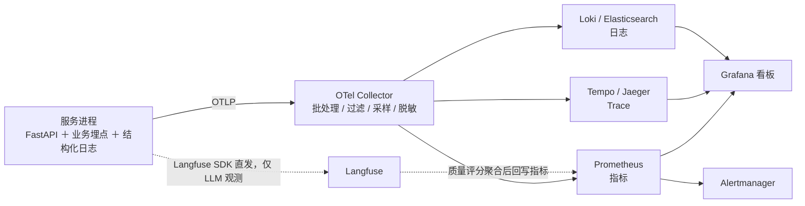

- **OTLP 端口**：`4317`（gRPC）、`4318`（HTTP，路径 `/v1/traces`、`/v1/metrics`）。Collector 可独立部署为 Gateway，也可按节点部署 Agent；规模小时可先直连后端，但应用只认 OTLP，不把业务代码绑到某个后端。
- **Langfuse 走 Python SDK 直发**，作为 LLM 观测的主埋点方式；确需统一出口时才改 Collector 转发（`/api/public/otel` ＋ Basic Auth ＋ `x-langfuse-ingestion-version` 头，且不能 gRPC 直连）。
- **禁止双写**：同一 Trace 既走 SDK 又走 Collector 会产生重复 Observation；**禁止重建 TracerProvider**——全局 Provider 一旦被覆盖，早初始化的组件会静默丢数据（一个 Provider 可挂多个 Span Processor，这是正确做法）。
- **依赖固定版本**：`opentelemetry-api` / `-sdk` / `-exporter-otlp` / `-instrumentation-fastapi` / `-instrumentation-logging` / `-instrumentation-httpx`，可选 `-instrumentation-sqlalchemy` / `-instrumentation-redis`；升级前先在预发验证双通路。

### 11.3 指标：三层、命名与基数纪律

| 层 | 内容 | 本项目口径 |
|---|---|---|
| 黄金指标 | Traffic / Errors / Latency / Saturation | 按 `route` 与 `status_code` 看；延迟用直方图出 P95 |
| 运行时 | Event loop 延迟、GC 次数与耗时、连接池等待与超时、in-flight 请求 | PG 连接池等待是重点：它先于超时暴露 |
| 业务 | 分通道丢弃率、短缺三因、阶梯步数与步数分布、端到端 P95、`dead tuple` 比例；模型调用成功率/延迟/超时/重试/Token | 定义、初值阈值与动作**全部沿用 §12.1**，本章只规定导出形态 |

- **命名**：`knowledge_api_http_requests_total`、`knowledge_api_http_request_duration_seconds`、`knowledge_api_model_tokens_total`、`knowledge_api_db_pool_wait_seconds`；LLM 侧统一 `llm_requests_total`、`llm_request_duration_seconds`、`llm_tokens_total`、`rag_retrieval_duration_seconds`、`rag_retrieval_results`。
- **标签白名单**：`service` / `route` / `method` / `status_code` / `dependency`，LLM 侧 `provider` / `model`（受控别名）/ `operation` / `status`。**禁止** `user_id`、`session_id`、`request_id`、`trace_id`、`query`、`document_id`、`chunk_id`、完整 Prompt 作标签——每个不同组合都是一条新时间序列，且这些值本身就带敏感信息。
- **路由必须是模板路径**（`/v1/answer` 而非 `/v1/answer?lang=zh`），否则基数随流量爆炸。
- **延迟用 Histogram 服务端聚合**，不要用分位数写入标签：`histogram_quantile(0.95, sum by (le, route)(rate(knowledge_api_http_request_duration_seconds_bucket[5m])))`，按 `route` 拆分、跨实例先求和再求分位。

### 11.4 Trace 结构与断言落点

一次问答的 Trace 层级固定如下，span 名即定位口径，不随实现改名：

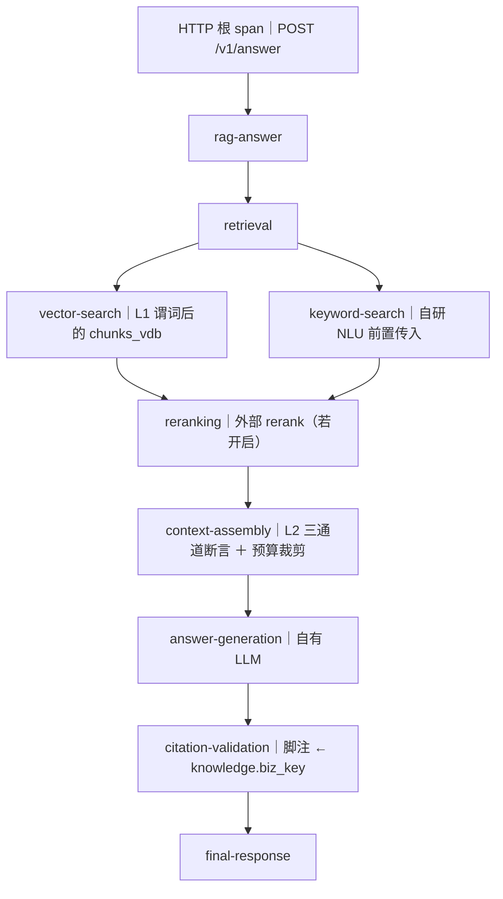

| Span | 必须记录 | 禁止记录 |
|---|---|---|
| `retrieval` | 命中数、候选宽度、是否续扫 | 正文 |
| `vector-search` / `keyword-search` | 谓词是否存在、命中数、耗时 | 谓词原文以外的用户标识 |
| `reranking` | 输入/输出候选数、阈值、是否出境 | 候选正文（出境风险） |
| `context-assembly` | 三通道丢弃数、丢弃维度名、预算截断数 | 被丢弃 chunk 的正文与摘要 |
| `answer-generation` | 模型名、Prompt 版本、Token 用量、耗时 | 完整 Prompt 与完整回答 |
| `citation-validation` | 引用条数、回指成功率 | 引用正文 |

- **脱敏是采集期规则，不是导出期补丁**：`mask_otel_spans` 只覆盖导出侧，内存、日志与其他后端都覆盖不到；默认不记录完整正文、完整 Prompt、模型原始响应（与 §12.1 打点纪律同一条底线）。
- **`trace_id` 是关联键，不是标签**：用它把一次请求、L2 丢弃记录与 Langfuse Generation 串起来，但不要写进 Prometheus 标签。LLM 侧再补 `prompt_version` 与受控 `model` 别名，才能把「指标退化」与「换了 Prompt/模型」对上。

### 11.5 告警、采样与成本

| 告警来源 | 典型信号 | 通道 |
|---|---|---|
| 可用性与性能 | 5xx 比例、P95 超 SLO、模型调用超时率 | Prometheus ＋ Alertmanager |
| 组件与任务健康 | 对账作业未按时完成、发布队列积压、导出失败 | Prometheus ＋ 日志 |
| LLM 质量与业务风险 | 忠实度下降、引用错误上升、负反馈上升、越权泄漏非零 | Langfuse 评分 ＋ 自定义 Gauge ＋ 规则 |

- **分级**：P0（用户影响 / 核心链路中断）立即通知值班；P1（持续退化 / 错误预算加速消耗）责任团队限时处理；P2（容量趋势、单语言异常）工单；P3 日报。**遥测自身故障也是一类告警**——没有数据不等于没问题。
- **窗口**：用多窗口多燃烧率，不要单点阈值；SLO 示例（成功率、P95、任务成功率）只作示例，实际值按 §一 的服务目标与压测基线定。
- **采样**：Trace 采样率与评测采样率**分开配置**；按风险分层——核心链路与发布前后全量或高比例，低风险路径采样，错误与负反馈必须保留。`LANGFUSE_SAMPLE_RATE` 只控制 LLM 观测侧，且**SDK 的全局采样率无法保证错误 Trace 一定被保留**，错误保留要另设机制（Collector tail sampling 或独立错误通道）。
- **容量与成本**：每日 Span 数 ≈ 每日请求数 × 每请求平均 Span 数 × 采样率；成本四项分别控——Observation 写入量（过滤无关 Span）、模型 Token（分析模型与 Prompt 长度）、LLM-as-a-Judge（单独采样与预算）、异步评测积压（并发与重试）。

### 11.6 三条红线

1. **观测不得扩大数据出境面**：Langfuse 若采集完整 Prompt 与模型输出，等于把正文送进第二个外部系统。默认只记元数据与脱敏摘要，Langfuse 自托管；这条与 §4.5 的 rerank 出境、§十三 的 P0 风险项是同一本账，接入前必须一起过。
2. **标签、日志、Trace 三处同一个禁入清单**：密码、访问令牌、API Key、Cookie、完整 Authorization 头、未脱敏个人信息、私有文档全文、用户原始提问、完整 Prompt 与模型响应。
3. **观测是旁路，不得成为授权旁路**：Trace 与看板只记「丢了几个、哪个维度、哪条 chunk_id」，不复制正文；任何为了让看板好看而在采样、过滤阶段放宽谓词的做法都属于改判定，不属于改观测。

---

## 十二、监控、对账与 CI

  

三层防线需要三种**互不替代**的证据：运行期打点回答「丢了多少、慢在哪、为什么丢」；夜间对账回答「投影副本与权威层是否等价」；CI 回答「升级后这些保证是否还在」。缺任何一条，另外两条都会失真——只有打点没有对账，漂移会被当成正常丢弃率；只有对账没有 CI，注入点消失而无人察觉。

  

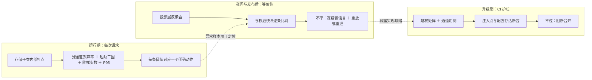

  

### 12.1 按 workspace × 按通道打点

  

**结论**

  

- **打点落点分三处**：L1 指标在存储子类内部（谓词前后的分母只有那里有）；L2 指标在断言层（看到的是框架裁剪后的批次）；阶梯与短缺三因在编排层。三处不得互相估算。
- **分通道是硬要求**。并集语义下图谱路丢弃率天然偏高，是设计结果；与向量路共用一个阈值会让告警长期失真。
- **每条阈值配一个动作**：向量路偏高 → 抬预放大倍数（§4.5）；图谱路偏高 → 查字典缺值与卡片维度配置（不是抬 top_k）；偏好维被阶梯频繁放宽 → 修配置；dead tuple 偏高 → 索引维护。
- **短缺三因分列**：scope 裁切 / 相关性阈值筛掉 / 上下文预算截断。混算会把「阈值设低了」误判成「权限太窄」，白走一轮阶梯。
- **L1 与 L2 的丢弃率不可互推**：L2 在框架裁剪之后，天然低于 L1；两套指标各自设阈值、各自出报表。
- **阈值分「初值」与「定稿」**：5% 与 30% 是初值；真实基线由附录 C 5 与阶梯分布实测在 M7 标定后回写本节，定稿前只告警、不自动调参。

  

**指标与动作**

  

| 指标 | 定义（分子 / 分母） | 初值阈值 | 动作 |
|---|---|---|---|
| L1a 图谱路正文丢弃率 | 因 scope 谓词未返回的 chunk id 数 / `get_by_ids` 请求的 chunk id 数（缺失位计分子；heading 回填调用单列，不与正文丢弃率混算） | 不设统一上限，按语言建基线 | 偏离基线 → 查字典缺值与卡片维度配置 |
| L1b ② 向量路正文丢弃率 | 谓词挡掉的候选行数 / 谓词应用前的候选窗口行数（`ef_search` 扫描集） | > 5%（初值） | 抬预放大倍数与 `ef_search`，复核 §4.5 预算 |
| L1b 候选收窄率（③a/③b/⑤–⑨） | 被裁掉的种子／边数 / 裁前数 | 按路建基线 | 异常升高查 scope 配置或字典；只解释召回，不作安全阈值 |
| L2 三通道丢弃率 | 每通道丢弃数 / 进入断言数（预算切完后的候选） | 0（任何非零都告警） | 逐条定位 L1 漏点；冻结该语言发布 |
| 自研答案缓存命中率 / 条目数（启用时） | 命中数 / 查询数；条目按「语言 × scope_sig × 代次」 | 命中率下降或条目膨胀 | 检查 key 维度与旧代次淘汰 |
| 短缺三因计数 | scope 裁切 / 分数下限 / 预算截断各计数 / 请求数 | 按语言建基线 | scope 型先分授权/偏好：授权维不足不放宽，偏好维不足走阶梯；分数型调 `min_rerank_score`；预算型调名额与 token |
| 阶梯触发率与步数 | 触发请求 / 总请求；步数直方图；单偏好维放宽率 | 单偏好维 > 30%（初值）或频繁触发即配置问题（§6.2） | 修配置，不继续放宽 |
| 端到端 P95（含 rerank） | 请求耗时 | §一 目标 5s（M7 达标） | 超限先查候选宽度／续扫，再查 rerank 出境 |
| dead tuple 比例 | `n_dead_tup / (n_live_tup + n_dead_tup)`，按表 | 按表建基线（发布后尖峰正常） | `REINDEX CONCURRENTLY` + `maintenance_work_mem`（§13） |

  

**打点纪律**

  

- 标签只放 workspace / channel / dim / reason；**禁止**把 chunk 正文、用户标识放进标签（基数爆炸）。
- 每次请求一个 `trace_id`；L2 丢弃必须能回连到具体 `chunk_id` 与请求。
- L2 三通道 = chunks / entities / relationships，与 §5.4 对齐；不得合并成一个总数。

  

### 12.2 Nightly 对账

  

**结论：对账是等价性检查，不是数据清洗。** 判据写成「恒等于零」，分组键是卡语言（`kid → knowledge.language`），修复只允许「权威层 → 投影层」。

  

**核心五项（每次发布后该卡增量 ＋ 夜间全量，逐语言）**

  

| 判据 | 键／口径 | 期望 | 不等时处置 |
|---|---|---|---|
| 正文投影表分块数 = `publish_state='PUBLISHED'` 卡片当前版 `chunk_filter` 行数 | 按语言分组；只计 `kid_version = 权威 current_version` | 相等 | 摄取被吞或未落库 → 重放该卡发布 |
| 两张 chunk 表六维同值 | 按 `(workspace, chunk_id)` 对齐；六维 ＋ `valid_from/to` ＋ `kid_version` | 0 差异 | 同源同值被破坏 → 冻结该语言并重放回填 |
| 两张 chunk 投影表版本落后 | `kid_version IS NULL OR kid_version < 权威 current_version`（**显式 NULL 分支**） | 0 行 | 位置复用承接旧 scope → 重放回填；漏写 NULL 分支即 fail-open |
| PENDING 滞留 | 两张 chunk 表 `publish_state = 'PENDING'` | 0 行 | 回填未完成 → 补回填并重放 |
| 当前版悬挂 chunk | `publish_state='PUBLISHED'` 卡片的 `chunk_filter` current 行在该卡语言正文表无对应行 | 0 行 | 分块数量位移未清理 → 清理并重灌 |

  

**补充巡检（夜间全量，逐语言）**

  

| 判据 | 键／口径 | 期望 | 不等时处置 |
|---|---|---|---|
| duplicate 指针行 | PUBLISHED 卡片在 `LIGHTRAG_DOC_STATUS.metadata->>'is_duplicate' = 'true'` | 0 行 | 内容去重吞卡 → 前缀化兜底并重发 |
| 渲染漂移 | 重渲染当前 content，去 `[KNOWLEDGE:{kid}]` 前缀后与 `LIGHTRAG_DOC_FULL.content` 逐字相等 | 0 | `schema_version` 未推进 → 按卡重灌，禁止反向覆盖 |
| 候选表 scope 反聚合 | entity/relation/图节点/边按 §8.3 派生（节点并集、边两端交集），与来源 chunk 的六维期望值比对 | 0 差异 | 重放该卡回填；样本进报告 |
| tracking 源视图 | `LIGHTRAG_ENTITY_CHUNKS` / `RELATION_CHUNKS` 与图节点／边 `source_id` 的差异（截断差异按登记规则豁免，未解释差异计入） | 0 | L2 ②③ 断言会失真 → 重建 tracking 与图投影 |

  

**作业约束**

  

- **方向红线**：对账只读权威层；修复只写投影层。任何把投影层当前值抄回权威层的做法，都是把泄漏固化成事实。
- **幂等**：重放／重灌同一卡两次结果一致；失败按 fail-closed 抛错，不删数据。
- **冻结**：某语言任一判据非零 → 冻结该语言发布队列，其余语言不受影响（语言之间互不影响：workspace 列隔离，M8 采用分区后才是物理隔离）。
- **证据**：报告按语言 × 判据出计数与样本 `chunk_id`，作为 §14 G2 门禁与 M8 评估的输入。
- **节奏**：夜间全量 ＋ 每次发布后对该卡增量。
- **表集合**：核心五项只覆盖两张 chunk 表；候选四表（entity/relation 向量表 ＋ 图节点/边表）只进补充巡检（无 `kid_version`）。

  

### 12.3 CI 越权矩阵与护栏

  

**结论：护栏分三类，加一条锚定原则；授权维与偏好维的断言强度不同。**

  

1. **授权矩阵（业务语义，绝不出现）**：授权四维（`product` / `year` / `security_level` / `publish_state`）＋ 语言逐维成对换值，断言对方卡片绝不出现。边界逐维给：请求值与卡片值仅部分重叠、字典外取值、非 `PUBLISHED`、密级层级（高读低可、反不可）、相邻年份、SPOT/CONTRACT 双向。另加两条 fail-closed 用例：授权维请求侧集合为空 → 空结果；`chunk_filter` 缺快照行 → L2 逐条丢弃。
2. **偏好维用例（可放宽，不是授权）**：`asset` / `region` 在第 0 步（未放宽）不出现；阶梯放宽后**允许出现**，但必须在阶梯记录中留下 `relaxed_dims` 且授权四维仍全过。**禁止**把偏好维当授权维做「绝不出现」断言——会与 §六 阶梯互斥。
3. **通道用例（数据面）**：图谱 description 默认不入 prompt（默认断言）；若开启，必须逐条经 tracking 清单断言。缓存：框架查询缓存关闭（策略 A）；自研答案缓存（若启用）key 按 §7.3 含 `scope_sig` ＋ 语言 ＋ `corpus_generation` ＋ 模型/提示版本 ＋ 检索参数，换权限域、代次或跨有效期边界均不复用（两种调用面各一例；跨边界用例把 `valid_to` 设在用例执行中途）。
4. **存活断言（升级面，最容易被忽略）**：10 个注入点的存在性 ＋ 签名 ＋「置值时 SQL 里确实含谓词」；④ 的 SQL 分支与缓冲分支各一例；启动侧后端类与向量签名断言；写路径护栏（`scope_var` 置值时写方法必须抛错）；DDL 幂等重放；degree 谓词与 ⑤⑥⑦ 同源（固定实体断言 rank 与可见边集自洽，仅 local 支）。
5. **锚定原则**：版本以 tag 为锚、不写裸 commit id；CI 失败阻断合并；矩阵与存活断言作为 §14 G3 的发布门禁。**升级后最先坏的不是功能，而是注入点的存在性**——功能全绿而越权防线消失，是本方案最坏的失效模式。

  

**用例构造**：每个维度准备两张只在该维不同的卡，换值断言只在该维串味；偏好维另加「阶梯后置」用例（断言 `relaxed_dims` 与授权四维）。矩阵数据入 CI 仓库，不依赖线上数据。

  

  

---

  

## 十三、风险清单（按优先级，本版重排）

  

| 优先级 | 风险 | 缓解 |
|---|---|---|
| **P0（新）** | 向量后端配成子类名 ⇒ `enable_vector=False`（无 pgvector 编解码器）+ ClientManager 签名冲突 `RuntimeError` | 类名保持 `PGVectorStorage`，只重指向 `STORAGES`；§12.3 启动断言 `vector_signature` |
| **P0（新）** | scope 若用进程全局传递，并发请求互相覆盖 = 越权 | contextvars + `finally reset`（§4.4 / §九） |
| **P0（新）** | rerank 把候选正文原文发外部模型（`utils.py:6196-6213`，`base.py:166` 默认开），且在 L2 之前 ⇒ L1 任一漏点即第三方出境 | L1a/L1b/L2 三层之外：接外部 rerank 前必须跑完 §12.3 十点存活断言；或 `QueryParam(enable_rerank=False)` / 自有 rerank（不出境） |
| **P0（新）** | 同进程各实例 `vector_storage` 取值不一致（含 None）→ signature 冲突 `RuntimeError`，崩不崩取决于初始化顺序 | 类名不改 ＋ §12.3 启动断言逐实例比对取值 |
| **P1（新）** | 默认路径 chunk_id = `{doc_id}-chunk-{NNN}`（`utils_pipeline.py:172`）**按位置复用**：改版若不先删旧投影，enqueue 会静默 no-op；若仍 bump，整卡旧投影被判版本落后而不可答（可用性），若未 bump 则旧内容继续可答（陈旧） | §8.3：改版先 `adelete_by_doc_id` 再重投；`chunk_filter` 按 `(chunk_id, kid_version)` 保留版本行；新行强制回填 `kid_version`/scope；§12.2 对投影表用「`kid_version IS NULL OR kid_version < 权威 current_version` 的行数 == 0」（含 NULL 分支）+「当前版悬挂 chunk == 0」 |
| **P1（新）** | degree 批查（`node_degrees_batch`/`edge_degrees_batch`）无 scope ⇒ 一跳扩展 `rank` 仍由全集边决定，与裁切后的可见边集矛盾 | §4.1 ⑧⑨ + 附录 B 十点（⑧⑨ 仅 local 支消费，见 §4.7 degree 取证）；与 ⑤⑥⑦ 共用同一谓词 |
| **P1（新）** | `min_rerank_score`（本方案 0.5）在 scope 之外静默清空候选，现象与「被裁干净」不可区分 → 误触发松弛阶梯 | §4.5 三类归因分别打点；§六 阶梯只在「偏好维裁切型短缺」时启动 |
| **P2（新）** | 真实表名 >63 字符（基表 19 + 后缀）→ 初始化 `ValueError` | 表名长度核算（§4.4）＋ `model_name` 非空且稳定 |
| **P2（新）** | 内容前缀 `[KNOWLEDGE:{kid}]` 随正文进 prompt，可能被 LLM 复读给终端用户 | §9.1 ⑦ 生成前清洗；CI 断言最终回答不含前缀 |
| P1（新） | `POSTGRES_WORKSPACE` 静默覆盖全部 workspace | `POSTGRES_WORKSPACE` 必须为空：启动自检 + CI |
| P1（新） | DDL 打在裸表名上（真实表带模型后缀）/ 模型名缺失回落裸表 | 动态解析表名 + `model_name` 非空且稳定 |
| P1（新） | ④ 裁 `get_vectors_by_ids` 触发 count-mismatch ⇒ 静默降级 VECTOR→WEIGHT + 越权 id 入日志 | §4.1 ④：裁切必须与预期命中集一致，SQL 分支与缓冲分支都要裁，M3 出用例 |
| P1 | 存储后端漏配（默认 NetworkX/JSON） | 四后端显式配置 ＋ CI 断言 |
| P1 | 误配 `PGGraphStorage`(AGE) | 明确子类自 `PGTableGraphStorage`；CI 断言 |
| P1 | `get_by_ids` 按位对齐契约被裁切破坏 → **静默数据错配** | §4.4 铁律 2，`reorder_to` 必测 |
| P1 | 写/清理路径被 scope 污染 → purge 误判「chunk 不存在」 | §4.4 铁律 1（子类写方法入口运行时断言，置值即抛）+ CI 用例 |
| P1 | 子类化升级兼容（方法改名/内联） | §12.3 注入点存活断言（不止查签名） |
| P1 | 六个过滤维中的集合维一律是逻辑隔离（物理兜底只有 lang；publish_state 是发布态闸） | L1a＋L1b＋L2 三层 ＋ 管理面查 `chunk_filter`；越权矩阵逐维成对覆盖，不许只拿一维当代表 |
| P1 | dead tuple 致 HNSW 召回静默下滑 | 发布后 `REINDEX CONCURRENTLY` + `maintenance_work_mem` 调高；监控 `pg_stat_user_tables.n_dead_tup` 阈值告警 + 固定 query 集抽检 |
| P1 | 窄 scope 静默少召回 | `iterative_scan='relaxed_order'` + 抬 `ef_search`/`max_scan_tuples`；带真过滤测召回 |
| P2 | 向量写入缓冲式（flush 在 callback/finalize）→ 回填时机错位 | §8.3：回填与校验放在 flush 之后 |
| P2 | `adelete_by_doc_id` 是 destructive_busy 独占 + fail-closed 抛错 | 发布串行化窗口 + 重试与人工通道 |
| P2 | `ainsert_custom_chunks` 已标 deprecated | §8.3：优先 `ainsert`；用前者需向上游确认 |
| P2 | workspace 字符串拼接绕过 registry | 强制走 `workspace_registry`，非法 lang 网关拒收 |
| P2 | 管理面跨 ws 查询一致性 | 一律查 `chunk_filter`，不 JOIN / UNION LightRAG 表 |
| P3 | 后人误在实体层强加精确过滤 | 文档 + 代码注释留痕「强制点在 KV chunk + L2」 |
| P3 | 误以为 `include_references` 是开关 | §九 注释：references 恒存在，字段 core 层不读 |

  

---

  

## 十四、实施计划

**结论：顺序由三条依赖决定——真相源先于投影、投影先于正文闸、正文闸先于查询路径与观测门槛。** 关键路径 M0 → M2 → M3 → M5 → M6 → M7；M1 与 M2 可并行，M4 与 M3／M5 可并行；M7a（离线评测）与 M7b（遥测管道）在 M7 之后并行，与 M7 共同构成 G3 的退出证据；M8 只看真实数据，不阻塞上线。任一阶段实测与本文假设不符，先改方案再继续（见「停止规则」）。


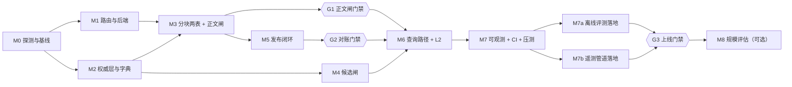

  

**里程碑与退出证据**

  

| 阶段 | 交付物 | 退出证据（全部满足才算过） | 关闭项 |
|---|---|---|---|
| M0 | 探测：用 `namespace_to_table_name + _generate_collection_suffix` 打印真实向量表名（核 63 字符上限）；确认 `aquery_data` 的 `chunk_id`/`references`；确认 pgvector ≥0.8.1 于 PG18；测 `LIGHTRAG_DOC_CHUNKS` 加列 + `text[]+GIN` 代价；**复跑 §4.4/附录 B 的 9 方法 / 10 注入点签名**；实测默认路径 chunk_id 形态；搭最小压测台（小样本） | 五份探测报告：表名、签名、chunk_id 形态、索引代价、QPS/P95 与 rerank 段占比（§一）；与本文假设不符的项已回写方案 | 附录 C 1/2/3/6（机制级）；§13 表名 >63；§一 服务目标基线 |
| M1 | 定死 workspace=`{lang}` 与 doc_id=纯 kid；建 `workspace_registry`；**四后端显式配置 + 子类重指向 `STORAGES`（类名不变）**；启动自检三项 | 非法 lang 网关拒收；`POSTGRES_WORKSPACE` 非空即启动失败；`vector_signature.enable_vector is True` 且 `vector_storage == "PGVectorStorage"`；四后端均为 PG 实现（非 NetworkX/JSON）；重启后图谱/状态仍在 | §13 `POSTGRES_WORKSPACE`、DDL 裸表名/模型名、存储后端漏配、向量后端子类名、`vector_storage` 不一致、误配 AGE、workspace 拼接 |
| M2 | 权威表 + `dim_registry`（**授权维/偏好维归组签字**）+ overlap 冲突检测 + scope 必填校验 | 六维字典种子与 CHECK 生效（固定样例逐维覆盖）；归组表有签字；冲突卡进人工队列；未登记维默认 authorization 用例通过 | §13 管理面跨 ws（管理面只查权威层） |
| M3 | 按 **附录 A.7** 扩 `LIGHTRAG_DOC_CHUNKS` + `LIGHTRAG_VDB_CHUNKS_<suffix>` 两表 scope 与索引；注入点 ①②④（contextvars）；`reorder_to` 契约测试；**④ 两条分支（SQL + pending buffer）各一例降级用例**；`chunk_filter` 按 `(chunk_id, kid_version)` 插入版本行（历史保留）；改版先 `adelete_by_doc_id` 再重投（enqueue 对已存在 doc_id 过滤），新行按位置复用 id 并回填 `kid_version`；deny 默认值（`publish_state='PENDING'`）落地 | 图谱路、向量路各一条越权正文用例（单 product ＋ 单 region 卡）不可见；按位对齐无错配；④ 不误触发 WEIGHT 降级；**同卡改版不承接旧 scope**；**PENDING 行在 ①② 两条正文闸均查不出**；EXPLAIN／日志可见谓词 | §13 chunk_id 位置复用、④ count-mismatch、`get_by_ids` 对齐、写路径 scope 污染；P3 实体层强加过滤（注释留痕） |
| M4 | 扩 entity/relation 向量表 + 图节点/边表 scope；注入点 ③a③b⑤⑥⑦⑧⑨（degree 与批查同谓词） | ③a 只收窄 local 种子、③b 只收窄 global 种子；一跳扩展不再枚举越权边；`rank` 与可见边集自洽（**只对 local 支断言**）；global 支未调用 degree 方法 | §13 degree 无 scope |
| M5 | 发布流水线（§八）：flush 后回填、两表同源校验、duplicate 指针检查、`current_version` 与回填同事务、撤回串行化 + 重试通道 | §12.2 核心五项 + 补充巡检全 0；同一发布重放两次结果一致（幂等）；试发布→撤回→重发闭环通过 | §13 向量写入缓冲（flush 时机）、`adelete_by_doc_id` 独占与 fail-closed、`ainsert_custom_chunks` deprecated、chunk_id 复用（对账口径）；附录 C 6（改版变化率） |
| M6 | 接原生 mix + L2 三通道断言（②③ 以 tracking 表为权威源）+ 短缺三类归因 + 重试 + 阶梯（只动偏好维）+ 自有 LLM（生成前清洗前缀）+ 脚注（`knowledge.biz_key`）+ 缓存策略 A | §12.3 越权矩阵六维逐维成对全绿（含语言隔离、密级层级、相邻年份、多值组合如 USA+UK）；图谱描述通道与 `source_id` 截断用例通过；回答不含前缀；缓存不共用；外部 rerank 默认关闭或已确认在出境白名单 | §13 rerank 出境、`min_rerank_score` 归因、前缀进 prompt、逻辑隔离（查询面） |
| M7 | 分通道打点（含 `min_rerank_score` 与 token 截断两条非 scope 通道）+ nightly 对账 + 越权 CI + 召回率基线（含 `relaxed_order` 验证）+ 十点注入点存活断言 + 全链路压测 | §12.3 三类护栏全绿（含写路径抛错）；10 个注入点的存在性/签名/「置值时 SQL 含谓词」全部通过；QPS=1,000、P95≤5s（含外部 rerank）达标或给出容量上限；nightly 连续无差异；§4.5 的「砍掉约一半」有实测标定 | §13 子类化升级兼容、窄 scope 少召回、dead tuple、`include_references`；附录 C 4/5/7 |
| M7a | 离线评测落地（§十）：黄金集首版（100–300 条，按语言 × 六维 × 题型分层）＋ 生命周期用例（解析 / 切分 / 改版 / 撤回 / 迟到写）＋ 越权反例集；DeepEval / Ragas 评测流水线（PR 冒烟 → 夜间全量 → 发布前锁定集）；忠实度、上下文召回与精确、越权泄漏率基线冻结 | 锁定测试集版本冻结且可复现（同数据集两次跑分差异在阈值内）；越权泄漏率 ＝ 0；四类门禁在 CI 中可阻断；基线随 M7 报告归档 | §十三 窄 scope 少召回（评测集必须覆盖） |
| M7b | 遥测管道落地（§十一）：OTel SDK ＋ Collector；Prometheus 三层指标与标签白名单；Langfuse 自托管接入（只记元数据与脱敏摘要）；Trace 层级按 §11.4 落地；看板与三类告警；采样与容量预算 | 看板可按 route / 通道下钻且无高基数标签；错误 Trace 可强制保留；抽样审计 Langfuse 无正文与完整 Prompt；三类告警各演练一次；容量预算按「请求数 × span 数 × 采样率」出表 | §十三 P0 出境项（Langfuse 二次出境） |
| M8 | 稳定后评估：是否开自组装路径、是否按 lang 分区（§十五.3）、是否给图谱补更强 pre-filter | 决策记录（做/不做 + 数据依据），不预设 | 附录 C 1/2（真实规模） |

  

**三道门禁（未过不得进入下一阶段）**

  

- **G1（M3 出口）·正文闸门禁**：两条正文闸（① 与 ②）与按位对齐契约全过才可接查询路径；不允许「先上线再补裁切」。

- **G2（M5 出口）·对账门禁**：§12.2 对账判据全 0 且发布幂等之前，只允许测试数据，不允许真实卡发布。

- **G3（M7 出口）·上线门禁**：§12.3 三类护栏 ＋ 负载目标 ＋ 基线标定 ＋ **M7a 的锁定测试集全绿与越权泄漏率 ＝ 0** ＋ **M7b 的三源告警演练通过**，缺一项即不上线。

**质量与观测的落位（章节 → 里程碑 → 门禁）**

| 章节 | 排进哪个阶段 | 交付物 | 进入哪道门禁 |
|---|---|---|---|
| §十 离线质量评估 | 代码四维自 M1 起作为 PR 门禁常开；评测集与离线门禁落在 M7a | 评测集三件套（黄金集 / 生命周期 / 越权反例）＋ 评测流水线 ＋ 基线 | G3 |
| §十一 线上持续观测 | M7b | 遥测管道 ＋ 指标与标签纪律 ＋ Trace 层级 ＋ 看板与告警 | G3 |
| §十二 监控、对账与 CI | 对账 M5、越权矩阵 M6、打点 M7 | 分通道打点 ＋ nightly 对账 ＋ 越权与存活断言 | G2 / G3 |


---

  


  

## 十五、PostgreSQL 18 专项

  

**本章只保留 PostgreSQL 18 与 pgvector 0.8.7 特有的、会影响正确性或容量的结论；通用设计与参数见对应章节，不重复。**

  

### 15.1 RLS 的定位：非强制点

  

**结论：RLS 不作强制点；强制点是子类 + contextvars 拼 SQL（L1a/L1b）+ L2 fail-closed（§4.4 / §五）。**

  

- **两个静默失效点**：LightRAG 自己建表（`pgtable_impl.py:78+`、`postgres_impl.py:3959`）⇒ 应用角色即表 owner，owner 默认绕过 RLS，除非 `ALTER TABLE ... FORCE ROW LEVEL SECURITY`；只写 `USING` 不写 `WITH CHECK`，INSERT/UPDATE 侧不受约束。

- **没有按请求 `SET LOCAL` 的可靠落点**：池级单例、每查询自行 acquire（`postgres_impl.py:781-830`/`:2780-2786`），归还时 `RESET ALL`（`:636-665`）——RLS 只有「一 workspace 一部署（独立进程/独立角色）」才可绑定。

- 本方案已定案单进程多 workspace（§一），故 RLS 不成立；即便日后启用，也只隔离 workspace(=lang)，**从不隔离授权维**。

  

### 15.2 `scope_sig` 的生成

  

**结论：用 BEFORE INSERT/UPDATE 触发器在库内计算 `encode(sha256(<归一化>::bytea),'hex')`；生成列是次选，且必须显式 `STORED`。**

  

- PG18 核心内建 `sha256(bytea)`（无需 pgcrypto）；该签名只接受 `bytea`，`text` 不会隐式转换 ⇒ 必须显式 `::bytea`，否则报 `function sha256(character varying) does not exist`。

- 归一化：五个集合维各自排序后 `array_to_string` 拼接，`publish_state` 取原值；放触发器里，因为表达式长度与 IMMUTABLE 依赖不宜压在生成列上。

- PG18 起生成列默认 **VIRTUAL**，而 VIRTUAL 列不能建索引 ⇒ 要索引必须写 `STORED`；次选表达式可用内建 `md5(text)` 或 `encode(sha256(...::bytea),'hex')`。

- `scope_sig` 是自有 LLM 缓存 key 的必含项之一（与 language、`corpus_generation`、模型/提示版本、检索参数一起，§7.3）；它只覆盖六维、**不含有效期**——有效期由代次推进兜住。

  

### 15.3 按 workspace(=lang) 声明式分区（可选，M8 决策）

  

- 适用对象：两张 chunk 表、两张图表、entity/relation 向量表；`PARTITION BY LIST (workspace)`。

- 收益：按语言的物理隔离强于 RLS、per-ws `REINDEX` 廉价可并行、规划器剪枝。

- 待验证：pgvector HNSW 在 LIST 分区表上的召回与写性能；`REINDEX TABLE CONCURRENTLY` 对分区父表的并行度收益（PG18 已支持，每个分区独立事务重建、不可在事务块内执行）。

- 不默认开启；M8 用真实规模数据决策（附录 C 1/2）。

  

### 15.4 `MERGE` 幂等写

  

- 权威表 `chunk_filter` 用 `MERGE ... WHEN MATCHED THEN UPDATE ... WHEN NOT MATCHED THEN INSERT`（§8.3）。

- 框架自身 upsert 走 `ON CONFLICT`（`postgres_impl.py:9744+`、`:1620`、`:4066`），两套不混用。

- `MERGE ... RETURNING`（含 `OLD/NEW` 别名）可用于发布流水线逐行回执。

  

### 15.5 pgvector 调优

  

- 查询期参数（`iterative_scan` / `ef_search` / `max_scan_tuples` / `scan_mem_multiplier`）见 §4.6，本节不重复。

- HNSW 比 IVFFlat 更占内存（pgvector README "uses more memory"）；实际用量以 M0 真实数据实测为准；可选 `vector_index_type="HNSW_HALFVEC"` 量化降费（LightRAG 已内建，`postgres_impl.py:2649-2655`）。

- 五个集合维的 GIN：`gin_pending_list_limit` / `fastupdate` 抑制大数组写入膨胀；建索引期可用 PG18 的 GIN 并行构建（配合 `max_parallel_maintenance_workers`）。

  

---

  

## 附录 A：权威层表定义

  

### A.1 公共约定与前置函数

  

**约定**：表名不带 schema 前缀（与框架自身建表方式一致）；时间一律 `timestamptz`；集合维一律 `text[]`，空数组 = 通配（仅偏好维允许）；枚举域集中在 `dim_scope_value` 或表级 CHECK；所有 DDL 幂等可重放。

  

```sql

-- 前置函数：令牌数组格式校验（空数组返回 true；令牌非空、无空白、长度 ≤ 128）
CREATE OR REPLACE FUNCTION ics_scope_token_arr_ok(arr text[])
RETURNS boolean LANGUAGE sql IMMUTABLE PARALLEL SAFE AS $$
SELECT COALESCE(bool_and(t IS NOT NULL AND btrim(t) <> '' AND t !~ '\s' AND length(t) <= 128), true)
FROM unnest(arr) AS t;
$$;

```

  

- **取值域校验不在 CHECK 里做**：`dim_scope_value` 是发布校验（§8.1 ①）与 CI 的判据；DDL 只保证格式与非空（三个集合授权维）。这样避免在 CHECK 中引用可变表导致的 `pg_dump`／恢复顺序问题。
- **`fn_kv_*` 是 TDD 侧前置函数**（卡片内容与审批链校验），签名固定：`fn_kv_content_ok(jsonb)`、`fn_kv_answer_policy_ok(jsonb)`、`fn_kv_quality_ok(jsonb)`、`fn_kv_chain_ok(jsonb)`、`fn_kv_chain_all_approved(jsonb)`、`fn_kv_chain_has(jsonb, text)`；未创建则 A.2 的 `knowledge_version` 建不出来。

  

### A.2 卡片与 scope：`knowledge` / `knowledge_version`

  

```sql

CREATE TABLE knowledge (

kid text NOT NULL PRIMARY KEY,

biz_key text NOT NULL, -- 面向用户/脚注的业务可读编号（§九 ⑧ 的 [i] 目标）；

-- 是 chunk_filter→卡片 映射的展示键，不参与检索谓词

title text NOT NULL,

schema_version text NOT NULL DEFAULT 'v1', -- 卡片内容结构版本；模板/字段变更时推进（§12.2 未推进即重灌）

current_version int NOT NULL DEFAULT 1,

publish_state text NOT NULL DEFAULT 'DRAFT', -- 授权维：发布生命周期（单值枚举，查询期取 'PUBLISHED'）

language text NOT NULL, -- 一卡一语言（§8.3）

-- 六个过滤维（授权四 + 偏好两；枚举与语义见 §4.3）

product text[] NOT NULL, -- SPOT | CONTRACT（三个集合授权维不允许通配，由 ck_k_auth 强制）

year text[] NOT NULL, -- 4 位年份代码，如 '2024'

security_level text[] NOT NULL, -- TopSecret | Confidential | Secret | Public

asset text[] NOT NULL DEFAULT '{}',

region text[] NOT NULL DEFAULT '{}',

verification_max text NOT NULL DEFAULT 'V1',

action_risk_level text NOT NULL DEFAULT 'R1',


valid_from timestamptz NOT NULL, -- 生效时间窗（§4.3；与 chunk_filter / 投影同名）

valid_to timestamptz NULL,

family text NULL,

locale text NOT NULL, -- 展示/区域变体，不参与路由与过滤（路由只用 language）

updated_at timestamptz NOT NULL DEFAULT now(),

CONSTRAINT ck_k_publish CHECK (publish_state IN ('DRAFT','IN_REVIEW','PUBLISHED','DEPRECATED','ROLLBACK_PENDING')),

CONSTRAINT ck_k_vmax CHECK (verification_max IN ('V0','V1','V2','V3')),

CONSTRAINT ck_k_risk CHECK (action_risk_level IN ('R0','R1','R2','R3','R4')),


CONSTRAINT ck_k_win CHECK (valid_to IS NULL OR valid_to > valid_from),

CONSTRAINT ck_k_lang CHECK (language = ANY (ARRAY['zh-CN','en-US','ja-JP']::text[])), -- 语言域随 §3.1 固定；新增语言＝改 CHECK + 补种子 + 建 registry + 全量重建（A.5）

CONSTRAINT ck_k_auth CHECK (cardinality(product) >= 1 AND cardinality(year) >= 1 AND cardinality(security_level) >= 1), -- 三个集合授权维禁止通配

CONSTRAINT ck_k_scope CHECK (ics_scope_token_arr_ok(product) AND ics_scope_token_arr_ok(year) AND ics_scope_token_arr_ok(security_level) AND ics_scope_token_arr_ok(asset) AND ics_scope_token_arr_ok(region)),

CONSTRAINT ck_k_biz CHECK (btrim(biz_key) <> '' AND biz_key !~ '[\r\n]'),

CONSTRAINT uq_k_biz UNIQUE (biz_key)

);


CREATE INDEX idx_k_pub ON knowledge (valid_from) WHERE publish_state = 'PUBLISHED';


CREATE INDEX idx_k_gin ON knowledge USING gin (product, year, security_level, asset, region);


```

  

```sql

CREATE TABLE knowledge_version (

kid text NOT NULL,

version int NOT NULL,

answer_hash text NOT NULL, -- 发布体摘要：encode(sha256((content::text)::bytea),'hex')

-- **不落 body_md**：渲染文本是 content 的派生物，不入库；

-- jsonb 的文本输出按键确定排序 ⇒ content::text 即规范化输入，

-- 同一 content 恒得同一 hash（该确定性只在同一 PG 大版本内成立，大版本升级要重算）

-- §8.1 的 ② overlap 冲突检测的比较键（同 scope 交集而 hash 不同 → 人工裁决）

topic text NOT NULL,

intent_refs text[] NOT NULL DEFAULT '{}',

content jsonb NOT NULL,

answer_policy jsonb NOT NULL,

quality jsonb NOT NULL,

review_chain jsonb NOT NULL,

risk_level text NOT NULL DEFAULT 'low',

timeline_required boolean NOT NULL DEFAULT false,

timeline_ref text NULL,

source_refs text[] NOT NULL,

owner text NOT NULL,

change_reason text NOT NULL,

refs jsonb NOT NULL,

author_id text NOT NULL,

reviewer_id text NOT NULL,

is_current boolean NOT NULL DEFAULT false,

published_at timestamptz NULL,

created_at timestamptz NOT NULL DEFAULT now(),

CONSTRAINT pk_kv PRIMARY KEY (kid, version),

CONSTRAINT fk_kv_kid FOREIGN KEY (kid) REFERENCES knowledge (kid),

CONSTRAINT ck_kv_dual CHECK (author_id <> reviewer_id),

CONSTRAINT ck_kv_refs CHECK (jsonb_array_length(refs) >= 1),

CONSTRAINT ck_kv_content CHECK (fn_kv_content_ok(content)),

CONSTRAINT ck_kv_ap CHECK (fn_kv_answer_policy_ok(answer_policy)),

CONSTRAINT ck_kv_quality CHECK (fn_kv_quality_ok(quality)),

CONSTRAINT ck_kv_chain CHECK (fn_kv_chain_ok(review_chain)),

CONSTRAINT ck_kv_chain_pub CHECK (published_at IS NULL

OR (jsonb_array_length(review_chain) >= 2

AND fn_kv_chain_all_approved(review_chain))),

CONSTRAINT ck_kv_risk CHECK (risk_level IN ('low','medium','high')),

CONSTRAINT ck_kv_chain_cmp CHECK (published_at IS NULL OR risk_level <> 'high'

OR fn_kv_chain_has(review_chain, 'compliance')),

CONSTRAINT ck_kv_src CHECK (cardinality(source_refs) >= 1 AND ics_scope_token_arr_ok(source_refs)),

CONSTRAINT ck_kv_owner CHECK (btrim(owner) <> '' AND btrim(change_reason) <> '' AND btrim(topic) <> ''),

CONSTRAINT ck_kv_timeline CHECK (timeline_ref IS NULL

OR timeline_ref ~ '^TL:[-A-Za-z0-9_.:@]{1,64}$'),

CONSTRAINT ck_kv_timeline_req CHECK (timeline_required = false OR timeline_ref IS NOT NULL)

);

CREATE UNIQUE INDEX uq_kv_current ON knowledge_version (kid) WHERE is_current = true;

CREATE INDEX idx_kv_content ON knowledge_version USING gin (content jsonb_path_ops);

CREATE INDEX idx_kv_chain ON knowledge_version USING gin (review_chain jsonb_path_ops);

CREATE INDEX idx_kv_src ON knowledge_version USING gin (source_refs);

```

  

### A.3 `chunk_filter`

  

```sql

CREATE TABLE chunk_filter (

chunk_id text NOT NULL, -- = LightRAG chunk id。默认 ainsert 路径实测为 `{doc_id}-chunk-{order:03d}`（`utils_pipeline.py:144-181` 三分支，见 §8.3）；

-- 按位置生成 ⇒ 同卡改版且 chunk 数不变时 chunk_id 复用；但 kid_version 前进即新行（历史保留），

-- 只有同一 (chunk_id, kid_version) 重放才 MERGE 覆盖，禁止「存在即跳过」

kid text NOT NULL, -- ↔ knowledge.kid

kid_version int NOT NULL, -- ↔ knowledge_version.version（发布快照时点）；同一 chunk_id 跨版本各成一行（历史保留）

-- 六个过滤维快照（§4.3；三个集合授权维非空，偏好两维允许 '{}' = 通配；publish_state 单值）

product text[] NOT NULL,

year text[] NOT NULL,

security_level text[] NOT NULL,

asset text[] NOT NULL DEFAULT '{}',

region text[] NOT NULL DEFAULT '{}',

publish_state text NOT NULL, -- 镜像 knowledge.publish_state（快照时点）；投影层同名列默认 'PENDING'（A.7 deny 默认值），本表行由发布事务显式写入

valid_from timestamptz NOT NULL,

valid_to timestamptz NULL,

scope_sig text NOT NULL, -- 六维排序归一后的哈希（§十五.2）

updated_at timestamptz NOT NULL DEFAULT now(),

CONSTRAINT pk_cf PRIMARY KEY (chunk_id, kid_version), -- 保留历史快照行：同 chunk_id 跨版本分行

CONSTRAINT fk_cf_kv FOREIGN KEY (kid, kid_version) REFERENCES knowledge_version (kid, version),

CONSTRAINT ck_cf_win CHECK (valid_to IS NULL OR valid_to > valid_from),

CONSTRAINT ck_cf_auth CHECK (cardinality(product) >= 1 AND cardinality(year) >= 1 AND cardinality(security_level) >= 1),

CONSTRAINT ck_cf_publish CHECK (publish_state IN ('DRAFT','IN_REVIEW','PUBLISHED','DEPRECATED','ROLLBACK_PENDING'))

);


CREATE INDEX idx_cf_kid ON chunk_filter (kid, kid_version);


CREATE INDEX idx_cf_gin ON chunk_filter USING gin (product, year, security_level, asset, region);


CREATE INDEX idx_cf_window ON chunk_filter (valid_from, valid_to);


```

  

- 权威写：`MERGE`（§十五.4）；两张投影 chunk 表的 scope 列**同一事务**从本表抄入（§4.2 / §8.3），抄入与 join 的键一律是 `(chunk_id, kid_version)`。

- 本表是 §五 L2 ①「按 `(chunk_id, kid_version)` join」与 §十二.2 对账的唯一基准。

- `publish_state` 取值域由 `ck_cf_publish` 固定为五枚举；发布事务只插入新版本行（A.3 主键含 `kid_version`），不改写旧行。

  

### A.4 `workspace_registry`

  

```sql

CREATE TABLE workspace_registry (

lang text NOT NULL PRIMARY KEY, -- workspace 名，如 'zh-CN'（受 validate_workspace 约束）

enabled boolean NOT NULL DEFAULT true,

embedding_model text NOT NULL, -- 决定向量表真实名后缀 <model>_<dim>d；须满足 §4.4 表名长度约束（规范化后 ≤41，含维度后缀）

embedding_dim int NOT NULL,

corpus_generation bigint NOT NULL DEFAULT 0, -- 可见集合代次：每个可见性变化点自增（删除旧投影前、回填事务内），有效期边界到点由查询入口惰性推进（§7.3）

next_boundary timestamptz NULL, -- 该语言最早的未来有效期边界（PUBLISHED 卡片的 valid_from / valid_to）；写事务内重算（§8.3）

updated_at timestamptz NOT NULL DEFAULT now()

);

```

  

- §3.1 的 `resolve(lang)`、§八③ 的 `registry(enabled)` 由此表提供；HNSW 参数为池级、**不入本表**（§3.1）。`corpus_generation` 由发布/撤回/回滚在每个可见性变化点推进，并在回填事务内重算 `next_boundary`（§8.3）；启用答案缓存时，查询入口按 `next_boundary <= now()` 惰性推进代次（§7.3）。

  

### A.5 `dim_*` / `dim_registry`

  

```sql

-- 集合维取值域字典：五个集合维 + languages（publish_state 不入字典，取值域见 A.2/A.3）
CREATE TABLE dim_scope_value (

dim text NOT NULL, -- 'product'|'year'|'security_level'|'asset'|'region'|'languages'
code text NOT NULL, -- 枚举值 / 年份代码（如 '2024'）/ 语言码
enabled boolean NOT NULL DEFAULT true,
PRIMARY KEY (dim, code)

);

  

CREATE INDEX idx_dsv_dim ON dim_scope_value (dim, enabled);

  

-- 种子（§4.3 枚举已锁定；year 按业务日历逐年补登）
INSERT INTO dim_scope_value (dim, code) VALUES

('product','SPOT'), ('product','CONTRACT'),
('security_level','TopSecret'), ('security_level','Confidential'), ('security_level','Secret'), ('security_level','Public'),
('asset','BTC'), ('asset','ETH'), ('asset','USDT'),
('region','USA'), ('region','JP'), ('region','KR'), ('region','HK'), ('region','TW'), ('region','UK'),
('languages','zh-CN'), ('languages','en-US'), ('languages','ja-JP')
ON CONFLICT DO NOTHING;

  

```

  

```sql

CREATE TABLE dim_registry ( -- §六 授权维/偏好维归组；未登记默认 authorization

dim text NOT NULL PRIMARY KEY,

grouping text NOT NULL,

CONSTRAINT ck_dr_group CHECK (grouping IN ('authorization','preference'))

);

  

-- 归组种子（§六 归组定案）
INSERT INTO dim_registry (dim, grouping) VALUES

('product','authorization'), ('year','authorization'), ('security_level','authorization'),
('asset','preference'), ('region','preference')
ON CONFLICT DO NOTHING;

```

  

- 五个集合维的**取值域**由 `dim_scope_value` 持有；**取值是否在域内由发布校验（§8.1 ①）与 CI 判定**，DDL 只做格式与非空（A.1）。`publish_state` 的取值域由 A.2 `ck_k_publish` / A.3 `ck_cf_publish` 定义，不入 `dim_scope_value`、也不入 `dim_registry`——它是独立闸，永不参与放宽；`languages` 只作 workspace 路由，同样不进 `dim_registry`。
- 卡片侧的**取值**是 `knowledge` 行内列（无 `knowledge_scope_*` 表）；chunk 粒度的快照是 `chunk_filter`（A.3）；投影层加列见 A.7。三层不重复定义枚举。
- `security_level` 的层级（TopSecret > Confidential > Secret > Public）是会话侧展开规则（§4.3），字典只登记取值。
- TDD 的 `verification_max` / `action_risk_level` 不参与过滤；若纳入，需登记 `dim_scope_value` 并补 `dim_registry` 行。
- 新增语言＝改 A.2 的 `ck_k_lang` + 补 `dim_scope_value` 的 languages 种子 + 建 `workspace_registry` 行 + 全量重建 workspace（§3.1 启用即不可改名）。

  

### A.7 投影层加列 DDL（与 A.3 同名同型，M3 执行）

  

命名与 `chunk_filter` 完全一致；所有语句幂等，并与 LightRAG 自身的 `information_schema` 守卫迁移共存（`postgres_impl.py:1346-1951`，只检查它自己要的列）。

  

```sql

-- 1) 两张 chunk 表：六个过滤维 + 版本戳（同源同值，同一事务从 chunk_filter 抄入）
ALTER TABLE LIGHTRAG_DOC_CHUNKS
ADD COLUMN IF NOT EXISTS product text[] NOT NULL DEFAULT '{}'::text[],
ADD COLUMN IF NOT EXISTS year text[] NOT NULL DEFAULT '{}'::text[],
ADD COLUMN IF NOT EXISTS security_level text[] NOT NULL DEFAULT '{}'::text[],
ADD COLUMN IF NOT EXISTS asset text[] NOT NULL DEFAULT '{}'::text[],
ADD COLUMN IF NOT EXISTS region text[] NOT NULL DEFAULT '{}'::text[],
ADD COLUMN IF NOT EXISTS publish_state text NOT NULL DEFAULT 'PENDING',
ADD COLUMN IF NOT EXISTS valid_from timestamptz NOT NULL DEFAULT '-infinity'::timestamptz,
ADD COLUMN IF NOT EXISTS valid_to timestamptz NULL,
ADD COLUMN IF NOT EXISTS kid_version int NULL,
ADD COLUMN IF NOT EXISTS scope_sig text NULL;

  

-- LIGHTRAG_VDB_CHUNKS_<suffix>：列清单与上行逐字一致；执行时先用 namespace_to_table_name() + _generate_collection_suffix() 解析真实表名，再原样替换，不得只改表名不改列。

  

CREATE INDEX IF NOT EXISTS idx_dc_scope_gin ON LIGHTRAG_DOC_CHUNKS
USING gin (product, year, security_level, asset, region);

  

CREATE INDEX IF NOT EXISTS idx_vdbc_scope_gin ON LIGHTRAG_VDB_CHUNKS_<suffix>
USING gin (product, year, security_level, asset, region);

  

-- 2) 四张候选表：只放五个集合维（无 publish_state / valid_* / kid_version / scope_sig）
ALTER TABLE LIGHTRAG_VDB_ENTITY_<suffix>
ADD COLUMN IF NOT EXISTS product text[] NOT NULL DEFAULT '{}'::text[],
ADD COLUMN IF NOT EXISTS year text[] NOT NULL DEFAULT '{}'::text[],
ADD COLUMN IF NOT EXISTS security_level text[] NOT NULL DEFAULT '{}'::text[],
ADD COLUMN IF NOT EXISTS asset text[] NOT NULL DEFAULT '{}'::text[],
ADD COLUMN IF NOT EXISTS region text[] NOT NULL DEFAULT '{}'::text[];

  

-- 其余三张同列逐表执行：LIGHTRAG_VDB_RELATION_<suffix> / lightrag_graph_nodes / lightrag_graph_edges

```

  

- **默认值一律用常量**（`'{}'::text[]` / `'-infinity'::timestamptz` / `'PENDING'`）：非恒定默认值可能触发整表重写（成本在 M0 / 附录 C 第 3 项实测）。方向一律 deny：`publish_state='PENDING'`，L1/L2 只认 `'PUBLISHED'`——「摄取已提交、回填未完成」的行在 ①② 两条正文闸都查不出。
- **自有列不得「NOT NULL 且无默认值」**：LightRAG 的 upsert 只列它认识的列（`postgres_impl.py:9744+`、`:9830-9868`），缺值即写入报错；发布流水线随后按 §8.3 回填权威值。
- **不设 `kid` 列**：两张 chunk 表自带 `full_doc_id`（`postgres_impl.py:9498` / `:9515`），§8.3 显式 `ainsert(ids=doc_id)` ⇒ `full_doc_id ≡ doc_id`；卡级信息经 `full_doc_id` join `chunk_filter (kid, kid_version)`（A.3，`idx_cf_kid`）取得。
- **`kid_version` 是对账落点**：§12.2 用「`kid_version IS NULL OR kid_version < 权威 current_version` 的行数 == 0」发现位置复用承接旧 scope；只存版本号，卡号用 `full_doc_id`。
- **投影层没有授权维非空约束**：四张候选表只扩五个集合维、不携带正文出口，残留影响限于召回污染与一跳扩展规模；两张 chunk 表的授权维若被回填成空数组，SQL 会按通配放行。因此回填只能从 `chunk_filter` 抄值，`publish_state='PENDING'` 只挡「未回填」，回填后的漂移由 §12.2 对账发现。
- 图节点/边表**无模型后缀**，直接常量名（`pgtable_impl.py:80-97`）。

  

## 附录 B：注入点速查（**10 个注入点 / 9 个子类方法**，签名级）

  

```

ScopedPGKVStorage(PGKVStorage)

get_by_ids(ids) # namespace==text_chunks 时必须裁；须保持按位对齐

get_by_id(id) # 同上（单条读点）

ScopedPGVectorStorage(PGVectorStorage)

query(query, top_k, query_embedding) # 一个方法 = 三个注入点：② chunks（强制，正文闸）/ ③a entities（local 种子）/ ③b relationships（global 种子）

get_vectors_by_ids(ids) # pick_by_vector_similarity 用，绕开 query()；裁切须与预期命中集一致，两条分支都要裁（§4.1 ④）

ScopedPGTableGraphStorage(PGTableGraphStorage)

get_nodes_batch(node_ids) # operate.py:6043 / 6371

get_edges_batch(pairs) # operate.py:6107 / 6316

get_nodes_edges_batch(node_ids) # operate.py:6086 —— 一跳扩展：越权边的枚举口

node_degrees_batch(node_ids) # operate.py:6044 —— 与 get_nodes_batch 并发 gather（仅 local 支）

edge_degrees_batch(edge_pairs) # operate.py:6108 —— 内部转调 node_degrees_batch，只需实现后者（仅 local 支）

```

  

补充：`has_nodes_batch`（`pgtable_impl.py:1464-1467`）委托 `get_nodes_batch`，无需单独实现；degree 两条必须与 ⑤⑥⑦ 用同一谓词，否则 `rank`（`operate.py:6124/6129`）与可见边集矛盾。degree 只被 local 支读取（`operate.py:6330`/`:6370` 明写 global 支不取 degree），所以 ⑧⑨ 的效果断言只挂在 local 用例上。

  

约定：每个读方法先 `scope_var.get()`，`None` 即完全走 `super()`；谓词只由 `render(FilterAST)` 产生；参数一律走 `$n` 占位，禁止取值拼接。**写路径护栏**：三个子类的写方法（upsert/delete/drop/flush）入口断言 `scope_var.get() is None`，非 None 即抛错（§4.4 铁律 1 的运行时形态）。**类名不要改**（重指向 `STORAGES` 即可）：改名会被存储实现清单校验直接拒绝，而环境变量自检对未登记的名字是静默跳过——两种失败混在一起最难查。

  

## 附录 C：未取证项与实测里程碑（7 项）

  

**结论：这 7 项是设计假设与实测的分界线；未产出可复核的报告／曲线之前，对应里程碑不得过门禁（§14）。M0 只做机制级与外推，M5–M7 做工程闭环，M8 做真实规模决策。**

  

| # | 未取证项与影响 | 里程碑 | 完成判据／产出 |
|---|---|---|---|
| 1 | pgvector HNSW 在 `PARTITION BY LIST(workspace)` 分区表上的召回与写入性能（§15.3；分区是可选项，收益须压过代价） | M0 机制级 / M8 决策 | 同数据同查询下的分区 vs 单表对比报告：召回不降、写入与维护成本可接受才允许 M8 启用；否则关闭分区方案 |
| 2 | `REINDEX TABLE CONCURRENTLY` 在分区父表上的**并行度收益**（PG18 支持性已文档化，见 §15.3） | M0 机制级 / M8 决策（仅分区方案） | 测出并行重建的耗时与锁行为；收益不足以抵消复杂度则 M8 不启用分区 |
| 3 | `LIGHTRAG_DOC_CHUNKS` 增列 + `text[]+GIN` 的建索引时长与膨胀（按容量基线缩放的代表性规模） | M0 | 给出建索引耗时、索引体积、膨胀率与迁移窗口；超出窗口则改分批／并行构建（`max_parallel_maintenance_workers`） |
| 4 | `relaxed_order` + `ef_search` 在「单 `product` ＋ 单 `region`」这类极窄谓词下的召回曲线（§4.6） | M7 | 「命中率—候选宽度—名额」曲线；据此定稿 `ef_search`／`max_scan_tuples` 与 `relaxed_order` 开关，窄权限用例召回率达标 |
| 5 | 注入点 ①（KV 裁切）生效后，图谱路／向量路／L2 各通道的真实丢弃率基线（§12.1 阈值的来源） | M7 | 图谱路／向量路／L2 三通道丢弃率与阶梯分布基线；§12.1 的分通道阈值据此定稿，不得沿用估值 |
| 6 | 默认 `ainsert` 路径 chunk_id 是否恒为 `{doc_id}-chunk-{order:03d}`（`utils_pipeline.py:144-181`），以及同卡改版的 chunk 数变化率（§8.3 / §12.2） | M0（形态）/ M5（变化率） | M0 确认形态与三分支；M5 用「试发布→改版→撤回」测出变化率，验证版本行写入与悬挂对账的实际负载 |
| 7 | 外部 rerank 模型是否在数据出境白名单内；若在，`min_rerank_score`（本方案 0.5）的合理取值与 L2 丢弃率的联动（§4.5） | M6（合规确认）/ M7（阈值标定） | M6 给出白名单结论（不在则默认关闭）；M7 产出「`min_rerank_score`—丢弃率」曲线并定稿阈值与归因口径 |

  

**取证纪律**：结论必须回写本文对应小节（§4.5 / §4.6 / §8.3 / §12.1 / §12.2 / §15.3 / A.7），并在里程碑退出证据中附报告或曲线；未回写视为该项未完成。